# 2. Installation

Slackware's installation is a bit more simplistic than that of most other Linux distributions and is very reminiscent of installing one of the varieties of BSD operating systems. If you're familiar with those, you should feel right at home. If you've never installed Slackware or have only used distributions that make use of graphical installers, you may feel a bit overwhelmed at first. Don't panic! The installation is very easy once you understand it, and it works on just about any x86 or x86_64 platform.

The latest versions of Slackware Linux are distributed on DVD or CD media, but Slackware can be installed in a variety of other ways. We're only going to focus on the most common method - booting from a DVD - in this book. If you don't have a CD or DVD drive, you might wish to take a look at the various README files inside the `usb-and-pxe-installers` directory at your favorite Slackware mirror. This directory includes the necessary files and instructions for booting the Slackware installer from a USB flash drive or from a network card that support PXE. The files there are the best source of information available for such boot methods.

## 2.1 Booting the Installer

Booting the installer is simply a process of inserting the Slackware install disk into your CD or DVD drive and rebooting. You may have to enter your computer's BIOS and alter the boot order to place the optical drive at a higher boot priority than your hard drives. Some computers allow you to change the boot order on the fly by pressing a specific function key during system boot-up. Since every computer is different, we can't offer instructions on how to do this, but the method is simple on nearly all machines.

Once your computer boots from the CD you'll be taken to a screen that allows you to enter any special kernel parameters. This is here primarily to allow you to use the installer as a sort of rescue disk. Some systems may need special kernel parameters in order to boot, but these are very rare exceptions to the norm. Most users can simply press enter to let the kernel boot.

```text

Welcome to Slackware version 14.0 (Linux kernel 3.2.27)! If you need to pass extra parameters to the kernel, enter them at the prompt below after the name of the kernel to boot (huge.s etc). In a pinch, you can boot your system from here with a command like: boot: huge.s root=/dev/sda1 rdinit= ro In the example above, /dev/sda1 is the / Linux partition. To test your memory with memtest86+, enter memtest on the boot line below. This prompt is just for entering extra parameters. If you don't need to enter any parameters, hit ENTER to boot the default kernel "huge.s" or press [F2] for a listing of more kernel choices.

```

After pressing <kbd>ENTER</kbd> you should see a lot of text go flying across your screen. Don't be alarmed, this is all perfectly normal. The text you see is generated by the kernel during boot-up as it discovers your hardware and prepares to load the operating system (in this case, the installer). You can later read these messages with the `dmesg` (1) command if you're interested. Often these messages are very important for troubleshooting any hardware problems you may have. Once the kernel has completed its hardware discovery, the messages should stop and you'll be given an option to load support for non-us keyboards.

```text

<OPTION TO LOAD SUPPORT FOR NON-US KEYBOARD> If you are not using a US keyboard, you may need to load a different keyboard map. To select a different keyboard map, please enter 1 now. To continue using the US map, just hit enter. Enter 1 to select a keyboard map: _

```

Entering <kbd>1</kbd> and pressing <kbd>ENTER</kbd> will give you a list of keyboard mappings. Simply select the mapping that matches your keyboard type and continue on.

```text

Welcome to the Slackware Linux installation disk! (version 14.0) ###### IMPORTANT! READ THE INFORMATION BELOW CAREFULLY. ###### - You will need one or more partitions of type 'Linux' prepared. It is also recommended that you create a swap partition (type 'Linux swap') prior to installation. For more information, run 'setup' and read the help file. - If you're having problems that you think might be related to low memory, you can try activating a swap partition before you run setup. After making a swap partition (type 82) with cfdisk or fdisk, activate it like this: mkswap /dev/<partition> ; swapon /dev/<partition> - Once you have prepared the disk partitions for Linux, type 'setup' to begin the installation process. - If you do not have a color monitor, type: TERM=vt100 before you start 'setup'. You may now login as 'root'. slackware login: root

```

Unlike other Linux distributions which boot you directly into a dedicated installer program, Slackware's installer places you in a limited Linux distribution loaded into your system's RAM. This limited distribution is then used to run all the installation programs manually, or can be used in emergencies to fix a broken system that fails to boot. Now that you're logged in as root (there is no password within the installer) it's time to start setting up your disks. At this point, you may setup software RAID or LVM support if you wish or even an encrypted root partition, but those topics are outside of the scope of this book. I encourage you to refer to the excellent `README_RAID.TXT` , `README_LVM.TXT` , and `README_CRYPT.TXT` files on your CD if you desire to setup your system with these advanced tools. Most users won't have any need to do so and should proceed directly to partitioning.

## 2.2 Partitioning

Unlike many other Linux distributions, Slackware does not make use of a dedicated graphical disk partitioning tool in its installer. Rather, Slackware makes use of the traditional Linux partitioning tools, the very same tools that you will have available once you've installed Slackware. Traditionally, partitioning is performed with either `fdisk` (8) or `cfdisk` (8), both of which are console tools. `cfdisk` is preferred by many people because it is curses menu-based, but either works well. Additionally, Slackware includes `sfdisk` (8) and `gdisk` (8). These are more powerful command-line partitioning tools. `gdisk` is required to alter GUID partition tables found on some of today's larger hard drives. In this book, we're going to focus on using `fdisk` , but the other tools are similar. You can find additional instructions for using these other tools online or in their man pages.

In order to partition your hard drive, you'll first need to know how to identify it. In Linux, all hardware is identified by a special file called a device file. These are (typically) located in the `/dev` directory. Nearly all hard drives today, are identified as SCSI hard drives by the kernel, and as such, they'll be assigned a device node such as `/dev/sda` . (Once upon a time each hard drive type had its own unique identifier such as /dev/hda for the first IDE drive. Over the years the kernel's SCSI subsystem morphed into a generic drive access system and came to be used for all hard disks and optical drives no matter how they are connected to your computer. If you think this is confusing, imagine what it would be like if you had a system with a SCSI hard drive, a SATA CD-ROM, and a USB memory stick, all with unique subsystem indentifiers. The current system is not only cleaner, but performs better as well.)

If you don't know which device node is assigned to your hard drive, `fdisk` can help you find out.

```text

root@slackware:/# fdisk -l Disk /dev/sda: 72.7 GB, 72725037056 bytes 255 heads, 63 sectors/track, 8841 cylinders Units = cylinders of 16065 * 512 = 8225280 bytes

```

Here, you can see that my system has a hard drive located at `/dev/sda` that is 72.7 GB in size. You can also see some additional information about this hard drive. The `-l` argument to `fdisk` tells it to display the hard drives and all the partitions it finds on those drives, but it won't make any changes to the disks. In order to actually partition our drives, we'll have to tell `fdisk` the drive on which to operate.

```text

root@slackware:/# fdisk /dev/sda The number of cylinders for this disk is set to 8841. There is nothing wrong with that, but this is larger than 1024, and could in certain setups cause problems with: 1) software that runs at boot time (e.g., old versions of LILO) 2) booting and partitioning software from other OSs (e.g., DOS FDISK, OS/2 FDISK) Command (m for help):

```

Now we've told fdisk what disk we wish to partition, and it has dropped us into command mode after printing an annoying warning message. The 1024 cylinder limit has not been a problem for quite some time, and Slackware's boot loader will have no trouble booting disks larger than this. Typing `m` and pressing ENTER will print out a helpful message telling you what to do with `fdisk` .

```text

Command (m for help): m Command action a toggle a bootable flag b edit bsd disklabel c toggle the dos compatibility flag d delete a partition l list known partition types m print this menu n add a new partition o create a new empty DOS partition table p print the partition table q quit without saving changes s create a new empty Sun disklabel t change a partition's system id u change display/entry units v verify the partition table w write table to disk and exit x extra functionality (experts only)

```

Now that we know what commands will do what, it's time to begin partitioning our drive. At a minimum, you will need a single `/` partition, and you should also create a swap partition. You might also want to make a separate `/home` partition for storing user files (this will make it easier to upgrade later or to install a different Linux operating system by keeping all of your users' files on a separate partition). Therefore, let's go ahead and make three partitions. The command to create a new partition is `n` (which you noticed when you read the help).

```text

Command: (m for help): n Command action e extended p primary partition (1-4) p Partition number (1-4): 1 First cylinder (1-8841, default 1): 1 Last cylinder or +size or +sizeM or +sizeK (1-8841, default 8841): +8G Command (m for help): n Command action e extended p primary partition (1-4) p Partition number (1-4): 2 First cylinder (975-8841, default 975): 975 Last cylinder or +size or +sizeM or +sizeK (975-8841, default 8841): +1G

```

Here we have created two partitions. The first is 8GB in size, and the second is only 1GB. We can view our existing partitions with the `p` command.

```text

Command (m for help): p Disk /dev/sda: 72.7 GB, 72725037056 bytes 255 heads, 63 sectors/track, 8841 cylinders Units = cylinders of 16065 * 512 = 8225280 bytes Device Boot Start End Blocks Id System /dev/sda1 1 974 7823623+ 83 Linux /dev/sda2 975 1097 987997+ 83 Linux

```

Both of these partitions are of type "83" which is the standard Linux filesystem. We will need to change `/dev/sda2` to type "82" in order to make this a swap partition. We will do this with the `t` argument to `fdisk` .

```text

Command (m for help): t Partition number (1-4): 2 Hex code (type L to list codes): 82 Command (me for help): p Disk /dev/sda: 72.7 GB, 72725037056 bytes 255 heads, 63 sectors/track, 8841 cylinders Units = cylinders of 16065 * 512 = 8225280 bytes Device Boot Start End Blocks Id System /dev/sda1 1 974 7823623+ 83 Linux /dev/sda2 975 1097 987997+ 82 Linux swap

```

The swap partition is a special partition that is used for virtual memory by the Linux kernel. If for some reason you run out of RAM, the kernel will move the contents of some of the RAM to swap in order to prevent a crash. The size of your swap partition is up to you. A great many people have participated in a great many flamewars on the size of swap partitions, but a good rule of thumb is to make your swap partition about twice the size of your system's RAM. Since my machine has only 512MB of RAM, I decided to make my swap partition 1GB. You may wish to experiment with your swap partition's size and see what works best for you, but generally there is no harm in having "too much" swap. If you plan to use hibernation (suspend to disk), you will need to have at least as much swap space as you have physical memory (RAM), so keep that in mind.

At this point we can stop, write these changes to the disk, and continue on, but I'm going to go ahead and make a third partition which will be mounted at `/home` .

```text

Command: (me for help): n Command action e extended p primary partition (1-4) p Partition number (1-4): 3 First cylinder (1098-8841, default 1098): 1098 Last cylinder or +size or +sizeM or +sizeK (1098-8841, default 8841): 8841

```

Now it's time to finish up and write these changes to disk.

```text

Command: (me for help): w The partition table has been altered! Calling ioctl() to re-read partition table. Syncing disks. root@slackware:/#

```

At this point, we are done partitioning our disks and are ready to begin the `setup` program. However, if you have created any extended partitions, you may wish to reboot once to ensure that they are properly read by the kernel.

## 2.3 The setup Program

Now that you've created your partitions it's time to run the `setup` program to install Slackware. `setup` will handle formatting partitions, installing packages, and running basic configuration scripts step-by-step. In order to do so, just type `setup` at your shell prompt.

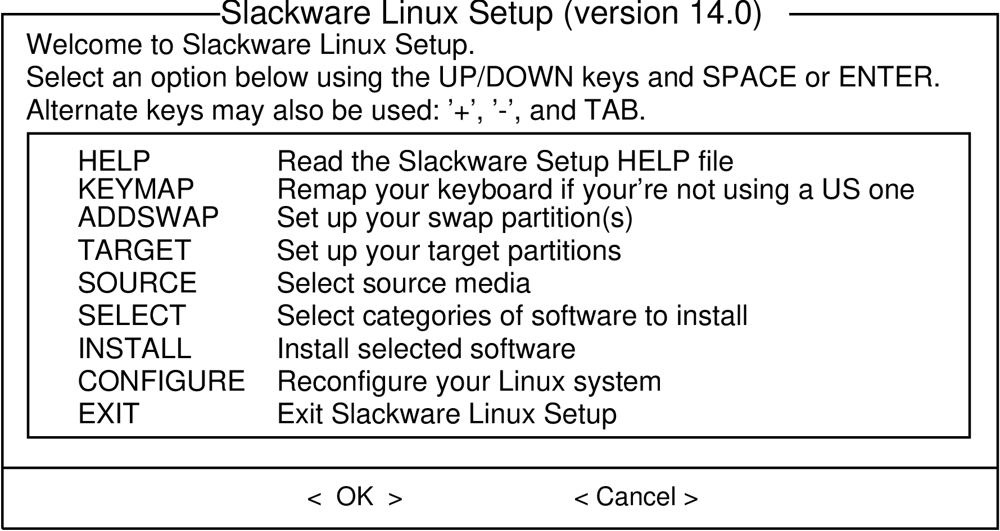

### 2.3.1 Help

If you've never installed Slackware before, you can get a very basic over-view of the Slackware installer by reading the Help menu. Most of the information here is on navigating through the installer which should be fairly intuitive, but if you've never used a curses-based program before you may find this useful.

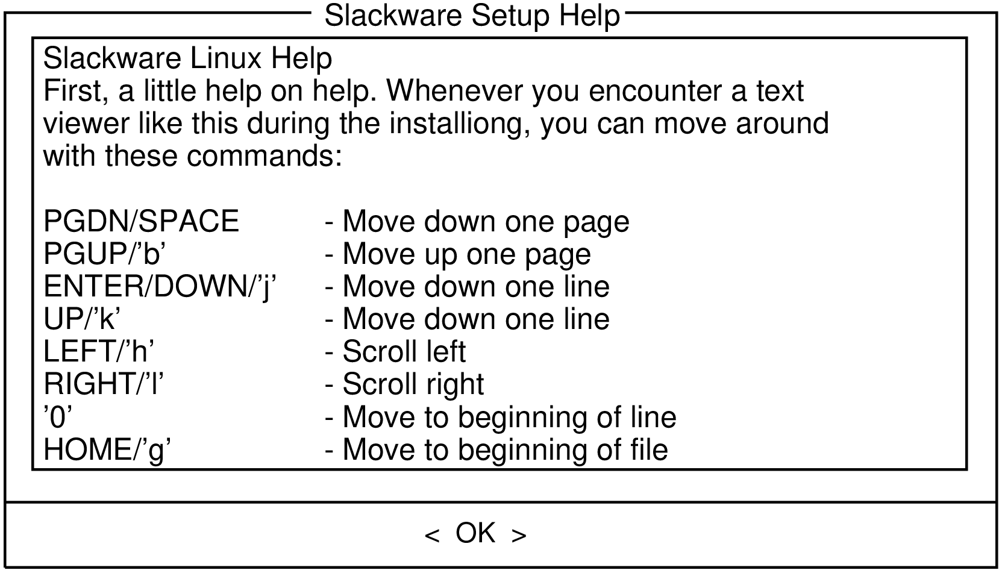

### 2.3.2 Keymap

Before we go any further, Slackware gives you the opportunity to select a different mapping for your keyboard. If you're using a standard US keyboard you can safely skip this step, but if you're using an international keyboard you will want to select the correct mapping now. This ensures that the keys you press on your keyboard will do exactly what you expect them to do.

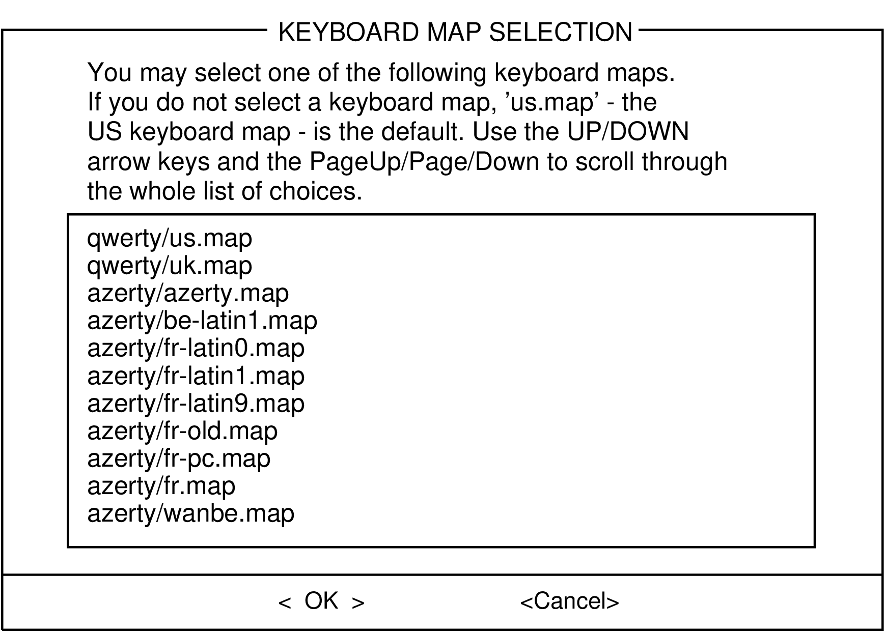

### 2.3.3 Addswap

If you created a swap partition, this step will allow you to enable it before running any memory-intensive activities like installing packages. swap space is essentially virtual memory. It's a hard drive partition (or a file, though Slackware's installer does not support swap files) where regions of active system memory get copied when your computer is out of useable RAM. This lets the computer "swap" programs in and out of active RAM, allowing you to use more memory than your computer actually has. This step will also add your swap partition to `/etc/fstab` so it will be available to your OS.

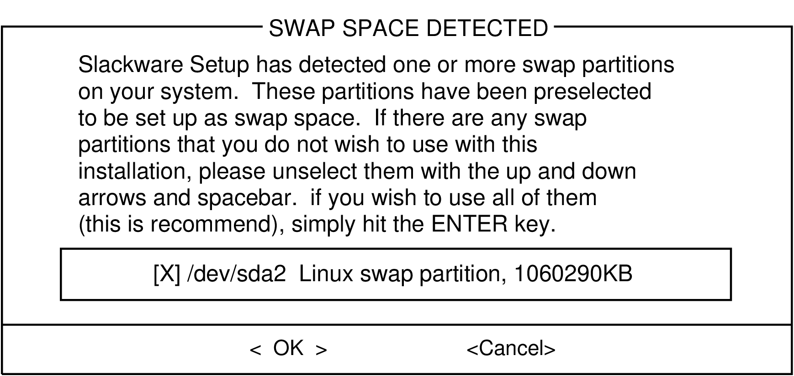

### 2.3.4 Target

Our next step is selecting our root partition and any other partitions we'd like Slackware to utilize. You'll be given a choice of filesystems to use and whether or not to format the partition. If you're installing to a new partition you must format it. If you have a partition with data on it you'd like to save, don't. For example, many users have a seperate `/home` partition used for user data and elect not to format it on install. This lets them install newer versions of Slackware without having to backup and restore this data.

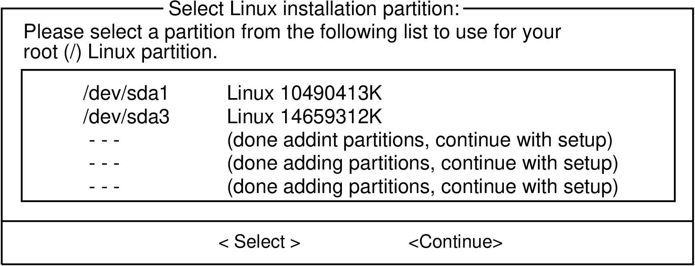

### 2.3.5 Source

Here you'll tell the installer where to find the Slackware packages. The most common method is to use the Slackware install DVD or CDs, but various other options are available. If you have your packages installed to a partition that you setup in the previous step, you can install from that partition or a pre-mounted directory. (You may need to mount that partition with `mount` (8) first. See chapter 11 for more details.) Additionally, Slackware offers a variety of networked options such as NFS shares, FTP, HTTP, and Samba. If you select a network installation, Slackware will prompt you for TCP/IP information first. We're only going to discuss installation from the DVD, but other methods are similar and straightforward.

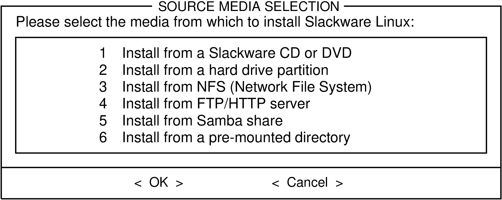

### 2.3.6 Select

One unique feature of Slackware is its manner of dividing packages into disksets. At the beginning of time, network access to FTP servers was available only through incredibly slow 300 baud modems, so Slackware was split into disk sets that would fit onto floppy disks so users could download and install only those packages they were interested in. Today that practice continues and the installer allows you to chose which sets to install. This allows you to easily skip packages you may not want, such as X and KDE on headless servers or Emacs on everything. Please note that the "A" series is always required.

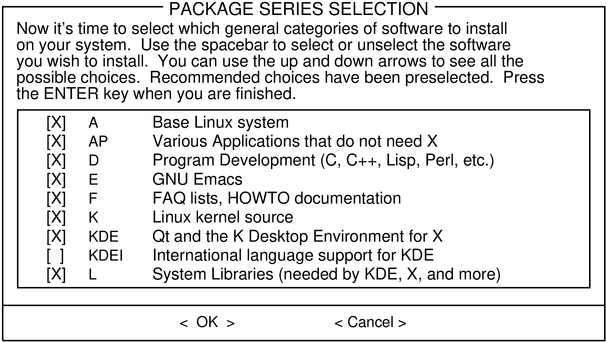

### 2.3.7 Install

Finally we get to the meat of the installer. At this stage, Slackware will ask you what method to use to chose packages. If this is your first time installing Slackware, the "full" method is highly recommended. Even if this isn't your first time, you'll probably want to use it anyway.

The "menu" and "expert" options allow you to choose individual packages to install and are of use to skilled users familiar with the OS. These methods allow such users to quickly prune packages from the installer to build a very minimal system. If you don't know what you're doing (sometimes even if you do) you're likely to leave out crucial pieces of software and end up with a broken system.

The "newbie" method can be very helpful to a new user, but takes a very long time to install. This method will install all the required packages, then prompt you individually for every other package. The big advantage here is that is pauses and gives you a brief overview of the package contents. For a new user, this introduction into what is included with Slackware can be informative. For most other users it is a long and tedious process.

The "custom" and "tagpath" options should only be used by people with the greatest skill and expertise with Slackware. These methods allow the user to install packages from custom tagfiles. Tagfiles are only rarely used. We won't discuss them in this book.

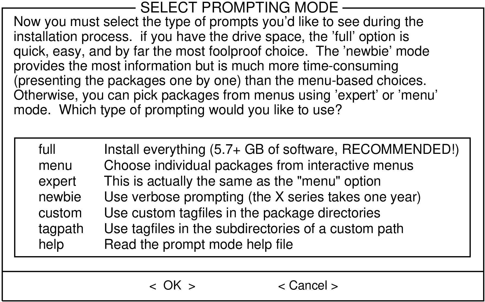

### 2.3.8 Configure

Once all the packages are installed you're nearly finished. At this stage, Slackware will prompt you with a variety of configuration tasks for your new operating system. Many of these are optional, but most users will need to set something up here. Depending on the packages you've installed, you may be offered different configuration options than the ones shown here, but we've included all the really important ones.

The first thing you'll likely be prompted to do is setup a boot disk. In the past this was typically a 1.44MB floppy disk, but today's Linux kernel is far too large to fit on a single floppy, so Slackware offers to create a bootable USB flash memory stick. Of course, your computer must support booting from USB in order to use a USB boot stick (most modern computers do). If you do not intend to use LILO or another traditional boot loader, you should consider making a USB boot stick. Please note that doing so will erase the contents of whatever memory stick you're using, so be careful.

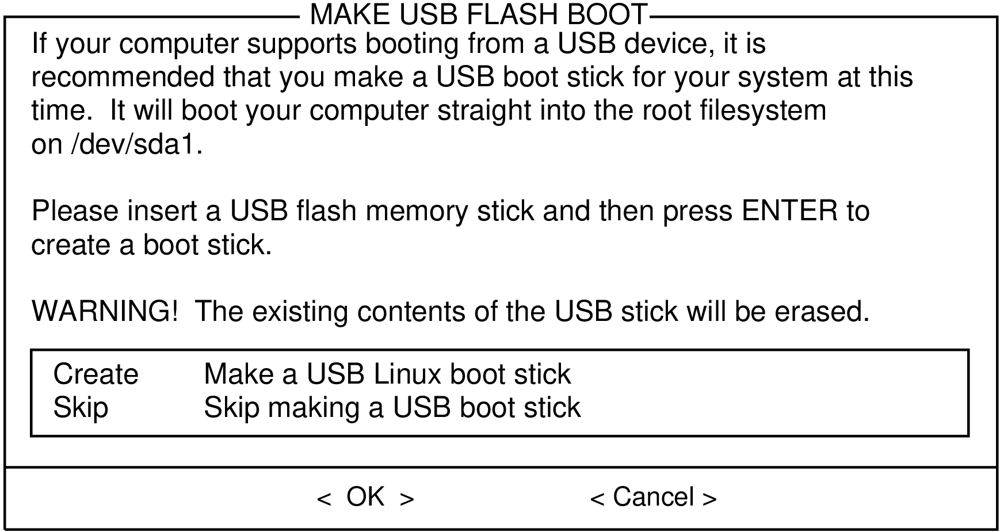

Nearly everyone will need to setup the LInux LOader, LILO. LILO is in charge of booting the Linux kernel and connecting to an initrd or the root filesystem. Without it (or some other boot loader), your new Slackware operating system will not boot. Slackware offers a few options here. The "simple" method attempts to automatically configure LILO for your computer, and works well with very simple systems. If Slackware is the only operating system on your computer, it should configure and install LILO for you without any hassels. If you don't trust the simpler method to work, or if you want to take an in-depth look at how to configure LILO, the "expert" method is really not all that complicated. This method will take you through each step and offer to setup dual-boot for Windows and other Linux operating systems. It also allows you to append kernel command parameters (most users will not need to specify any though).

LILO is a very important part of your Slackware system, so an entire section of the next chapter is devoted to it. If you're having difficulty configuring LILO at this stage, you may want to skip ahead and read Chapter 3 first, then return here.

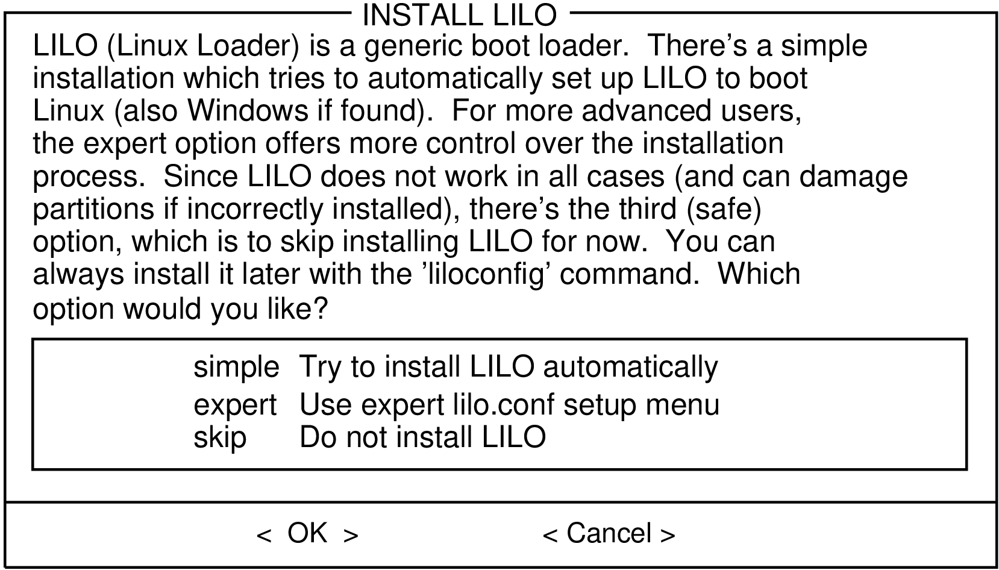

This simple step allows you to configure and activate a console mouse for use outside of the graphical desktops. By activating a console mouse, you'll be able to easily copy and paste from within the Slackware terminal. Most users will need to choose one of the first three options, but many are offered, and yes those ancient two-button serial mice do work.

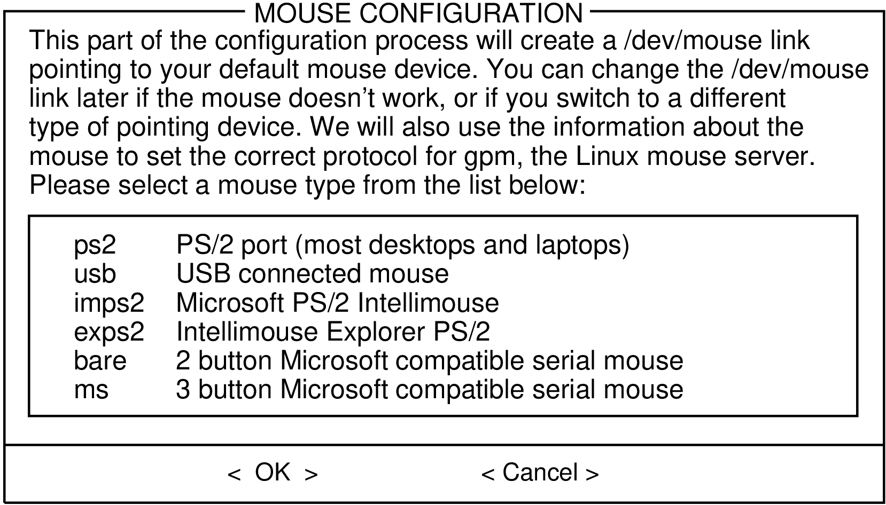

The next stage in configuring your install is the network configuration. If you don't wish to configure your network at this stage, you may decline, but otherwise you'll be prompted to provide a hostname for your computer. If you're unsure what to do here, you might want to read through first.

The following screens will prompt you first for a hostname, then for a domainname, such as example.org. The combination of the hostname and the domainname can be used to navigate between computers in your network if you use an internal DNS service or maintain your `/etc/hosts` file. If you skip setting up your network, Slackware will name your computer "darkstar" after a song by the Grateful Dead.

You have three options when setting your IP address; you may assign it a static IP, use DHCP, or configure a loopback connection. The simplest option, and probably the most common for laptops or computers on a basic network, is to let a DHCP server assign IP addresses dynamically. Unless you are installing Slackware for use as a network server, you probably do not need to setup a static IP address. If you're not sure which of these options to choose, pick DHCP.

Rarely DHCP servers requires you specify a DHCP hostname before you're permitted to connect. You can enter this on the Set DHCP Hostname screen. This is almost always be the same hostname you entered earlier.

If you choose to set a static IP address, Slackware will ask you to enter it along with the netmask, gateway IP address, and what nameserver to use.

The final screen during static IP address configuration is a confirmation screen, where you're permitted to accept your choices, edit them, or even restart the IP address configuration in case you decide to use DHCP instead.

Once your network configuration is completed Slackware will prompt you to configure the startup services that you wish to run automatically upon boot. Helpful descriptions of each service appear both to the right of the service name as well as at the bottom of the screen. If you're not sure what to turn on, you can safely leave the defaults in place. What services are started at boot time can be easily modified later with `pkgtool` .

Every computer needs to keep track of the current time, and with so many timezones around the world you have to tell Slackware which one to use. If your computer's hardware clock is set to UTC (Coordinated Universal Time), you'll need to select that; most hardware clocks are not set to UTC from the factory (though you could set it that way on your own; Slackware doesn't care). Then simply select your timezone from the list provided and off you go.

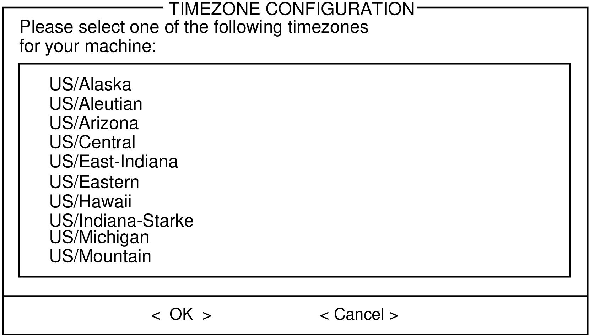

If you installed the X disk set, you'll be prompted to select a default window manager or desktop environment. What you select here will apply to every user on your computer, unless that user decides to run `xwmconfig` (1) and choose a different one. Don't be alarmed if the options you see below do not match the ones Slackware offers you. `xwmconfig` only offers choices that you installed. So for example, if you elected to skip the "KDE" disk set, KDE will not be offered.

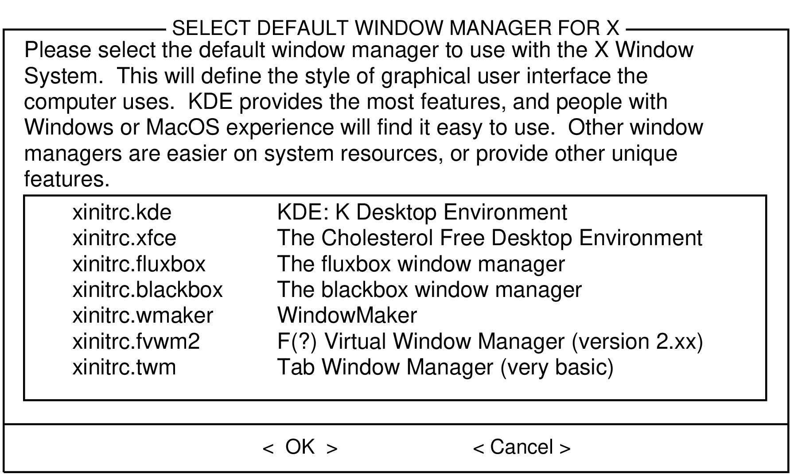

The last configuration step is setting a root password. The root user is the "super user" on Slackware and all other UNIX-like operating systems. Think of root as the Administrator user. root knows all, sees all, and can do all, so setting a strong root password is just common sense.

With this last step complete, you can now exit the Slackware installer and reboot with a good old <kbd>CTRL</kbd> + <kbd>ALT</kbd> + <kbd>DELETE</kbd> . Remove the Slackware installation disk, and if you performed all the steps correctly, your computer will boot into your new Slackware linux system. If something went wrong, you probably skipped the LILO configuration step or made an error there somehow. Thankfully, the next chapter should help you sort that out.

When you have rebooted into your new Slackware installation, the very first step you should take is to create a user. By default, the only user that exists after the install is the root user, and it's dangerous to use your computer as root, given that there are no restrictions as to what that user can do.

The quickest and easiest way to create a normal user for yourself is to log in as root with the root password that you created at the end of the intallation process, and then issue the `adduser` command. This will interactively assist you in creating a user; see for more information.
