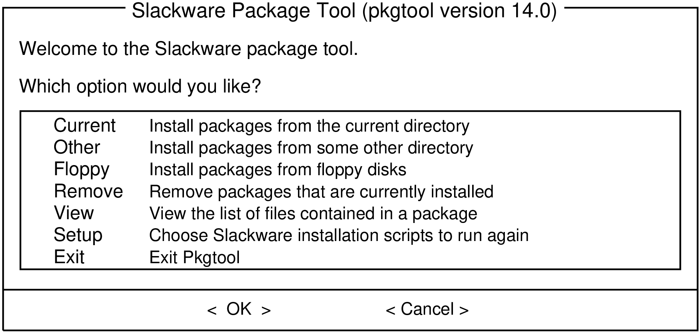

# 17. Package Management

Package management is an essential part of any Linux distribution. Every piece of software included by Slackware, along with many third-party tools are distributed as source code that can be compiled, but compiling all those thousands of different applications and libraries is tedious and time consuming. That's why many people prefer to install pre-compiled software packages. In fact, when you installed Slackware, the `setup` program primarily worked by running package management tools on a list of packages. Here we'll look at the various tools used for handling Slackware packages.

## 17.1 pkgtool

The simplest way to perform package maintenance tasks is to invoke `pkgtool` (8), a menu-driven interface to some of the other tools. `pkgtool` allows you to install or remove packages as well as view the contents of those packages and the list of currently installed packages in a user-friendly ncurses interface.



`pkgtool` is a convenient and easy way to perform the most basic tasks, but for more advanced work more flexible tools are needed.

## 17.2 Installing, Removing, and Upgrading Packages

While `pkgtool` scores points for convenience, `installpkg` (8) is much more capable of handling odd tasks, such as quickly installing a single package, installing an entire disk set of packages, or scripting an install. `installpkg` takes a list of packages to install, and simply installs them without asking any questions. Like all Slackware package management tools, it assumes that you know what you're doing and doesn't pretend to be smarter than you. In its simplest form, `installpkg` simply takes a list of packages to install, and does exactly what you would expect.

```text

darkstar:~# installpkg blackbox-0.70.1-i486-2.txz 
Verifying package blackbox-0.70.1-i486-2.txz. 
Installing package blackbox-0.70.1-i486-2.txz: 
PACKAGE DESCRIPTION: 
#blackbox (Blackbox window manager) 
# 
#Blackbox is that fast, light window manager you have been looking for 
#without all those annoying library dependencies. 
# 
#Also included in this package is the bbkeys utility for controlling 
#keyboard shortcut commands from within Blackbox. 
# 
#The Blackbox home page is http://blackboxwm.sourceforge.net 
# 
Package blackbox-0.70.1-i486-2.txz installed.

```

You can of course install multiple packages at a time, and in fact use shell wild cards. The following installs all of the "N" series packages from a mounted CD-ROM:

```text

darkstar:~# installpkg /mnt/cdrom/slackware/n/*.txz

```

At any given time, you can see what packages are installed on your system by listing the contents of /var/log/packages, which lists not only every application on your system but also the version number. Should you want to know what individual files were installed as a part of that package, `cat` the contents of the package:

```text

darkstar:~# cat /var/log/packages/foo-1.0-x86_64.txz

```

This will return everything from the size of the package, a description of what it does, and the name and location of every file installed as a part of the package.

Removing a package is every bit as easy as installing one. As you might expect, the command to do this is `removepkg` (8). Simply tell it which packages to remove, and `removepkg` will check the contents of the package database and remove all the files and directories for that package with one caveat. If that file is included in multiple installed packages, it will be skipped and if a directory has new files in it, the directory will be left in place. Because of this, removing packages takes a good while longer than installing them.

```text

darkstar:~# removepkg blackbox-0.70.1-i486-2.txz

```

Finally, upgrading is just as easy with (you guessed it), `upgradepkg` (8) which first installs a new package, then removes whatever files and directories are left-over from the old package. One important thing to remember is that `upgradepkg` doesn't check to see if the previously installed package has a higher version number than the "new" package, so it can also be used to downgrade to older versions.

```text

darkstar:~# upgradepkg blackbox-0.70.1-i486-2.txz
+============================================================================== 
| Upgrading blackbox-0.65.0-x86_64-4 package using 
./blackbox-0.70.1-i486-2.txz 
+============================================================================== 

Pre-installing package blackbox-0.70.1-i486-2... 

Removing package 
/var/log/packages/blackbox-0.65.0-x86_64-4-upgraded-2010-02-23,16:50:51... 
    --> Deleting symlink /usr/share/blackbox/nls/POSIX 
    --> Deleting symlink /usr/share/blackbox/nls/US_ASCII 
    --> Deleting symlink /usr/share/blackbox/nls/de 
    --> Deleting symlink /usr/share/blackbox/nls/en 
    --> Deleting symlink /usr/share/blackbox/nls/en_GB 
... 
Package blackbox-0.65.0-x86_64-4 upgraded with new package 
./blackbox-0.70.1-i486-2.txz.

```

All of these tools have useful arguments. For example, the `--root` to `installpkg` will install packages into an arbitrary directory. The `--dry-run` argument will instruct `upgradepkg` to simply tell you what it would attempt without actually making any changes to the system. For complete details, you should (as always) refer to the man pages.

## 17.3 Package Compression Formats

In the past, all Slackware packages were compressed with the `gzip` (1) compression utility, which was a good compromise between compression speed and size. Recently, new compression schemes have been added and the package management tools have been upgraded to handle these. Today, official Slackware packages are compressed with the `xz` utility and end with .txz extensions. Older packages (and many third party packages) still use the .tgz extension.

It's worth emphasizing that .tgz and .txz (or, more succinctly, .t?z files) are very standard, non-unique extensions for compressed .tar files. This has many advantages; they're easy to build on nearly any UNIX system (many other package formats require special toolchains), and they're just as simple to de-construct.

However, it is also important to realize that just because all Slackware packages *are* .t?z files, not all .t?z files are Slackware packages. `Installpkg` won't magically install just any .t?z file, only Slackware packages.

### 17.3.1 slackpkg

`Slackpkg` is an automated tool for management of Slackware Linux Packages. It originally appeared in /extra for the release of slackware-12.1, and since the release of slackware-12.2 it has been included in the ap/ series of a base installation.

Just as you are able to use `installpkg` to install Slackware packages from the /extra directory included on the install media, you can use `slackpkg` to pull packages from the Internet and install them. This is particularly useful for security updates or significant application upgrades that are posted to the Slackware servers, some of which you may want to start using on your own system.

Without `slackpkg` , the process would be:

1. Notice in the Slackware changelog that an update has been released.

2. Look on your local Slackware mirror to find a download link of the package.

3. Download the package from a Slackware mirror to your hard drive.

4. `installpkg` `pkgtool`

With `slackpkg` , this is reduced to:

1. Notice in the Slackware changelog that an update for `foo` has been released.

2. `slackpkg` `install` foo

Clearly, this streamlines a fairly common task.

To use `slackpkg` , configure your system with a Slackware mirror by editing `/etc/slackpkg/mirrors` as root. Find the mirror that is associated with your Slackware version and architecture, and uncomment it. This list of mirrors offers ftp and http access, but you must uncomment *only one* mirror.

Once a mirror has been selected, update the list of remote files by issuing the initial command `slackpkg update` . This should be done any time you notice that a new package has been posted (regularly checking in with the Slackware changelog is recommended; see for more information).

To search for a package, use `slackpkg search foo` , and to install use `slackpkg install foo` .

Once a package has been installed with `slackpkg` , it can be removed or upgraded using `pkgtool` and the other package management commands as detailed in the section called “Installing, Removing, and Upgrading Packages”.

For more information see the `man` pages for slackpkg(8) and slackpkg.conf(5), and see its website at http://www.slackpkg.org/

### 17.3.2 rpm2tgz

One of the most ubiquitous package formats for Linux software is RPM; it's not uncommon to find a developer offering their application for download as either source code or an RPM file, and no more. In this case, you would have three options:

1. Build your own Slackware package.

2. Compile and install directly from source code.

3. Convert and install from RPM.

Building from source code or creating your own Slackware package is usually not as complex as you might think but installing directly from source code is generally discouraged because there is no easy way to track what has been installed on your system after issuing the `make install` command. Building your own Slackware packages is outside the scope of this chapter. So this leaves us with the helpful tool `rpm2tgz` .

`rpm2tgz` converts RPM packages into a Slackware package that can then be installed via `pkgtool` or `installpkg` . This circumvents the need to create your own Slackware package but grants you the benefit of being able to remove, update, and track what you've installed.

While a Slackware package is just a shell script and source code, an RPM package can by comparison be a maze of dependency listings and special instructions. Therefore, `rpm2tgz` will not always work, especially on very complex applications, and it will never magically resolve dependencies.

To try `rpm2tgz` , download an RPM file from a trusted source and convert it:

```text

rpm2tgz foo-x.x.xx.rpm

```

The result is a .tgz file, so after the conversion is finished, the original RPM can safely be discarded. Use `installpkg` to install the Slackware package you've just created, provided that you've installed all dependency code for the application to actually function.
