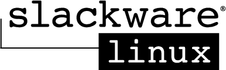

# Slackware Linux Essentials



**Alan Hicks**
**Chris Lumens**
**David Cantrell**
**Logan Johnson**

```
Copyright © 1998, 1999, 2000, 2001, 2002, 2003, 2004, 2005 Slackware Linux, Inc.

Slackware Linux is a registered trademark of Patrick Volkerding and Slackware Linux, Inc.

Linux is a registered trademark of Linus Torvalds.

America Online and AOL are registered trademarks of America Online, Inc. in the United States and/or other countries.

Apple, FireWire, Mac, Macintosh, Mac OS, Quicktime, and TrueType are trademarks of Apple Computer, Inc., registered in the United States and other countries.

IBM, AIX, EtherJet, Netfinity, OS/2, PowerPC, PS/2, S/390, and ThinkPad are trademarks of International Business Machines Corporation in the United States, other countries, or both.

IEEE, POSIX, and 802 are registered trademarks of Institute of Electrical and Electronics Engineers, Inc. in the United States.

Intel, Celeron, EtherExpress, i386, i486, Itanium, Pentium, and Xeon are trademarks or registered trademarks of Intel Corporation or its subsidiaries in the United States and other countries.

Microsoft, IntelliMouse, MS-DOS, Outlook, Windows, Windows Media and Windows NT are either registered trademarks or trademarks of Microsoft Corporation in the United States and/or other countries.

Netscape and the Netscape Navigator are registered trademarks of Netscape Communications Corporation in the U.S. and other countries.

Red Hat, RPM, are trademarks or registered trademarks of Red Hat, Inc. in the United States and other countries.

XFree86 is a trademark of The XFree86 Project, Inc.

Many of the designations used by manufacturers and sellers to distinguish their products are claimed as trademarks. Where those designations appear in this document, and Slackware Linux, Inc. was aware of the trademark claim, the designations have been followed by the “™” or the “®” symbol.
```

1-57176-338-4
