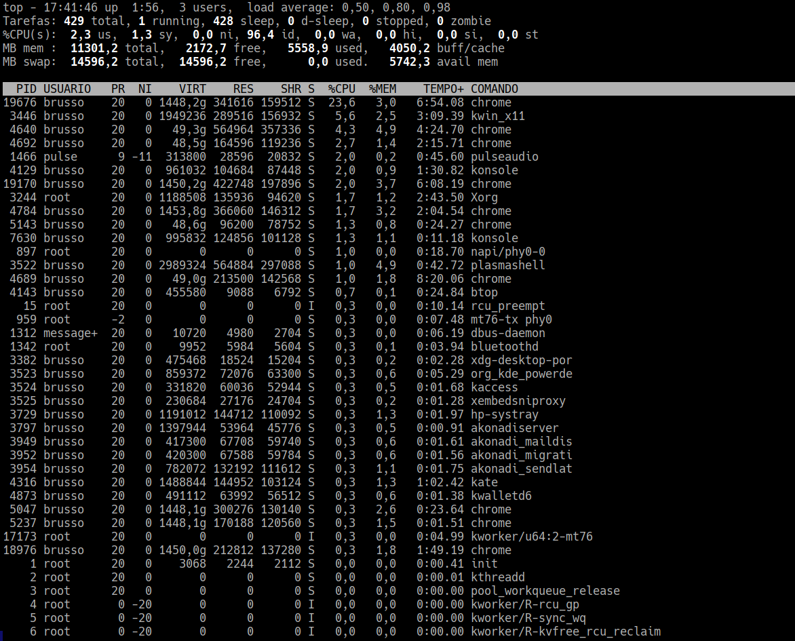
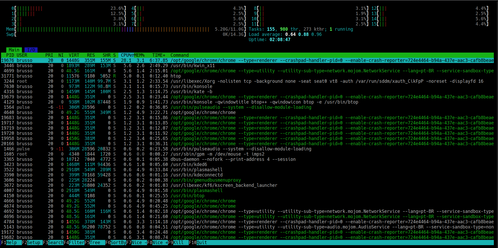
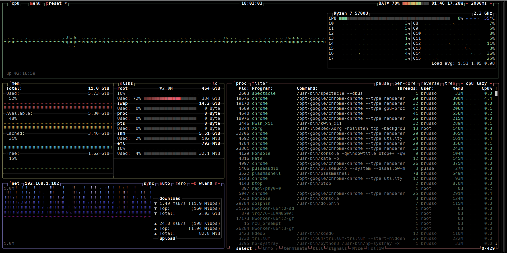

# 6. Process Control

Slackware systems often run hundreds or thousands of programs, each of which is referred to as a process in a Linux environment. Managing these processes is an important part of system administration.

So how exactly do we handle all of these separate processes? To help us with this task, there are several utilities we can use. In this chapter, we will explore some of the most common ones.


## 6.1 ps

The first step in managing processes is figuring out what processes are currently running. The most popular and powerful tool for this is `ps`. Without any arguments, `ps` won't tell you much information. By default, it only tells you what processes are running in your currently active shell. If we want more information, we'll need to look deeper.


```text

darkstar:~$ ps 
  PID TTY           TIME CMD 
12220 pts/4     00:00:00 bash 
12236 pts/4     00:00:00 ps

```

Here you can see what processes you are running in your currently active shell or terminal and only some information is included. The PID is the "Process ID"; every process is assigned a unique number. The TTY tells you what terminal device the process is attached to. Naturally, CMD is the command that was run. You might be a little confused by TIME though, since it seems to move so slowly. This isn't the amount of real time the process has been running, but rather the amount of CPU time the process has consumed. An idle process uses virtually no CPU time, so this value may not increase quickly.

Here, you can see what processes you are running in your currently active shell or terminal, with only basic information included. The PID is the "Process ID" — every process is assigned a unique number. The TTY tells you what terminal device the process is attached to. Naturally, CMD is the command that was run. You might be a little confused by TIME, though, since it seems to move so slowly. This isn't the amount of real time the process has been running, but rather the amount of CPU time the process has consumed. An idle process uses virtually no CPU time, so this value may not increase quickly.


Viewing only our own processes isn't very much fun, so let's take a look at all the processes on the system with the `-e` argument.

```text

darkstar:~$ ps -e 
PID TTY         TIME     CMD 
  1 ?        00:00:00 init 
  2 ?        00:00:00 kthreadd 
  3 ?        00:00:00 pool_workqueue_release
  4 ?        00:00:00 kworker/R-rcu_gp
  5 ?        00:00:00 kworker/R-sync_wq
  6 ?        00:00:00 kworker/R-kvfree_rcu_reclaim
  7 ?        00:00:00 kworker/R-slub_flushwq
  8 ?        00:00:00 kworker/R-netns
 10 ?        00:00:00 kworker/0:0H-kblockd
 11 ?        00:00:00 kworker/0:1-events
 12 ?        00:00:01 kworker/u64:0-gfx
 13 ?        00:00:00 kworker/R-mm_percpu_wq
 14 ?        00:00:00 ksoftirqd/0
 15 ?        00:00:01 rcu_preempt
 16 ?        00:00:00 rcu_exp_par_gp_kthread_worker/0
 17 ?        00:00:00 rcu_exp_gp_kthread_worker
 18 ?        00:00:00 migration/0
 19 ?        00:00:00 kprobe-optimizer
... many more lines omitted ...

```

**Note**

The above example uses the standard `ps` syntax, but much more information can be discovered if we use BSD syntax. In order to do so, we must use the `aux` argument.

This is distinct from the `-aux` argument, but in most cases the two arguments are equivalent. This is a decades-old relic. For more information, see the man page for `ps`.

```text

darkstar:~$ ps aux 
USER    PID     %CPU    %MEM    VSZ     RSS TTY STAT START TIME COMMAND 
root      1     0.0     0.0     3928    632 ?   Ss   15:45 0:00 init [4] 
root      2     0.0     0.0        0      0 ?   S    15:45 0:00 [kthreadd]
root      3     0.0     0.0        0      0 ?   S    15:45 0:00 [pool_workqueue_release]
root      4     0.0     0.0        0      0 ?   I<   15:45 0:00 [kworker/R-rcu_gp]
root      5     0.0     0.0        0      0 ?   I<   15:45 0:00 [kworker/R-sync_wq]
root      6     0.0     0.0        0      0 ?   I<   15:45 0:00 [kworker/R-kvfree_rcu_reclaim]
root      7     0.0     0.0        0      0 ?   I<   15:45 0:00 [kworker/R-slub_flushwq]
root      8     0.0     0.0        0      0 ?   I<   15:45 0:00 [kworker/R-netns]
root     10     0.0     0.0        0      0 ?   I<   15:45 0:00 [kworker/0:0H-kblockd]
root     11     0.0     0.0        0      0 ?   I    15:45 0:00 [kworker/0:1-events]
root     12     0.1     0.0        0      0 ?   I    15:45 0:01 [kworker/u64:0-gfx]
root     13     0.0     0.0        0      0 ?   I<   15:45 0:00 [kworker/R-mm_percpu_wq]
root     14     0.0     0.0        0      0 ?   S    15:45 0:00 [ksoftirqd/0]
root     15     0.1     0.0        0      0 ?   I    15:45 0:01 [rcu_preempt]
... many more lines omitted ....

```

As you can see, the `aux` argument offers much more information, including which user controls the process and what percentage of CPU and RAM the process is consuming when `ps` is run.

To accomplish this on a per-process basis, `ps` allows one or more process IDs (PIDs) to be provided on the command line and features the `-o` flag to display specific attributes of a PID.


```text
darkstar:~$ ps -o cmd -o etime
CMD                             ELAPSED
/bin/bash                         09:21
fish                              09:21
ps -o cmd -o etime                00:00
```

What this is displaying, is the PID's command name (cmd), and its elapsed time (etime). The PID in this example, is a shell variable for the PID of the current shell. So you can see, in this example, the shell process has existed for 9 minutes, 21 seconds.

By combining `ps` with the `pgrep` command, this process can be easily automated:

```text
darkstar:~$  ps -o cmd -o rss -o vsz $(pgrep chrome)
CMD                           RSS    VSZ
/opt/google/chrome/chrome   516976 51688644
/opt/google/chrome/chrome_c  4396 50355400
/opt/google/chrome/chrome_c  3812 50346164
/opt/google/chrome/chrome - 65816 50774672
/opt/google/chrome/chrome - 66164 50774660
/opt/google/chrome/chrome - 19420 50774688
/opt/google/chrome/chrome - 196028 51243208
/opt/google/chrome/chrome - 153324 50886676
/opt/google/chrome/chrome - 57752 50858720
/opt/google/chrome/chrome - 158208 1518473728
/opt/google/chrome/chrome - 353032 1524425320
/opt/google/chrome/chrome - 512404 1518545988
/opt/google/chrome/chrome - 289524 1518470868
/opt/google/chrome/chrome - 94932 50848384
/opt/google/chrome/chrome - 122228 1518466812
/opt/google/chrome/chrome - 165912 1518475280
/opt/google/chrome/chrome - 198144 1518534900
/opt/google/chrome/chrome - 53908 67618392
/opt/google/chrome/chrome - 418120 1518642108
/opt/google/chrome/chrome - 112568 1518360188
/opt/google/chrome/chrome - 126632 1520336712
/opt/google/chrome/chrome - 136956 1518380384
/opt/google/chrome/chrome - 77984 1518350972


```
In this example, command substitution using $(pgrep chrome) returns the PIDs of all running processes whose command names match 'chrome'. ps then displays each process's command name (cmd), resident set size (rss), and virtual memory size (vsz).


Finally, `ps` can also create a process tree. This shows you which processes have children processes. Ending the parent of a child process also ends the child. We do this with the `-ejH` argument.


```text

darkstar:~$ ps -ejH 
... many lines omitted ... 
3091  3091  3091 ?        00:00:00   login
3111  3111  3111 tty2     00:00:00     bash
3130  3130  3111 tty2     00:00:00       sddm.bin
3135  3135  3135 tty7     00:00:00         Xorg
3175  3130  3111 tty2     00:00:00         sddm-helper
3176  3130  3111 tty2     00:00:01           sddm-greeter-qt
3182  3130  3111 tty2     00:00:00   dbus-launch
3183  3183  3183 ?        00:00:00   dbus-daemon
3239  3239  3239 ?        00:00:00   sddm.bin
3244  3244  3244 tty8     00:00:55     Xorg
3327  3239  3239 ?        00:00:00     sddm-helper
3343  3239  3239 ?        00:00:00       dbus-run-sessio
3365  3239  3239 ?        00:00:01         dbus-daemon
3366  3239  3239 ?        00:00:00         startplasma-x11
3373  3239  3239 ?        00:00:00           plasma_session
3423  3239  3239 ?        00:00:01             kded6
... many more lines omitted ...

```

As you can see, `ps` is an incredibly powerful tool for determining not only what processes are currently active on your system, but also for learning lots of important information about them.

As is the case with many of the applications, there is often several tools for the job. Similar to the `ps -ejH` output, but more terse, is `pstree`. It displays the process tree, a bit more visually.

```text
darkstar:~$ pstree 
init─┬─ModemManager───3*[{ModemManager}]
     ├─NetworkManager─┬─dhcpcd─┬─dhcpcd───2*[dhcpcd]
     │                │        └─dhcpcd
     │                └─3*[{NetworkManager}]
     ├─acpid
     ├─4*[agetty]
     ├─akonadi_contact───2*[{akonadi_contact}]
     ├─akonadi_control─┬─akonadi_archive───4*[{akonadi_archive}]
     │                 ├─akonadi_contact───2*[{akonadi_contact}]
     │                 ├─akonadi_followu───3*[{akonadi_followu}]
     │                 ├─akonadi_indexin───2*[{akonadi_indexin}]
     │                 ├─akonadi_maildir───2*[{akonadi_maildir}]
     │                 ├─akonadi_maildis───3*[{akonadi_maildis}]
     │                 ├─akonadi_mailfil───4*[{akonadi_mailfil}]
     │                 ├─akonadi_mailmer───3*[{akonadi_mailmer}]
     │                 ├─akonadi_migrati───3*[{akonadi_migrati}]
     │                 ├─akonadi_newmail───3*[{akonadi_newmail}]
     │                 ├─akonadi_sendlat───3*[{akonadi_sendlat}]
     │                 ├─akonadi_unified───3*[{akonadi_unified}]
     │                 ├─akonadiserver─┬─mysqld───14*[{mysqld}]
     │                 │               └─26*[{akonadiserver}]
     │                 └─2*[{akonadi_control}]
... many more lines omitted ...
```

## 6.2 kill and killall

Managing processes isn't only about knowing which ones are running, but also about communicating with them to change their behavior. The most common way of managing a program is to terminate it. Thus, the tool for the job is named `kill`. Despite the name, `kill` doesn't actually terminate processes, but sends signals to them. The most common signal is SIGTERM, which tells the process to finish up what it is doing and terminate. There are a variety of other signals that can be sent, but the three most common are SIGTERM, SIGHUP, and SIGKILL.

What a process does when it receives a signal varies. Most programs will terminate (or attempt to terminate) whenever they receive any signal, but there are a few important differences. For starters, the SIGTERM signal informs the process that it should terminate itself at its earliest convenience. This gives the process time to finish up any important activities, such as writing information to disk, before it closes. In contrast, the SIGKILL signal tells the process to terminate itself immediately, no questions asked. This is most useful for killing processes that are not responding and is sometimes called the "silver bullet". Some processes (particularly daemons) capture the SIGHUP signal and reload their configuration files whenever they receive it.

In order to signal a process, we first need to know it's PID. You can get this easily with `ps` as we discused. In order to send different signals to a running process, you simply pass the signal name or number and `-s` as an argument. The `-l` argument lists all the signals you can choose and their number. You can also send signals by their name with `-s` .

```text
darkstar:~$ kill -l 
 1) SIGHUP   2) SIGINT   3) SIGQUIT  4) SIGILL 
 5) SIGTRAP  6) SIGABRT  7) SIGBUS   8) SIGFPE 
 9) SIGKILL 10) SIGUSR1 11) SIGSEGV 12) SIGUSR2 
13) SIGPIPE 14) SIGALRM 15) SIGTERM 16) SIGSTKFLT 
... many more lines omitted ... 
darkstar:~$ kill 1234 # SIGTERM 
darkstar:~$ kill -s 9 1234 # SIGKILL 
darkstar:~$ kill -s 1 1234 # SIGHUP 
darkstar:~$ kill -s HUP 1234 # SIGHUP
```

Sometimes you may wish to terminate all running processes with a certain name. You can kill processes by name using `killall`. Just pass the same arguments to `killall` that you would pass to kill:

```text
darkstar:~$ killall bash # SIGTERM 
darkstar:~$ killall -s 9 bash # SIGKILL 
darkstar:~$ killall -s 1 bash # SIGHUP 
darkstar:~$ killall -s HUP bash # SIGHUP
```

## 6.3 top


So far, we've learned how to look at active processes for a single moment in time, but what if we want to monitor them continuously over an extended period? `top` allows us to do just that. It displays an ordered, real-time list of active processes on your system along with vital resource consumption metrics, updating periodically (every three seconds by default).



The man page has helpful details on how to interact with `top`, such as changing its delay interval, altering the order in which processes are displayed, and even terminating processes right from within `top` itself.


## 6.4 htop

The `htop` like top allow you to look active processes in real-time and allows you to scroll vertically and horizontally, and interact using a pointing device (mouse).  You can observe all processes running on the system, along with their command line arguments, as well as view them in a tree format, select multiple processes and act on them all at once.

At the top of the screen, `htop` features visual meters displaying real-time CPU, memory, and swap utilization. At the bottom, a footer bar displays available actions mapped to Function keys (<kbd>F1</kbd> through <kbd>F10</kbd>). This allows you to search, filter, send signals (killing), or adjust process priorities (renicing) directly without needing to enter PIDs manually.




The man page has helpful details on how to interact with `htop`.


## 6.5 btop

Another popular resource monitor is `btop`, which displays real-time statistics and resource usage for the processor, memory, storage disks, network interfaces, and running processes. In other words, `btop` serves as a comprehensive, feature-rich TUI (Text User Interface) dashboard for system performance.

If you prefer an intuitive, visually responsive interface to monitor your system, `btop` is an excellent choice. It features full mouse support, allowing you to click on elements, scroll through lists, and select individual PIDs to view detailed process trees or filter resource usage effortlessly.



The man page has helpful details on how to interact with `btop`.


## 6.6 cron

So far, we've learned many different ways of viewing active processes on our system and methods for signaling them, but what if we want to run a process periodically on an automated schedule? Fortunately, Slackware includes just the tool for the job: `crond`. `cron` runs processes for every user on a schedule specified by that user. This makes it extremely useful for tasks that need to run periodically without requiring a dedicated daemon, such as automated backup scripts. Every user gets their own entry in the `cron` database, allowing non-root users to schedule their own background tasks as well.

In order to manage scheduled tasks, you will need to use the `crontab` utility. The man page lists a variety of options, but the most common method is using the `-e` argument. This locks the user's entry in the `cron` database (preventing concurrent modifications) and opens it in the text editor specified by the `VISUAL` or `EDITOR` environment variable. On Slackware systems, this defaults to the `vi` editor. You may wish to review the chapter on `vi` before proceeding.

The `cron` database entries may seem a bit archaic at first glance, but they are remarkably flexible. Each uncommented line is processed by `crond`, and the specified command is executed whenever all time conditions match.

```text
darkstar:~$ crontab -e 
#Keep current with slackware 
30 02 * * * /usr/local/bin/rsync-slackware64.sh 1>/dev/null 2>&1

```

As mentioned before, the syntax for `cron` entries can be a little difficult to understand at first, so let's break down each part individually. From left to right, the five time fields are: **Minute**, **Hour**, **Day of Month**, **Month**, and **Day of Week**, followed by the **Command** to execute.

An asterisk (`*`) acts as a wildcard, matching every possible value for that field (e.g., every minute, every hour, or every day).

In the previous example (`30 02 * * * /usr/local/bin/rsync-slackware64.sh 1>/dev/null 2>&1`):
* **Minute (`30`)**: At minute 30
* **Hour (`02`)**: At 2:00 AM
* **Day of Month (`*`)**: Every day of the month
* **Month (`*`)**: Every month
* **Day of Week (`*`)**: Every day of the week

Therefore, the command `/usr/local/bin/rsync-slackware64.sh 1>/dev/null 2>&1` runs **every day at 2:30 a.m.**


`crond` will also email the local user with any standard output or error generated by a executed command. For this reason, many tasks have their output redirected to `/dev/null`, a special character device file that immediately discards any data written to it.

To make it easier to remember the syntax rules and output redirection, you can paste the following commented template at the top of your own `crontab` file:

```text
# MIN HOUR DAY MONTH WEEKDAY COMMAND
# Redirect output to /dev/null: 1>/dev/null 2>&1
```

By default, Slackware includes a number of pre-configured entries and comments in `root`'s `crontab`. These entries make it easier to set up periodic system maintenance by utilizing dedicated directories in `/etc` corresponding to execution frequencies. Any executable script placed within these directories will automatically run on that schedule.

The directory names are self-explanatory:
* `/etc/cron.hourly` — Executed once every hour
* `/etc/cron.daily` — Executed once every day
* `/etc/cron.weekly` — Executed once every week
* `/etc/cron.monthly` — Executed once every month


## 6.7 at

Similar to `cron`, the `at` utility allows you to schedule tasks for automatic execution, but with a key difference: while `cron` is designed for recurring, periodic jobs, `at` executes a scheduled task **only once** at a specified future time.

To schedule a task, you specify the time as an argument. You can either enter commands interactively (pressing <kbd>Ctrl</kbd>+<kbd>d</kbd> when finished) or specify a script file directly using the `-f` option.

Following the previous update script example, to schedule a single execution at 10:35 AM:

```bash
darkstar:~$ at 10:35 -f /usr/local/bin/rsync-slackware64.sh
warning: commands will be executed using /bin/sh
job 1 at Wed Oct 29 10:35:00 2026
```

To schedule a task for 10:35 PM, you can specify:

```bash
darkstar:~$ at 10:35PM -f /usr/local/bin/rsync-slackware64.sh
warning: commands will be executed using /bin/sh
job 2 at Wed Oct 29 22:35:00 2026
```

To view currently scheduled jobs, use the -l option:

```bash
darkstar:~$ at -l
2       Tue Oct 29 22:45:00 2026 a brusso
1       Wed Oct 28 10:45:00 2026 a brusso
```

> Note: An alternative to `at -l` is the standalone `atq` command.


To remove a scheduled job, pass its job number using the -r option (or use the equivalent atrm command):


```bash
darkstar:~$ at -r 1
2       Tue Oct 29 22:45:00 2026 a brusso
1       Wed Oct 28 10:45:00 2026 a brusso


darkstar:~$ at -l
2       Tue Oct 29 22:45:00 2026 a brusso
```


Another useful feature of at is its flexible time specification syntax—it supports natural expressions such as now + 3 hours, noon, or tomorrow. Consult the man page for at for full details on supported time formats and interaction options.
