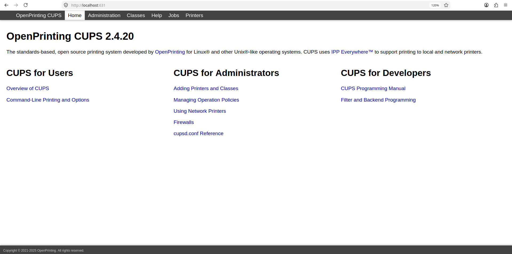
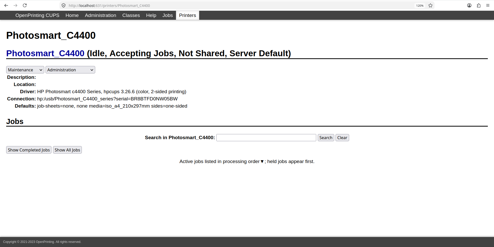

# 8. Printing

## 8.1 Choosing A Printer

Historically, printer configuration on Linux required navigating complex spoolers and custom filter scripts, making hardware support hit-or-miss. Today, the vast majority of modern printers work seamlessly with Linux out of the box, although hardware compatibility can still vary depending on the manufacturer and model.


When selecting a new printer for a Slackware environment:

* **Laser Printers:** Generally offer the best out-of-the-box compatibility, particularly models supporting standard printer command languages like PostScript or PCL.
* **Inkjet Printers:** Entry-level or budget inkjet models often rely on proprietary host-based rasterization protocols ("Winprinters") that may lack native Linux driver support.

If you are uncertain about hardware compatibility prior to purchase, consult community resources such as OpenPrinting.org to verify driver availability and user reports.


**The Common UNIX Printing System (CUPS)**

Slackware manages printing services using **CUPS** (Common UNIX Printing System), the industry-standard printing environment across UNIX-like operating systems. CUPS manages print queues, rasterizes documents, converts job formats (such as PDF or PostScript), and communicates with physical local and network devices.

CUPS features a built-in web-based administration interface that allows users and administrators to add printers, configure options, and monitor active print jobs.


**Accessing the CUPS Web Interface**

To configure a printer using CUPS, launch any web browser (such as `firefox` or console browsers like `links`) and navigate to:

```text
http://localhost:631
```




## 8.2 Getting the Driver

Before configuring a printer in CUPS, you must ensure the appropriate driver or description file is available on your system. Printer drivers generally fall into three main categories:

1. **PostScript Printers:** PostScript printers use the universal PostScript page description language to communicate with computers. A dedicated driver is usually unnecessary because Slackware includes `Ghostscript`, a PostScript-compatible subsystem, out of the box.
2. **Gutenprint Drivers:** `Gutenprint` is an open-source driver suite developed for Linux that provides support for hundreds of printer models.
3. **Manufacturer-Provided Drivers:** Printer manufacturers often provide Linux-specific drivers on their official support websites for models that require proprietary rasterizers.


**Installing Drivers in Slackware**

Because `Gutenprint` is pre-installed in Slackware, driver setup generally follows one of two methods:


* **Manufacturer Drivers:** Installation is handled like any standard software package in Slackware. Download the package from the manufacturer and install it using `installpkg` (it may be necessary to convert RPM packages using `rpm2tgz` first). Always consult the documentation supplied with the driver package for special setup requirements.
* **PostScript PPD Files:** For PostScript printers, no formal driver installation is required. Simply download the appropriate **PPD** (PostScript Printer Description) file for your model and save it in a sensible directory on your filesystem.

> **Note:** In my environment, I use an HP Photosmart printer, whose drivers are installed by default on Slackware.


Once you have identified and installed or downloaded the necessary driver components, you are ready to configure the printer in CUPS.


## 8.3 Setting Up a Printer in CUPS

While CUPS manages its printer definitions behind the scenes in `/etc/cups/printers.conf`, the easiest and most straightforward way to configure a printer is through the built-in CUPS web administration interface.


**Step-by-Step Web Interface Setup**


1. **Access the Administration Page:**
   Open any web browser (such as Firefox or `links`) and navigate to: `http://localhost:631`. Click on the **Administration** tab at the top of the page, then select **Add Printer**.

2. **Authenticate as Root:**
   When prompted for administrative credentials, enter `root` as the username along with your system's `root` password.

3. **Select the Printer Connection / Protocol:**
   CUPS will display a list of available local interfaces and network protocols:
   * **Local Printer:** If your printer is connected directly via USB and powered on, it will appear under *Local Printers*.
   * **Network Printer:** For networked printers, select the appropriate connection protocol (most commonly **LPD/LPR Host or Printer**, **AppSocket/HP JetDirect**, or **IPP**).

4. **Specify the Device Location / URI (Network Printers Only):**
   If configuring a network printer, enter its IP address or network URI. For example, using the `LPD/LPR` protocol:  
   `lpd://192.168.4.8`  
   *(You can locate your printer's IP address on its status screen or from your router's device list).*

5. **Enter Printer Details:**
   Provide human-readable information to identify the device:
   * **Name:** A short, single-word identifier without spaces (e.g., `hp` or `office_hp`).
   * **Description:** A distinctive description (e.g., `HP Photosmart`).
   * **Location:** The physical placement of the machine (e.g., `Downstairs Office`).

6. **Select the Printer Driver or PPD File:**  
   Point CUPS to the appropriate printer model definition:
   * **Manufacturer List:** Select the manufacturer (e.g., *Epson* or *HP*) and choose your model driver from the list (such as *HP Photosmart c4440 Series, hpcups 3.26.6 (en)*).
   * **PPD File:** If you downloaded a custom `.ppd` file, click **Browse...** to upload the PPD directly.

7. **Save and Set Default Options:**  
   Click **Add Printer**, set default options (paper size, print quality, duplexing), and confirm. Your printer is now ready to receive print jobs.


> **Under the Hood: How CUPS Stores Configuration**
> When you complete the web setup, CUPS automatically generates an entry in `/etc/cups/printers.conf` defining attributes like `MakeModel` and `DeviceURI` (e.g., `lpd://192.168.4.8`). While manual editing of `/etc/cups/printers.conf` is possible, it requires stopping the `cupsd` daemon first (`/etc/rc.d/rc.cups stop`) to prevent configuration overwrites. Using the web interface handles daemon updates safely and automatically.

```text
darkstar:~# cat /etc/cups/printers.conf
# Printer configuration file for CUPS v2.4.20
# Written by cupsd
# DO NOT EDIT THIS FILE WHEN CUPSD IS RUNNING
NextPrinterId 2
<DefaultPrinter Photosmart_C4400>
PrinterId 1
UUID urn:uuid:6c68e0ee-e32c-3a28-48a1-92bc88b33070
Info
Location
MakeModel HP Photosmart c4400 Series, hpcups 3.26.6
DeviceURI hp:/usb/Photosmart_C4400_series?serial=BR8BTFD0NW05BW
State Idle
StateTime 1795197275
ConfigTime 1785366850
Type 36892
Accepting Yes
Shared Yes
JobSheets none none
QuotaPeriod 0
PageLimit 0
KLimit 0
OpPolicy default
ErrorPolicy stop-printer
</DefaultPrinter>
```





## 8.4 Printing from the Command Line

Now that you have successfully installed and configured your printer, you can print documents directly from the terminal using `lpr`.

The `lpr` utility sends files to the print queue. Before printing, it is helpful to set a default printer on your system so you do not have to specify the target printer name with every command.


**Setting the Default Printer**

**Method 1: System-Wide (as Root)**
To set a system-wide default printer for all users on the machine, run `lpadmin` with the `-d` flag as `root`:

```bash
darkstar:~# lpadmin -d Photosmart_C4400
```

> Note: In this example, `Photosmart_C4400` is the queue name defined during the CUPS setup (either in the web interface or `/etc/cups/printers.conf`).


**Method 2: Per-User (Environment Variable)**
If you do not have root privileges on the workstation, you can set the default printer for your user account by exporting the PRINTER environment variable in your shell:

```bash
darkstar:~\$ export PRINTER=Photosmart_C4400
```

To make this setting permanent for your user account, add `export PRINTER=Photosmart_C4400` to your `~/.bashrc` configuration file.


**Sending Jobs to the Printer**

Once a default printer is configured, send any document to the print queue simply by passing the filename to lpr:

```bash
darkstar:~\$ lpr document.txt
```

If you have multiple printers configured and wish to send a document to a specific printer other than your default, use the -P flag:

```bash
darkstar:~\$ lpr -P Photosmart_C4400 document.txt
```

### 8.4.1 Formatting for Print with `pr`

Like many traditional UNIX utilities, `lpr` adheres strictly to the UNIX philosophy: it does one thing—sending raw data to a print queue—without altering document layout, margins, or pagination. When printing unformatted plain text files, sending raw text directly to a printer can result in awkward page breaks, missing margins, or text running off the physical page boundaries.

To format plain text documents before printing, use `pr`.

`pr` is a standard UNIX text formatting utility that prepares plain text files for printing by inserting proper page breaks, headers (including the timestamp, file name, and page number), footers, and margins. Because `pr` outputs its formatted text directly to standard output (`stdout`), it seamlessly integrates with `lpr` via standard shell pipelines.


**Piping Formatted Text to `lpr`**

To format a text file and send the output directly to your default print queue in a single command, pipe the output of `pr` into `lpr`:

```bash
darkstar:~\$ pr document.txt | lpr
```

You can also customize the header title and layout options before sending the job to the printer:

```bash
darkstar:~\$ pr -h "Quarterly Report" -l 60 document.txt | lpr
```

**Common pr Command Flags**

| Flag | Description | Example |
| ---- | ----------- | ------- |
| -h <header> | Replaces the default header filename with a custom title string. | pr -h "System Log" log.txt |
| -l <lines> | Sets the page length in lines (default is 66 lines per page). | pr -l 60 document.txt |
| -w <width> | Sets the page width in columns (default is 72 columns). | pr -w 80 document.txt |
| -d | Double-spaces the text output. | pr -d document.txt |
| -n | Prepends line numbers to each line of formatted text. | pr -n document.txt |
| -m | Formats and prints multiple files side-by-side in parallel columns. | pr -m file1.txt file2.txt |

