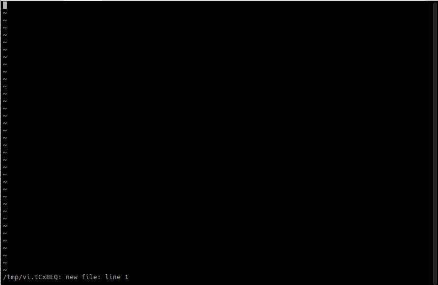
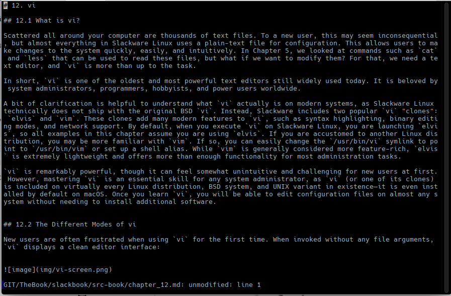

# 12. vi

## 12.1 What is vi?

Scattered all around your computer are thousands of text files. To a new user, this may seem inconsequential, but almost everything in Slackware Linux uses a plain-text file for configuration. This allows users to make changes to the system quickly, easily, and intuitively. In Chapter 5, we looked at commands such as `cat` and `less` that can be used to read these files, but what if we want to modify them? For that, we need a text editor, and `vi` is more than up to the task.

In short, `vi` is one of the oldest and most powerful text editors still widely used today. It is beloved by system administrators, programmers, hobbyists, and power users worldwide.

A bit of clarification is helpful to understand what `vi` actually is on modern systems, as Slackware Linux technically does not ship with the original BSD `vi`. Instead, Slackware includes two popular `vi` "clones": `elvis` and `vim`. These clones add many modern features to `vi`, such as syntax highlighting, binary editing modes, and network support. By default, when you execute `vi` on Slackware Linux, you are launching `elvis`, so all examples in this chapter assume you are using `elvis`. If you are accustomed to another Linux distribution, you may be more familiar with `vim`. If so, you can easily change the `/usr/bin/vi` symlink to point to `/usr/bin/vim` or set up a shell alias. While `vim` is generally considered more feature-rich, `elvis` is extremely lightweight and offers more than enough functionality for most administration tasks.

`vi` is remarkably powerful, though it can feel somewhat unintuitive and challenging for new users at first. However, mastering `vi` is an essential skill for any system administrator, as `vi` (or one of its clones) is included on virtually every Linux distribution, BSD system, and UNIX variant in existence—it is even installed by default on macOS. Once you learn `vi`, you will be able to edit configuration files on almost any system without needing to install additional software.


## 12.2 The Different Modes of vi

New users are often frustrated when using `vi` for the first time. When invoked without any file arguments, `vi` displays a clean editor interface:




At this point, a beginner will typically begin typing and expect the pressed keys to appear directly in the document. Instead, unexpected behaviors occur—the cursor jumps around, lines disappear, or the terminal beeps.

The reason for this is simple: `vi` is a **modal editor**. Unlike traditional text editors, `vi` operates in distinct modes:

* **Command Mode (Normal Mode):** This is the default mode when `vi` starts. In Command Mode, keystrokes are interpreted as editing commands rather than literal text. Keystrokes allow you to navigate the document, delete text, copy (yank) and paste lines, search, and perform formatting.
* **Insert Mode:** In this mode, `vi` behaves like a standard text editor. Everything you type is inserted directly into the file.
* **Ex Mode (Command-line Mode):** Accessed by typing `:` while in Command Mode. This mode places the cursor on the bottom line of the screen, allowing you to save files, quit, perform global replacements, or run shell commands.

To switch from **Command Mode** to **Insert Mode**, press <kbd>i</kbd> (to insert before the cursor), <kbd>a</kbd> (to append after the cursor), or <kbd>o</kbd> (to open a new line below). To return to **Command Mode** at any time, press the <kbd>Esc</kbd> key.


## 12.3 Opening, Saving, and Quitting

Now that you understand the basic operational modes of `vi`, the first practical step is learning how to open, save, and exit files.

Opening a file is straightforward—simply pass the filename as an argument when launching `vi` from the command line:

```bash
darkstar:~$ vi chapter_12.md
```

This opens `chapter_12.md` and loads its content into a buffer. The next image show its.




**Saving Changes (`:w` and `:wq`)**

To save your work, you must be in **Command Mode**. Pressing the <kbd>:</kbd> key temporarily moves the cursor to the bottom line of the screen, entering **Ex Mode** (Command-line Mode). 

* **`:w`** — Writes (saves) the buffer contents back to the file on disk.
* **`:wq`** — Writes the changes and quits `vi` in a single command.

If you want to switch to editing another file without closing `vi`, use `:e filename`:

```text
:e chapter_05.md
```

If you have unsaved changes in your current buffer, `:e` will prevent you from switching files and display a warning. You can force `vi` to discard your unsaved changes and open the new file immediately by appending an exclamation mark: **`:e!`**. Adding <kbd>!</kbd> to most Ex Mode commands forces the action, ignoring unsaved buffer warnings.


**Quitting `vi` (`:q` and `:q!`)**

To close `vi` and return to your shell prompt:

* **`:q`** — Quits `vi` (succeeds only if there are no unsaved changes).
* **`:q!`** — Forces `vi` to quit immediately, abandoning all unsaved changes.
* **`:e!`** — Reloads the original file from disk, resetting your current buffer to its last saved state.

**Quick Reference: Ex Mode Commands**

| Command | Action |
| :--- | :--- |
| `:w` | Save current changes without exiting |
| `:wq` | Save changes and exit `vi` |
| `:q` | Exit `vi` (fails if there are unsaved changes) |
| `:q!` | Force exit `vi`, discarding all unsaved changes |
| `:e filename` | Open a different file in the buffer |
| `:e!` | Revert current file to its last saved state |


## 12.4 Moving Around

Moving around in `vi` is often one of the most unusual adjustments for new users. `vi` does not traditionally rely on the directional arrow keys for cursor movement (although modern implementations like `elvis` and `vim` in Slackware do support them). Instead, navigation is executed using commands while in **Command Mode**.

Historically, `vi` was created on Lear Siegler ADM-3A terminals before dedicated arrow keys were standard on keyboards. The right-hand home-row keys—<kbd>h</kbd>, <kbd>j</kbd>, <kbd>k</kbd>, and <kbd>l</kbd>—were chosen because their physical keycaps had direction arrows printed on them:

| Command | Action |
| :--- | :--- |
| <kbd>h</kbd> | Move the cursor one character to the **left** |
| <kbd>j</kbd> | Move the cursor one line **down** |
| <kbd>k</kbd> | Move the cursor one line **up** |
| <kbd>l</kbd> | Move the cursor one character to the **right** |


**Combining Counts with Movement**

Movement in `vi` becomes significantly more efficient when combining navigation keys with numeric prefixes. Prefixing a movement command with a number executes that action multiple times:
* **`10j`** — Moves the cursor down 10 lines.
* **`5w`** — Moves the cursor forward 5 words.

**Advanced Navigation Shortcuts**

In addition to single-character movements, `vi` provides quick shortcuts to jump across lines, words, and entire files:

| Command | Action |
| :--- | :--- |
| <kbd>w</kbd> | Jump forward to the start of the next **word** |
| <kbd>b</kbd> | Jump backward to the start of the previous **word** |
| <kbd>0</kbd> | Jump to the very **beginning of the current line** |
| <kbd>^</kbd> | Jump to the **first non-blank character** of the current line |
| <kbd>$</kbd> | Jump to the **end of the current line** |
| <kbd>1G</kbd> (or <kbd>gg</kbd>) | Jump to the **first line** of the file |
| <kbd>G</kbd> | Jump to the **last line** of the file |
| <kbd>Ctrl</kbd>+<kbd>f</kbd> / <kbd>Ctrl</kbd>+<kbd>b</kbd> | Scroll one full page **down** / **up** |


## 12.5 Editing A Document

Now that you can open, save, and navigate through documents, it is time to learn how to modify their content. Editing in `vi` revolves around switching between **Command Mode** and **Insert Mode**, as well as executing text manipulation commands.

**Entering Insert Mode (`i`, `a`, `o`, `O`)**

To begin typing text, you must enter **Insert Mode**. `vi` provides several keys to enter Insert Mode depending on where you want to place the cursor:

* <kbd>i</kbd> — Insert text **before** the current cursor position.
* <kbd>a</kbd> — Append text **after** the current cursor position.
* <kbd>o</kbd> — Open a new line **below** the current line and enter Insert Mode.
* <kbd>O</kbd> — Open a new line **above** the current line and enter Insert Mode.

Once in Insert Mode, you can type normally. To finish editing and return to **Command Mode**, press the <kbd>Esc</kbd> key.

**Deleting and Cutting Text (`x`, `dw`, `dd`)**

In `vi`, deleting text also places it into an internal copy buffer (acting like a "cut" operation):

* <kbd>x</kbd> — Delete the single character under the cursor.
* <kbd>dw</kbd> — Delete from the cursor position to the end of the current **word**.
* <kbd>dd</kbd> — Delete (cut) the entire current **line**.

You can prefix deletion commands with a number (e.g., `5dd` deletes 5 consecutive lines).

**Copying (Yanking) and Pasting (`yy`, `yw`, `p`, `P`)**

Copying text in `vi` is referred to as **yanking**:

* <kbd>yy</kbd> (or <kbd>Y</kbd>) — Yank (copy) the entire current line.
* <kbd>yw</kbd> — Yank (copy) the current word.
* <kbd>p</kbd> — Paste the buffer contents **after** the cursor (or below the current line).
* <kbd>P</kbd> — Paste the buffer contents **before** the cursor (or above the current line).

Like deletion, yanking accepts numeric multipliers (e.g., `3yy` copies 3 lines).

**Undoing and Replacing Changes (`u`, `r`, `R`)**

* <kbd>u</kbd> — **Undo** the last action.
* <kbd>r</kbd> — Replace a **single character** under the cursor and return to Command Mode instantly.
* <kbd>R</kbd> — Enter **Replace Mode** to overwrite text character-by-character until pressing <kbd>Esc</kbd>.

**Searching and Substituting Text (`/` and `:%s`)**

To search for a specific text string within the document, type <kbd>/</kbd> followed by the search pattern while in Command Mode:

```text
/slackware
```

Press <kbd>n</kbd> to jump to the next match forward, or <kbd>N</kbd> to jump to the previous match.
To perform search-and-replace across lines, use Ex Mode commands:

```text
:s/old/new/g     # Replaces all occurrences of 'old' with 'new' on the CURRENT line
:%s/old/new/g    # Replaces all occurrences of 'old' with 'new' across the ENTIRE file
```


## 12.6 vi Cheat Sheet

Since `vi` can be challenging to learn at first, this cheat sheet provides a quick reference for the essential commands until navigating and editing become second nature.

**1. Navigation**

| Command | Action |
| :--- | :--- |
| <kbd>h</kbd> | Move the cursor one character to the **left** |
| <kbd>j</kbd> | Move the cursor one line **down** |
| <kbd>k</kbd> | Move the cursor one line **up** |
| <kbd>l</kbd> | Move the cursor one character to the **right** |
| <kbd>10j</kbd> | Move the cursor **10 lines down** |
| <kbd>^</kbd> | Move to the **beginning of the current line** |
| <kbd>$</kbd> | Move to the **end of the current line** |
| <kbd>G</kbd> | Jump to the **last line** of the file |
| <kbd>1G</kbd> (or <kbd>gg</kbd>) | Jump to the **first line** of the file |

**2. Editing and Deleting**

| Command | Action |
| :--- | :--- |
| <kbd>x</kbd> | Delete the character under the cursor |
| <kbd>X</kbd> | Delete the character before the cursor |
| <kbd>dd</kbd> | Delete (cut) the current line |
| <kbd>5dd</kbd> | Delete (cut) 5 consecutive lines |
| <kbd>dw</kbd> | Delete (cut) from cursor to the end of the word |
| <kbd>5dw</kbd> | Delete (cut) 5 consecutive words |
| <kbd>r</kbd> | Replace a single character under the cursor |
| <kbd>R</kbd> | Enter Replace Mode (overwrite text) |
| <kbd>u</kbd> | Undo the last action |

**3. Copying (Yanking) and Pasting**

| Command | Action |
| :--- | :--- |
| <kbd>yy</kbd> | Yank (copy) the current line |
| <kbd>yw</kbd> | Yank (copy) the current word |
| <kbd>5yw</kbd> | Yank (copy) 5 consecutive words |
| <kbd>p</kbd> | Paste buffer contents **after** the cursor or below the current line |
| <kbd>P</kbd> | Paste buffer contents **before** the cursor or above the current line |

**4. Search and Replace**

| Command | Action |
| :--- | :--- |
| `/pattern` | Search forward for `pattern` |
| <kbd>n</kbd> / <kbd>N</kbd> | Jump to the next / previous search match |
| `:s/old/new/g` | Replace all occurrences of `old` with `new` on the **current line** |
| `:%s/old/new/g` | Replace all occurrences of `old` with `new` across the **entire file** |

**5. File Management and Exiting**

| Command | Action |
| :--- | :--- |
| `:w` | Save changes to the current file |
| `:w filename` | Save the buffer as a new file named `filename` |
| `:q` | Quit `vi` (fails if there are unsaved changes) |
| `:q!` | Quit `vi` immediately, discarding unsaved changes |
| `:wq` (or `:x`) | Save changes and quit `vi` |
