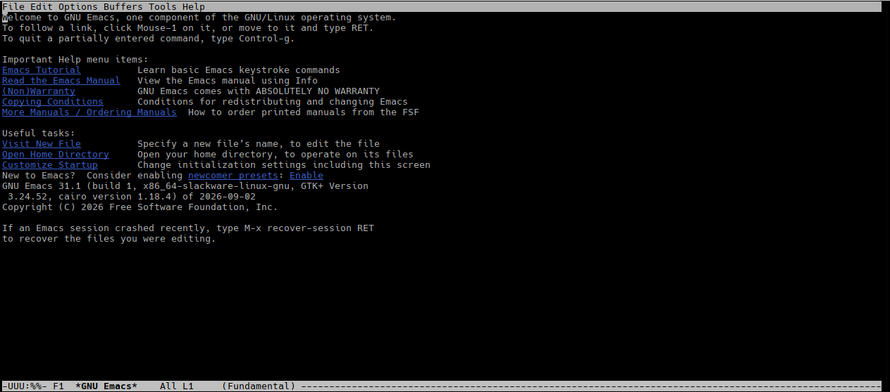

# 13. Emacs

## 13.1 What is Emacs?

`vi` and its clones are functional, fast, and powerful text editors. However, traditional `vi` is not particularly extensible. While `vim` breaks this trend by being both lightweight and highly extensible, many users prefer an editor with even greater customization capabilities and built-in features. This is why many system administrators and programmers prefer **GNU Emacs**.

`Emacs` takes extensibility to the next level. Outside of a minimal core written in C for performance, the vast majority of `Emacs` is written in **Emacs Lisp** (Elisp)—a dialect of the Lisp programming language. Nearly all of `Emacs` is exposed to the user, allowing you to configure, tweak, or completely extend the editor at will.

Over the decades, the community has written an incredible variety of extensions in Emacs Lisp, ranging from syntax highlighting for obscure languages to full web browsers, email clients, and terminal emulators. In fact, `Emacs` even includes a `vi` emulation mode (such as `viper` or `evil-mode`), allowing you to enjoy modal editing while leveraging the underlying power of the `Emacs` environment.

Like `vi`, there are multiple implementations of `Emacs` (collectively referred to as "emacsen"). However, the most widely used variant—and the one included with Slackware Linux—is **GNU Emacs**. When people mention "Emacs", they are almost always referring to GNU Emacs.

Unlike `vi`, `Emacs` operates more like a traditional editor by default. It is modeless, meaning most actions and keyboard shortcuts are performed using modifier keys (such as <kbd>Ctrl</kbd> and <kbd>Alt</kbd>) without needing to switch between Command and Insert modes. You can open a file and immediately begin typing without worrying about which operational mode is active.


## 13.2 Starting Out

`Emacs` can be started simply by running the `emacs` command in your terminal. When launched in a console without any arguments, `Emacs` displays a startup screen containing helpful documentation links and tutorial options.




If you are running the X Window System, `Emacs` may launch its graphical user interface (GUI) by default. If you prefer running it directly inside your terminal console, invoke it with the `-nw` (*no window*) flag:

```bash
darkstar:~$ emacs -nw
```

While on the startup screen, you can navigate using the keyboard arrow keys. Underlined items are links that can be activated by moving the cursor over them and pressing <kbd>Enter</kbd>.

**Understanding Emacs Key Notation**

`Emacs` keyboard shortcuts rely heavily on modifier keys and use a specific shorthand notation throughout manuals and built-in help:

- `C- (Control)`: Hold down the <kbd>Ctrl</kbd> key while pressing the specified key. For example, <kbd>C-h</kbd> means holding <kbd>Ctrl</kbd> and pressing <kbd>h</kbd>.
- `M- (Meta)`: Hold down the <kbd>Meta</kbd> key (mapped to <kbd>Alt</kbd> on modern keyboards) or press <kbd>Esc</kbd> before the key. For example, <kbd>M-x</kbd> means holding <kbd>Alt</kbd> and pressing <kbd>x</kbd>.
- `Sequential Key Combinations`: Sequences such as <kbd>C-x C-c</kbd> mean holding <kbd>Ctrl</kbd> and pressing <kbd>x</kbd>, then holding <kbd>Ctrl</kbd> and pressing <kbd>c</kbd>. Conveniently, <kbd>C-x C-c</kbd> is the command to save modified buffers and exit Emacs.


**Opening, Editing, and Saving Files**

You can also launch `Emacs` directly with a filename as an argument:

```bash
darkstar:~\$ emacs chapter_13.md
```

**Saving Files (C-x C-s)**

To save your changes back to disk, press <kbd>C-x C-s</kbd>.

If you are creating a new file, `Emacs` will prompt you for a filename in the minibuffer—the single text input line located at the very bottom of the screen. Type your desired filename and press <kbd>Enter</kbd>.

If you make a mistake or want to cancel any active minibuffer prompt, press <kbd>C-g</kbd> to abort the current command.

> Note: Tab completion is available in the minibuffer for filenames and command names.


**Managing Files and Buffers (C-x C-f, C-x b, C-x C-b)**

In `Emacs`, open files are held in memory structures called buffers.

- Opening or Creating Files (C-x C-f): Press <kbd>C-x C-f</kbd> (find-file) to open another file within the same Emacs session. Enter the file path in the minibuffer. If the file does not exist, Emacs creates a new buffer for it, which will be written to disk when saved (<kbd>C-x C-s</kbd>).
- Switching Buffers (C-x b): Opening a new file does not close previously opened files. To switch back to an open buffer, press <kbd>C-x b</kbd> (switch-to-buffer), type the buffer name in the minibuffer, and press <kbd>Enter</kbd>.
- Listing All Buffers (C-x C-b): Press <kbd>C-x C-b</kbd> (list-buffers) to open a split window displaying all active buffers.

>>>>>>>>>>Stop here
## 13.3 How to Move Around

Like `vi` , `Emacs` is also older than the arrow keys on your keyboard. Also, like in `vi` , using the arrow keys to navigate files is also supported. While the `vi` movement keys are more ergonomic, `emacs` 's are more "mnemonic". However, it is still very possible to operate using the main `Emacs` keybindings quickly and efficiently. Here is a table of the basic movement keybindings:

| Command | Result |
| --- | --- |
| C-f | Move the cursor one character to the right (forward) |
| C-b | Move the cursor one character to the left (backward) |
| C-n | Move the cursor one line down (next) |
| C-p | Move the cursor one line up (previous) |

Of course, like with `vi` it is also possible to repeat these commands with a numeric argument. If you type in <kbd>M-1 M-0 C-p</kbd> , or <kbd>C-u 10 C-p</kbd> , the cursor will move ten lines up. If you type in <kbd>M-5 C-f</kbd> or <kbd>C-u 5 C-f</kbd> , the cursor will move five characters to the right.

## 13.4 Getting Help

`Emacs` contains a great deal of documentation, to the point that it is often called a "self-documenting" editor. This is because it provides mechanisms for providing users with documentation while you are using it. Here are some useful functions that display documentation (they all start with <kbd>C-h</kbd> ):

| Command | Result |
| --- | --- |
| C-h f FUNCTION-NAME Enter | Show documentation for function FUNCTION-NAME |
| C-h k C-x C-c | Show documentation for the function bound to the keys C-x C-c |
| C-h t | Show the Emacs tutorial |
| C-h ? | Show all help-related functions |

<kbd>C-h t</kbd> is especially useful if you want or need practice using `Emacs` .

## 13.5 Calling Functions

As noted earlier, `Emacs` exports a large number of functions to for interactive use. Some of these, like those opening and saving files, are mapped to keys. Others (like the ones for moving to the beginning and end of lines) are not. To call them, you have to invoke them. Say we want to call the function "end-of-line". We would do this:

<kbd>M-x end-of-line Enter</kbd>

And the cursor would move to the end of the line, as the function name suggests.

## 13.6 Emacs Cheat Sheet

While Emacs can be simple to use, its scope can easily be overwhelming. Below are some useful Emacs commands. Some aspects have been simplified, most notably regarding text selection. These concepts, and more, are described the `Emacs` manual, and various on-line tutorials. Decent summaries can also be gleaned from web searches.

| Command | Result |
| --- | --- |
| C-f | Move the cursor one character to the right (forward) |
| C-b | Move the cursor one character to the left (backward) |
| C-n | Move the cursor one line down (next) |
| C-p | Move the cursor one line up (previous) |
| C-h f FUNCTION-NAME Enter | Show documentation for function FUNCTION-NAME |
| C-h k C-x C-c | Show documentation for the function bound to the keys C-x C-c |
| C-h t | Show the Emacs tutorial |
| C-h ? | Show all help-related functions |
| M-` | Access the Menu Bar |
| C-g | Cancel the current operation. This is most useful when in the minibuffer. |
| M-x FUNCTION-NAME Enter | Call the interactive function FUNCTION-NAME |
| M-1 M-0 C-n | Move the cursor ten lines down |
| C-u 10 C-n | Move the cursor ten lines down (same as above) |
| M-x beginning-of-line | Move the cursor to the beginning of the current line |
| M-x end-of-line | Move the cursor to the end of the current line |
| M-> | Move the cursor to the end of the buffer |
| M-< | Move the cursor to the beginning of the buffer |
| C-k | Remove text from the cursor to the end of the line and place it into the kill ring |
| C-space | Enter selection mode (use normal motion keys to move around). Press C-space again to leave it. |
| C-w | While in selection mode, delete the selected region, and store the result into the kill ring |
| M-w | While in selection mode, store the selected region into the kill ring. |
| C-y | "Yanks" the contents of the kill ring and places them at the cursor's location |
| C-/ | Undo the previous action. Unlike most other editors, this includes previous undo actions. |
| insert | Enable or disable overwriting characters |
| C-s asdf Enter | Forward incremental search for the string "asdf". Repeat C-s as needed to search for future items, or C-r (below) to search backwards. |
| C-r asdf Enter | Backward incremental search for the string "asdf". Repeat C-r as needed to search for future items, or C-s (above) to search forwards. |
| M-% old Enter new Enter | Search for each instance of "old" and prompt you to replace it with "new". You can force replacement of all items by typing "!" at the replacement prompt. |
| C-x C-c | Exit Emacs, prompting you to save each unsaved buffer before doing so |
| C-x C-s | Save the currrent buffer to its file |
| C-x C-w new-file.txt Enter | Save the current buffer to a file "new-file.txt" |
