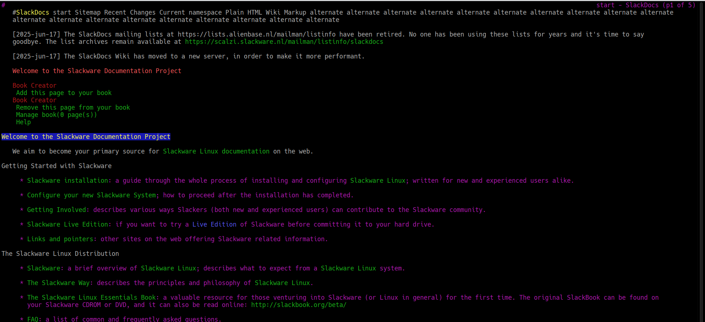
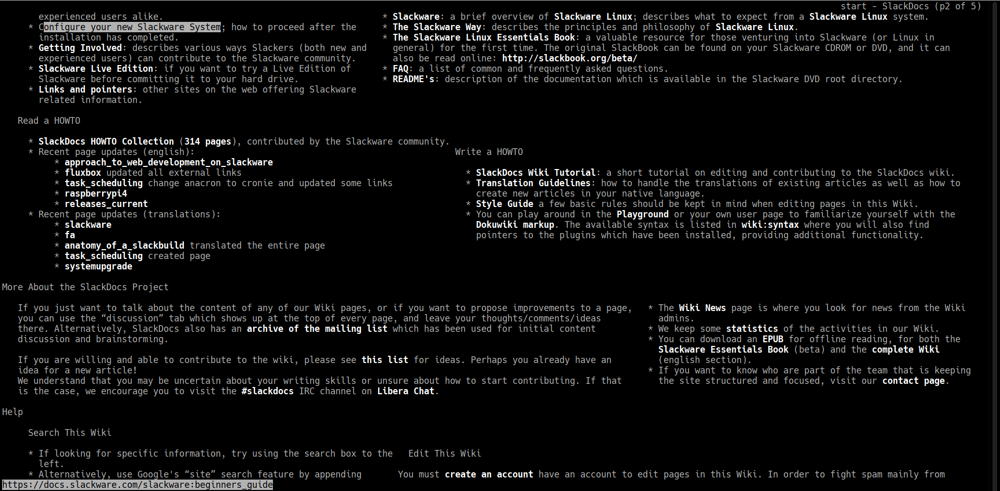

# 16. Basic Command-Line Networking Utilities

So you have finally set up your network connection—now what? How do you verify that it is functioning correctly? How do you confirm that your configuration is accurate, and what tools do you use to diagnose issues or interact with remote hosts? 

This chapter explores the foundational command-line networking utilities included with Slackware Linux, covering network diagnostics, remote administration, console web browsing, and file transfer tools.

## 16.1 Network Diagnostic Tools

Slackware Linux includes a rich selection of networking tools for troubleshooting connectivity, monitoring network traffic, and discovering active hosts. While a few utilities offer graphical interfaces, command-line tools remain the primary choice for remote server administration, quick terminal diagnostics, and shell scripting.

This section explores foundational diagnostic utilities—ranging from basic connectivity checks (`ping`, `traceroute`) to secure administration (`ssh`, `telnet`), packet inspection (`tcpdump`), port scanning (`nmap`), and DNS troubleshooting (`host`, `dig`).


### 16.1.1 `ping` — Testing Network Reachability

The `ping` utility is the fundamental diagnostic tool for verifying whether a host is active and reachable across a local network or the Internet. Conceptually, `ping` acts like sonar for IP networks: it transmits ICMP (Internet Control Message Protocol) **ECHO_REQUEST** packets to a target IP address or hostname and waits for a corresponding **ECHO_REPLY**.


By default on Linux, `ping` continues to send one packet per second until manually interrupted by pressing `<CTRL>-c`. Upon termination, it presents a statistical summary detailing packet loss and Round-Trip Time (RTT) latency. In the example below, `-c 3` is used to send exactly three packets before exiting automatically:

```text
darkstar:~# ping -c 3 www.slackware.com 
PING e9788.dscx.akamaiedge.net (2.19.10.212) 56(84) bytes of data.
64 bytes from a2-19-10-212.deploy.static.akamaitechnologies.com (2.19.10.212): icmp_seq=1 ttl=53 time=4.39 ms
64 bytes from a2-19-10-212.deploy.static.akamaitechnologies.com (2.19.10.212): icmp_seq=2 ttl=53 time=19.2 ms
64 bytes from a2-19-10-212.deploy.static.akamaitechnologies.com (2.19.10.212): icmp_seq=3 ttl=53 time=4.50 ms

--- e9788.dscx.akamaiedge.net ping statistics ---
3 packets transmitted, 3 received, 0% packet loss, time 2002ms
rtt min/avg/max/mdev = 4.387/9.346/19.156/6.936 ms
```


**Understanding the Output Fields**

- **bytes from**: Confirms that a response packet was received and displays its payload size (typically 64 bytes).
- **icmp_seq**: The sequence number of the packet, allowing you to detect dropped packets or out-of-order delivery.
- **ttl (Time to Live)**: The remaining hop count. Each router along the path decrements this value by 1, preventing lost packets from looping endlessly.
- **time**: The total round-trip time (in milliseconds) required for the packet to reach the target and return.
- **rtt min/avg/max/mdev**: Summary statistics calculated at the end of the session, showing minimum, average, maximum latency, and mean deviation.

**Common ping Command Flags**

| Flag | Description | Example|
| ---- | ----------- | ------ |
| -c <count> | Stops after sending a specified number of packets. | ping -c 4 www.slackware.com | 
| -i <seconds> | Adjusts the time interval between packets (default is 1 second). | ping -i 0.5 www.slackware.com | 
| -s <bytes> | Specifies the ICMP packet payload size (default is 56 bytes). | ping -s 1000 www.slackware.com | 
| -W <seconds> | Sets the timeout waiting for a reply for each packet. | ping -W 2 www.slackware.com | 
| -4 / -6 | Forces IPv4 or IPv6 resolution explicitly. | ping -6 www.slackware.com | 


> **Security Note on ICMP Filtering**: While ping is an excellent tool for verifying connectivity, many network firewalls and routers are configured to drop ICMP Echo requests for security or anti-reconnaissance reasons. Consequently, a host may fail to reply to ping even though its HTTP, SSH, or other services are fully operational.


### 16.1.2 `traceroute` — Tracing Network Hops


The `traceroute` utility maps the path (route) that IP packets travel from your local system to a remote destination host. It identifies every intermediate router (hop) along the route while measuring the round-trip latency for each jump.

Conceptually, `traceroute` works by transmitting a sequence of probe packets with incrementally increasing **Time to Live (TTL)** values—starting at `TTL=1`. The first router along the path decrements the TTL to `0`, drops the packet, and sends an ICMP **Time Exceeded** message back to your machine. `traceroute` logs the router's IP address and latency, then increments the TTL to `2`, repeating the process hop-by-hop until the target destination is reached.


```text

darkstar:~# traceroute www.slackware.com
traceroute to www.slackware.com (2.19.10.216), 30 hops max, 60 byte packets
 1  192.168.1.1 (192.168.1.1)  6.792 ms  6.740 ms  6.719 ms
 2  * * *
 3  201-1-230-94.dsl.telesp.net.br (201.1.230.94)  9.902 ms 201-1-230-92.dsl.telesp.net.br (201.1.230.92)  9.880 ms  9.860 ms
 4  179-88-6-72.user.vivozap.com.br (179.88.6.72)  9.842 ms 152-255-169-246.user.vivozap.com.br (152.255.169.246)  9.817 ms 152-255-183-228.user.vivozap.com.br (152.255.183.228)  9.799 ms
 5  187-100-57-102.dsl.telesp.net.br (187.100.57.102)  9.818 ms  9.798 ms  9.776 ms
 6  84.16.7.106 (84.16.7.106)  9.756 ms  5.982 ms  5.909 ms
 7  5.53.0.85 (5.53.0.85)  10.267 ms  14.243 ms  14.178 ms
 8  * * *
 9  * * *
10  * * *
11  a2-19-10-216.deploy.static.akamaitechnologies.com (2.19.10.216)  6.736 ms  6.690 ms  12.074 ms

```

**Understanding the Output Fields**

- **Hop Number (Column 1)**: The sequential distance (number of routers traversed) from your system.
- **Hostname / IP Address (Column 2)**: The domain name (if reverse DNS resolution succeeds) and IP address of the intermediate router interface.
- **RTT Probes (Columns 3–5)**: By default, traceroute sends three probe packets per hop, displaying the latency in milliseconds (ms) for each attempt.


**Common traceroute Command Flags**

| Flag | Description | Example |
| ---- | ----------- | ------- | 
| -n | Disables reverse DNS lookups (displays numerical IP addresses only, speeding up output). | traceroute -n www.slackware.com | 
| -I | Uses ICMP ECHO requests instead of default high-port UDP datagrams. | traceroute -I www.slackware.com | 
| -T | Uses TCP SYN packets (useful for tracing paths through strict firewalls on port 80/443). | traceroute -T -p 80 www.slackware.com | 
| -m <hops> | Sets the maximum hop limit (default is 30 hops). | traceroute -m 15 www.slackware.com | 
| -w <seconds> | Sets the timeout duration waiting for a response (default is 5 seconds). | traceroute -w 2 www.slackware.com | 

> **Handling Asterisks (* * *)**: If a hop displays asterisks (* * *) instead of latency times, it indicates that the intermediate router dropped the probe or was configured to suppress ICMP Time Exceeded responses. This does not necessarily mean a network failure unless all subsequent hops also fail to respond.


### 16.1.3 `telnet` — Testing Raw TCP Connections

Historically, `telnet` was the standard utility for accessing remote UNIX shells over a network. `telnet` establishes an unencrypted text connection between two host computers and hands direct control of the terminal session to the user. However, because `telnet` transmits all data—including usernames and passwords—in cleartext over the network, using it for remote shell administration has been superseded by `ssh`.

Today, `telnet` remains an indispensable network diagnostic tool. Because it creates a raw TCP connection to any arbitrary port, system administrators use it to test socket availability and interact manually with text-based network protocols (such as HTTP, SMTP, or POP3).


**Testing Raw Port Connectivity**

To test whether a remote service is listening on a specific port, specify the target hostname (or IP address) followed by the port number:


```text

darkstar:~$ telnet 127.0.0.1 80
Trying 127.0.0.1...
Connected to 127.0.0.1.
Escape character is '^]'.
get
HTTP/1.1 400 Bad Request
Date: Fri, 20 Nov 2026 20:39:03 GMT
Server: Apache/2.4.71 (Unix)
Content-Length: 266
Connection: close
Content-Type: text/html; charset=iso-8859-1

<!DOCTYPE HTML PUBLIC "-//W3C//DTD HTML 4.01//EN" "http://www.w3.org/TR/html4/strict.dtd">
<html><head>
<title>400 Bad Request</title>
</head><body>
<h1>Bad Request</h1>
<p>Your browser sent a request that this server could not understand.<br />
</p>
</body></html>
Connection closed by foreign host.

```

If the port is open and listening, `telnet` displays `Connected to <hostname>`. Once connected, you can type raw protocol commands directly into the socket (such as sending a `GET / HTTP/1.1` request to a web server).

**Escaping and Closing a Session**

When interacting with a raw TCP socket, the remote server may not close the connection automatically. To manually break out of an active `telnet` session:

1. Press `<CTRL>-]` (Control + Right Bracket) to trigger the escape sequence.
2. At the telnet> prompt, type `quit` (or `close`) and press ENTER:

> **Security Warning**: Never use `telnet` across untrusted or public networks to authenticate or execute remote shell commands. For all secure remote administration, use OpenSSH (`ssh`).


### 16.1.4 `ssh` — Secure Shell Remote Access

While `telnet` serves well as a raw TCP diagnostic tool, its cleartext nature makes it entirely unsuited for remote shell administration. Modern operating systems rely on the Secure Shell protocol via **OpenSSH**, or `ssh`, to provide encrypted, authenticated network communication across untrusted networks.

`ssh` uses strong public-key cryptography to encrypt all traffic—including user credentials, interactive shell sessions, and transferred files—protecting sessions against eavesdropping, connection hijacking, and packet tampering.


**Basic Connection Syntax**

To open a secure terminal session on a remote server, specify the remote username and hostname (or IP address):

```bash
darkstar:~# ssh username@remote.host
username@remote.host\`s password: secret
```

If your local username matches your remote login name, you can omit username@ and simply specify the host: `ssh remote.host`


**First-Time Connection and Host Verification**

When connecting to a host for the first time, `ssh` prompts you to verify and store the server's public host key fingerprint locally in `~/.ssh/known_hosts`:

```text
The authenticity of host 'remote.host (192.168.1.50)' can't be established.
ED25519 key fingerprint is SHA256:x8K9+.../vT4.
Are you sure you want to continue connecting (yes/no/[fingerprint])? yes
Warning: Permanently added 'remote.host' (ED25519) to the list of known hosts.
username@remote.host's password: 
```

Once accepted, `ssh` remembers the host key. On subsequent connections, `ssh` automatically validates the server's identity against `~/.ssh/known_hosts` before prompting for credentials.


**Host Key Mismatches and Man-in-the-Middle (MITM) Protection**

If a remote server's host key changes after your initial connection, `ssh` halts the connection process immediately and displays a prominent security warning:

```text
@@@@@@@@@@@@@@@@@@@@@@@@@@@@@@@@@@@@@@@@@@@@@@@@@@@@@@@@@@@
@    WARNING: REMOTE HOST IDENTIFICATION HAS CHANGED!     @
@@@@@@@@@@@@@@@@@@@@@@@@@@@@@@@@@@@@@@@@@@@@@@@@@@@@@@@@@@@
IT IS POSSIBLE THAT SOMEONE IS DOING SOMETHING NASTY!
Someone could be eavesdropping on you right now (man-in-the-middle attack)!
```

This error usually indicates one of two scenarios:

1. **Security Attack**: An unauthorized third party is intercepting your connection attempt (Man-in-the-Middle attack).
2. **Administrative Change**: The remote server was reinstalled or its SSH host keys were legitimately regenerated.


If the change was planned, you must remove the old host key entry from `~/.ssh/known_hosts` (using `ssh-keygen -R remote.host`) before ssh will allow you to reconnect.


**Common ssh Command Flags**

| Flag | Description | Example | 
| ---- | ----------- | ------- | 
| -p <port> | Specifies a non-standard SSH port (default is port 22). | ssh -p 2222 username@10.0.0.1 |
| -i <identity_file> | Selects a specific private SSH key file for public-key authentication. | ssh -i ~/.ssh/id_ed25519 username@10.0.0.1 |
| -X / -Y | Enables X11 forwarding, allowing remote graphical applications to render locally.  | ssh -X username@remote.slackware.com |
| -v / -vvv | Enables verbose debugging mode, invaluable for troubleshooting connection failures. | 
ssh -v username@10.0.0.1 |
| -L <local>:<host>:<port> | Configures local port forwarding (SSH tunneling). | ssh -L 8080:localhost:80 user@remote.host |


### 16.1.5 `tcpdump` — Network Packet Analyzer

While tools like `ping`, `traceroute`, and `ssh` focus on establishing connections or verifying host reachability, `tcpdump` allows you to inspect the network traffic itself. As a powerful command-line packet analyzer (or packet sniffer), `tcpdump` captures, decodes, and analyzes raw network packets originating from or received by your machine.

Because capturing raw network traffic requires placing network interfaces into promiscuous mode, `tcpdump` must be executed with root privileges (`root`).


**Basic Packet Capture**

By default, running `tcpdump` without arguments captures packets on the first active non-loopback network interface it finds:

```bash
darkstar:~# tcpdump -i wlan0 -c 10
tcpdump: verbose output suppressed, use -v[v]... for full protocol decode
listening on wlan0, link-type EN10MB (Ethernet), snapshot length 262144 bytes
20:40:04.639235 IP Samsung.local.8001 > st-routers.mcast.net.8001: UDP, length 198
20:40:04.663824 IP maria.local.50354 > dns.google.domain: 6404+ PTR? 7.0.0.224.in-addr.arpa. (40)
20:40:04.672803 IP dns.google.domain > maria.local.50354: 6404 1/0/0 PTR st-routers.mcast.net. (74)
20:40:04.673010 IP maria.local.46542 > dns.google.domain: 46187+ PTR? 49.1.168.192.in-addr.arpa. (43)
20:40:04.677160 IP dns.google.domain > maria.local.46542: 46187 NXDomain 0/0/0 (43)
20:40:04.778288 IP maria.local.mdns > mdns.mcast.net.mdns: 0 PTR (QM)? 49.1.168.192.in-addr.arpa. (43)
20:40:05.040189 IP Samsung.local.mdns > mdns.mcast.net.mdns: 0*- [0q] 1/0/2 (Cache flush) PTR Samsung.local. (102)
20:40:05.040664 IP maria.local.54180 > dns.google.domain: 53960+ PTR? 8.8.8.8.in-addr.arpa. (38)
20:40:05.045386 IP dns.google.domain > maria.local.54180: 53960 1/0/0 PTR dns.google. (62)
20:40:05.045501 IP maria.local.50772 > dns.google.domain: 61754+ PTR? 102.1.168.192.in-addr.arpa. (44)
10 packets captured
15 packets received by filter
0 packets dropped by kernel

```

In the example above, `-i eth0` selects the target interface, and `-c 10` limits the capture session to three packets before terminating automatically.


**Understanding Packet Output Fields**

A standard IP packet output line in tcpdump contains several key components:

- **Timestamp (20:40:04.639235)**: Displays local time down to microsecond precision.
- **Protocol (IP / IP6)**: Identifies the network layer protocol.
- **Source & Destination (maria.local.mdns > mdns.mcast.net.mdns)**: Indicates the sending address/port followed by > pointing to the receiving address/port.
- **TCP Flags (Flags [P.])**: Represents TCP control flags (P for Push, . for ACK, S for SYN, F for FIN, R for RST).
- **Sequence & Acknowledgment (seq, ack)**: Tracks TCP payload offsets during data transmission.
- **Payload Size (length 43)**: Specifies the length (in bytes) of the application payload data.


**Common tcpdump Command Flags**

| Flag | Description | Example | 
| ---- | ----------- | ------- |
| -D | Lists all available network interfaces on the machine. | tcpdump -D |
| -i <interface> | Specifies the interface to monitor (use any for all interfaces). | tcpdump -i wlan0 |
| -n | Prevents DNS hostname resolution (shows numerical IP addresses). | tcpdump -n -i eth0 |
| -nn | Prevents host and port name resolution (shows numerical IPs and port numbers). | tcpdump -nn -i eth0 |
| -c <count> | Stops capturing after receiving the specified number of packets. | tcpdump -c 10 |
| -A | Prints packet payloads in readable ASCII text (great for debugging HTTP/plain text). | tcpdump -A -i eth0 port 80 |
| -X | Prints packet payloads in both Hexadecimal and ASCII format. | tcpdump -X -i eth0 |
| -v / -vv | Increases verbosity, displaying TTL, TOS, and IP header options. | tcpdump -v -i eth0 |


### 16.1.6 `nmap` — Network Exploration and Port Scanning

Suppose you need to determine which network services are running across a machine (or several machines), discover active hosts on a subnet, or audit network firewall rules. Manually executing `ping` or `telnet` against every individual IP address and port is tedious and time-consuming. The standard tool for network discovery and security auditing is `nmap` (Network Mapper).

`nmap` is capable of scanning TCP and UDP ports, identifying running services and version numbers, detecting remote operating systems, and performing automated security checks across single targets or large networks.


**Host Discovery (Subnet Scanning)**

To quickly identify active hosts on a network without performing a full port scan, use host discovery mode (`-sn`, historically known as `-sP`). `nmap` accepts target specifications in various formats, including individual hostnames, IP ranges, or CIDR subnet notation:

```bash
darkstar:~# nmap -sn 192.168.1.0/24
Starting Nmap 7.993 ( https://nmap.org ) at 2026-11-20 20:47 -0300
RTTVAR has grown to over 2.3 seconds, decreasing to 2.0
Nmap scan report for GPT-2731GN2A4P.GPT-2731GN2A4P (192.168.1.1)
Host is up (0.019s latency).
MAC Address: C0:3D:D9:73:31:48 (MitraStar Technology)
Nmap scan report for 192.168.1.10
Host is up (0.13s latency).
MAC Address: 26:0C:A9:F2:E2:AD (Unknown)
Nmap scan report for 192.168.1.27
Host is up (0.20s latency).
MAC Address: 18:0B:1B:52:68:F9 (Amazon Technologies)
Nmap scan report for 192.168.1.49
Host is up (0.17s latency).
MAC Address: 70:B1:3D:41:E3:E0 (Samsung Electronics)
Nmap scan report for 192.168.1.83
Host is up (0.015s latency).
MAC Address: E0:D3:62:95:34:46 (TP-Link Systems)
Nmap scan report for 192.168.1.84
Host is up (0.0046s latency).
MAC Address: C2:D5:51:54:E2:F8 (Unknown)
Nmap scan report for 192.168.1.123
Host is up (2.3s latency).
MAC Address: C2:C9:E3:04:7B:9C (Unknown)
Nmap scan report for 192.168.1.201
Host is up (3.2s latency).
MAC Address: C2:C9:E3:04:7B:9C (Unknown)
Nmap scan report for 192.168.1.102
Host is up.
Nmap done: 256 IP addresses (9 hosts up) scanned in 8.24 seconds
```

**Port and Service Inspection**

When inspecting a specific target, `nmap` scans common TCP ports and reports their status along with detected service versions:

```bash
darkstar:~# nmap -sV 192.168.1.1
Starting Nmap 7.993 ( https://nmap.org ) at 2026-11-20 20:48 -0300
Nmap scan report for GPT-2731GN2A4P.GPT-2731GN2A4P (192.168.1.1)
Host is up (0.0067s latency).
Not shown: 993 closed tcp ports (reset)
PORT    STATE    SERVICE VERSION
21/tcp  filtered ftp
22/tcp  open     ssh     Dropbear sshd 2019.78 (protocol 2.0)
23/tcp  filtered telnet
53/tcp  filtered domain
80/tcp  open     http
161/tcp filtered snmp
443/tcp filtered https
1 service unrecognized despite returning data. If you know the service/version, please submit the following fingerprint at https://nmap.org/cgi-bin/submit.cgi?new-service :
SF-Port80-TCP:V=7.993%I=7%D=11/20%Time=6B00DC57%P=x86_64-slackware-linux-g
SF:nu%r(GetRequest,2F1,"HTTP/1\.0\x20200\x20Ok\r\nDate:\x20Fri,\x2020\x20N
SF:ov\x202026\x2020:49:39\x20GMT\r\nContent-Type:\x20text/html;\x20charset
SF:=UTF-8\r\nX-XSS-Protection:\x201\r\nX-Content-Type-Options:\x20'nosniff
SF:'\r\nX-Frame-Options:\x20SAMEORIGIN\r\nContent-Security-Policy:\x20fram
SF:e-ancestors\x20'self';default-src\x20'self';\x20script-src\x20'self'\x2
SF:0'unsafe-inline'\x20'unsafe-eval';style-src\x20'self'\x20'unsafe-inline
SF:'\r\nContent-Length:\x20336\r\nLast-Modified:\x20Thu,\x2011\x20Sep\x202
SF:025\x2002:12:15\x20GMT\r\nConnection:\x20close\r\n\r\n<html>\r\n\t<head
SF:>\r\n\t\t<title>movistar</title>\r\n\t\t<meta\x20http-equiv=\"Content-T
SF:ype\"\x20content=\"text/html;\x20charset=UTF-8\">\r\n\t\t<meta\x20http-
SF:equiv=\"Pragma\"\x20content=\"no-cache\">\r\n\t\t<meta\x20http-equiv=\"
SF:Cache-Control\"\x20CONTENT=\"no-cache\">\r\n\t\t<meta\x20http-equiv=\"r
SF:efresh\"\x20content=\"0;\x20url=cgi-bin/\">\r\n\t\t<meta\x20name=\"robo
SF:ts\"\x20content=\"noindex\">\r\n\t</head>\r\n</html>");
MAC Address: C0:3D:D9:73:31:48 (MitraStar Technology)
Service Info: OS: Linux; CPE: cpe:/o:linux:linux_kernel

Service detection performed. Please report any incorrect results at https://nmap.org/submit/ .
Nmap done: 1 IP address (1 host up) scanned in 22.86 seconds
```

**Understanding Port States**

- **open**: An application is actively accepting incoming TCP connections or UDP packets on this port.
- **closed**: The port is accessible (the system receives packets), but no service is currently listening on it.
- **filtered**: A firewall, filter, or network rule is blocking probes, preventing nmap from determining whether the port is open or closed.


**Common nmap Command Flags**


| Flag | Description | Example | 
| ---- | ----------- | ------- |
|-sn | Performs host discovery only (no port scan; modern replacement for -sP). | nmap -sn 10.0.0.0/24 |
|-sS | Performs a stealthy TCP SYN half-open scan (default when run as root). | nmap -sS 192.168.1.1 |
|-sT | Performs a full TCP connect scan (used when unprivileged). | nmap -sT 192.168.1.1 |
|-sV | Interrogates open ports to determine service and software version details. | nmap -sV 192.168.1.50 |
|-O | Enables remote Operating System detection (fingerprinting). | nmap -O 192.168.1.1 |
|-p <ports> | Restricts the scan to specific ports or port ranges. | nmap -p 22,80,443,8000-8080 10.0.0.1 |
|-A | Enables aggressive mode (combines OS detection, version scanning, and traceroute). | nmap -A 192.168.1.1 |


> **Legal and Ethical Notice**: Scanning external networks or third-party systems without explicit authorization can be flagged as hostile reconnaissance by network administrators or security systems. Always confine unauthorized network testing to your own local hardware or lab environments.


> **Warning**
> Be warned! Some Internet Service Providers frown heavily on port scanning and may take measures to prevent you from doing it. `nmap` and applications like it are best used on your own systems for maintenance and security purposes, not as general purpose Internet scanners.


### 16.1.7 `host` — Quick DNS Lookups

Many network connectivity issues stem from Domain Name System (DNS) resolution failures rather than physical link or routing problems. Because DNS maps human-readable domain names (such as `www.slackware.com`) to numerical IP addresses, verifying name resolution is a critical diagnostic step. The `host(1)` utility provides a simple, high-level interface for querying DNS servers.

When executed with a domain name, `host` queries your system's configured name servers (defined in `/etc/resolv.conf`) to resolve IP addresses, CNAME aliases, and mail exchange records:


```bash
darkstar:~# host slackware.com
slackware.com has address 64.57.102.36
slackware.com mail is handled by 10 mail.cwo.com.
```

**Reverse DNS Lookups (PTR Records)**

host also performs reverse DNS lookups—converting an IP address back into its associated domain name pointer—when given an IP address instead of a domain:

```bash
darkstar:~# host 64.57.102.36
36.102.57.64.in-addr.arpa domain name pointer connie.slackware.com.
```

**Querying Specific Record Types**

By default, host queries common host and mail records. You can query specific resource record types using the -t (type) flag:

- Mail Servers (MX):
```bash
darkstar:~# host -t MX slackware.com
slackware.com mail is handled by 10 mail.cwo.com.
```

- Authoritative Name Servers (NS):
```bash
darkstar:~# host -t NS slackware.com
slackware.com name server NS1.CWO.com.
slackware.com name server NS2.CWO.com.
```


- Text Records (TXT, used for SPF/DKIM verification):
```bash
darkstar:~# host -t TXT slackware.com
slackware.com descriptive text "v=spf1 ip4:64.57.102.36/29 -all"
```

**Common host Command Flags**

| Flag | Description | Example |
| ---- | ----------- | ------- |
| -t <type> | Specifies the DNS record type to query (A, AAAA, MX, NS, TXT, SOA, PTR, ANY). | host -t TXT slackware.com |
| -a  | Verbose mode (displays all records, TTL values, and DNS header metadata; equivalent to host -v -t ANY). | host -a slackware.com |
| -4 / -6 | Forces host to use IPv4 or IPv6 transport for querying name servers. | host -4 slackware.com |
| -W <seconds> | Sets the timeout duration waiting for a reply from the DNS server. | host -W 3 slackware.com |


> **DNS Troubleshooting Tip**: If ping 64.57.102.34 succeeds but ping www.slackware.com fails, your TCP/IP network connection is functioning, but your DNS resolution is failing. Running host www.slackware.com will instantly confirm whether name resolution is working correctly.


### 16.1.8 `dig` — Advanced DNS Querying and Troubleshooting

While `host` offers quick and human-friendly DNS resolution, `dig` (Domain Information Groper) is the definitive command-line utility for in-depth DNS inspection and troubleshooting. `dig` queries name servers directly and displays their raw responses in standard BIND resource record format.

System administrators favor `dig` because it provides precise details about query execution performance, server response flags, authoritative record paths, and exact Time-To-Live (TTL) countdowns.


**Standard Query Structure and Output**

Executing `dig` against a domain name returns several structured response sections:

```text
darkstar:~# dig www.slackware.com

; <<>> DiG 9.20.30 <<>> www.slackware.com
;; global options: +cmd
;; Got answer:
;; ->>HEADER<<- opcode: QUERY, status: NOERROR, id: 3097
;; flags: qr rd ra; QUERY: 1, ANSWER: 4, AUTHORITY: 0, ADDITIONAL: 1

;; OPT PSEUDOSECTION:
; EDNS: version: 0, flags:; udp: 512
;; QUESTION SECTION:
;www.slackware.com.             IN      A

;; ANSWER SECTION:
www.slackware.com.      14400   IN      CNAME   www.slackware.com.edgekey.net.
www.slackware.com.edgekey.net. 600 IN   CNAME   e9788.dscx.akamaiedge.net.
e9788.dscx.akamaiedge.net. 20   IN      A       2.19.10.212
e9788.dscx.akamaiedge.net. 20   IN      A       2.19.10.216

;; Query time: 210 msec
;; SERVER: 8.8.8.8#53(8.8.8.8) (UDP)
;; WHEN: Fri Nov 20 21:02:00 -03 2026
;; MSG SIZE  rcvd: 157

```


**Understanding Key Output Sections**

- **HEADER Section (`status: NOERROR`)**: Displays transaction status (`NOERROR` indicates success; `NXDOMAIN` means the domain does not exist; `SERVFAIL` signals a server error) and control flags (`qr` = query response, rd = recursion desired, ra = recursion available).
- **QUESTION SECTION**: Displays the exact request sent to the DNS server (querying the A record for `www.slackware.com.`).
- **ANSWER SECTION**: Contains the records returned by the name server, along with their remaining TTL (in seconds), record class (`IN` for Internet), type (`CNAME`, `A`), and target values.
- **Footer Metadata**: Displays round-trip query latency (`210 msec`), the specific IP address and port of the name server that answered (`SERVER: 8.8.8.8#53`), and the total response size in bytes.


**Advanced Usage Patterns**

1. **Directing Queries to a Specific Name Server (@server)**

By default, `dig` queries the local resolvers listed in `/etc/resolv.conf`. To test a specific remote or internal DNS server directly, prefix its IP address or hostname with `@`:

```text
darkstar:~# dig @8.8.8.8 slackware.com MX

; <<>> DiG 9.20.30 <<>> @8.8.8.8 slackware.com MX
; (1 server found)
;; global options: +cmd
;; Got answer:
;; ->>HEADER<<- opcode: QUERY, status: NOERROR, id: 58049
;; flags: qr rd ra; QUERY: 1, ANSWER: 1, AUTHORITY: 0, ADDITIONAL: 1

;; OPT PSEUDOSECTION:
; EDNS: version: 0, flags:; udp: 512
;; QUESTION SECTION:
;slackware.com.                 IN      MX

;; ANSWER SECTION:
slackware.com.          3600    IN      MX      10 mail.cwo.com.

;; Query time: 213 msec
;; SERVER: 8.8.8.8#53(8.8.8.8) (UDP)
;; WHEN: Fri Nov 20 21:07:22 -03 2026
;; MSG SIZE  rcvd: 67

```

2. **Concise Output (+short)**

When writing shell scripts or when you only need raw record values without diagnostic headers, append the +short option:

```text
darkstar:~# dig www.slackware.com +short
www.slackware.com.edgekey.net.
e9788.dscx.akamaiedge.net.
2.19.10.212
2.19.10.216
```


3. **Tracing Resolution Delegation (+trace)**

The +trace option instructs dig to perform iterative queries starting from the Internet Root Name Servers down through Top-Level Domain (TLD) servers to the authoritative DNS servers, exposing every link in the resolution chain:

```text
darkstar:~# dig slackware.com +trace

; <<>> DiG 9.20.30 <<>> slackware.com +trace
;; global options: +cmd
.                       87203   IN      NS      f.root-servers.net.
.                       87203   IN      NS      d.root-servers.net.
.                       87203   IN      NS      h.root-servers.net.
.                       87203   IN      NS      k.root-servers.net.
.                       87203   IN      NS      e.root-servers.net.
.                       87203   IN      NS      j.root-servers.net.
.                       87203   IN      NS      m.root-servers.net.
.                       87203   IN      NS      b.root-servers.net.
.                       87203   IN      NS      g.root-servers.net.
.                       87203   IN      NS      l.root-servers.net.
.                       87203   IN      NS      i.root-servers.net.
.                       87203   IN      NS      a.root-servers.net.
.                       87203   IN      NS      c.root-servers.net.
.                       87203   IN      RRSIG   NS 8 0 518400 20261203210000 20261120200000 8763 . wXqvjLA/VsoWyPiq92LlUfhV5ynMB9S+lb4e4oU4fnglhvFiVyUPGLKz sMH9F6OcW/P2muoU5ljpdsPtKxeTE77+/xAwjgkO6YryiJKnnflRluko AgWlWGpA18M618AujCidtSKs3d41iiNGHvojjgsR/bXVVPW/2bK+cuG7 5CNHToJKzDWiGRUv8le8jqvyeBkkQNK2Cd9ZJR2M++Gg++XCVxQ0LQYZ 3JdQBCTVNaFbzQ9QX8zqlKU/b/0Ue4pjfVCvIXX1+QDI3GgoNkDU3PnL ffb7yLMWRwyGbLzE8BsXdY2dLqBSmSH4Vc2MbHp4/3S/IWj/CgwPJdDO WDBCWg==
;; Received 525 bytes from 8.8.8.8#53(8.8.8.8) in 25 ms

;; UDP setup with 2001:503:c27::2:30#53(2001:503:c27::2:30) for slackware.com failed: network unreachable.
;; no servers could be reached
;; UDP setup with 2001:503:c27::2:30#53(2001:503:c27::2:30) for slackware.com failed: network unreachable.
;; no servers could be reached
;; UDP setup with 2001:503:c27::2:30#53(2001:503:c27::2:30) for slackware.com failed: network unreachable.
com.                    172800  IN      NS      a.gtld-servers.net.
com.                    172800  IN      NS      b.gtld-servers.net.
com.                    172800  IN      NS      c.gtld-servers.net.
com.                    172800  IN      NS      d.gtld-servers.net.
com.                    172800  IN      NS      e.gtld-servers.net.
com.                    172800  IN      NS      f.gtld-servers.net.
com.                    172800  IN      NS      g.gtld-servers.net.
com.                    172800  IN      NS      h.gtld-servers.net.
com.                    172800  IN      NS      i.gtld-servers.net.
com.                    172800  IN      NS      j.gtld-servers.net.
com.                    172800  IN      NS      k.gtld-servers.net.
com.                    172800  IN      NS      l.gtld-servers.net.
com.                    172800  IN      NS      m.gtld-servers.net.
com.                    86400   IN      DS      19718 13 2 8ACBB0CD28F41250A80A491389424D341522D946B0DA0C0291F2D3D7 71D7805A
com.                    86400   IN      RRSIG   DS 8 1 86400 20261203210000 20261120200000 8763 . jX10URSJQVYzwtXiGCSQOojof3SMg9wfSkeUJ8PgCC8Q8FHJIFE8gcu4 S5NxSWdlT/PZGjZduIqJe2e2QMmjeZmosJSGkHBFXfGyBwifvFuCNn7O pO67GRw9aowo/s22w4bETdwOdeNhV5TJj/ACO0gxqJ7ASeRX+LDAIrZK S1FE8uiGaLAHgt9wRCd0YZxtEHcUcJZSyNENuiRYRAKXKYXf/ldo3J4n jrpyT3FkaUykx9Sns66CK15jWWuDMhmSBgGNqi83JTFvI9bqp7N1Tk4s Em+xiuG6CaAqDV6CklXXMogeFN0g5eGO8OAeqQDk0fG0QvEnh+ZZa9i4 ZjZ8HQ==
;; Received 1173 bytes from 192.5.5.241#53(f.root-servers.net) in 3 ms

slackware.com.          172800  IN      NS      ns2.cwo.com.
slackware.com.          172800  IN      NS      ns1.cwo.com.
CK0POJMG874LJREF7EFN8430QVIT8BSM.com. 900 IN NSEC3 1 1 0 - CK0Q35HRS4H76G6CHNB9414CJN6S5UPL NS SOA RRSIG DNSKEY NSEC3PARAM
CK0POJMG874LJREF7EFN8430QVIT8BSM.com. 900 IN RRSIG NSEC3 13 2 900 20261126002640 20261118231640 65344 com. B7Yrt+EyOBChfhURhB3ti52cnZS4118tPepxRpCHqD5KvY3rmtKp83Dg zuHkkOJO8wgvKlla0/TjE3Vo4W89gg==
5JAHAIAIN8UU1FLEMNUVVSCIADBP64J2.com. 900 IN NSEC3 1 1 0 - 5JAHUS79T8RDV6TAMN1344L8A7MLO0LM NS DS RRSIG
5JAHAIAIN8UU1FLEMNUVVSCIADBP64J2.com. 900 IN RRSIG NSEC3 13 2 900 20261124024452 20261117013452 65344 com. AbyQhGM/em9HtxJ+jFAuwbCT67Hm3Fkqa0feZtfXqcJrts1VW1ijKro6 /eCxvYuk226A/3rcjP+oGsOt2Xg7vg==
;; Received 471 bytes from 192.54.112.30#53(h.gtld-servers.net) in 190 ms

slackware.com.          14400   IN      A       64.57.102.36
;; Received 58 bytes from 52.70.171.109#53(ns2.cwo.com) in 129 ms
```

4. **Reverse DNS Lookups (-x)**

To resolve an IP address to its hostname pointer using dig, use the -x flag:

```text
darkstar:~# dig -x 64.57.102.34 +short
slackware.com.
```

**Common dig Options and Flags**

| Flag / Option | Description | Example |
| @server | Directs the query to a specific DNS server instead of local system defaults. | dig @1.1.1.1 slackware.com |
| -t <type> | Specifies the record type (A, AAAA, MX, NS, TXT, SOA, ANY). | dig slackware.com -t TXT |
| -x <IP> | Performs a reverse DNS lookup for an IP address. | dig -x 64.57.102.34 |
| +short | Prints only answer values, suppressing headers and metadata. | dig slackware.com +short |
| +trace | Traces the full DNS delegation path starting from root servers. | dig slackware.com +trace |
| +noall +answer | Suppresses all output sections except the ANSWER section. | dig slackware.com +noall +answer |


### 16.1.9 `curl` — HTTP Inspection and Transfer Utility

While `telnet` allows raw TCP connections, modern web diagnosis requires supporting encrypted HTTPS, inspecting HTTP headers, and testing RESTful endpoints. The `curl` (Client URL) utility is the universal command-line tool for transferring data and testing web protocols (including HTTP, HTTPS, FTP, and SFTP).

System administrators frequently use `curl` to verify web server responsiveness, inspect HTTP response codes, trace redirect chains, and validate SSL/TLS certificates without rendering full HTML pages.


**Inspecting HTTP Headers (`-I`)**

To inspect a web server's response headers without downloading the full page body, use the `-I` (head) flag:

```bash
darkstar:~# curl -I https://www.slackware.com
HTTP/2 301 
server: AkamaiGHost
content-length: 0
location: http://www.slackware.com/
date: Sat, 21 Nov 2026 00:17:27 GMT

```

**Following Redirects (-L) and Verbose Debugging (-v)**

- **Following HTTP Redirects (-L)**: If a URL redirects (e.g., HTTP 301 or 302 to HTTPS), curl stops by default. The -L flag instructs curl to follow the location header until reaching the final destination:

```text
darkstar:~# curl -I -L http://slackware.com
HTTP/1.1 301 Moved Permanently
Date: Sat, 21 Nov 2026 00:18:58 GMT
Server: Apache/2.2.22
Location: http://www.slackware.com/
Content-Type: text/html; charset=iso-8859-1

HTTP/1.1 200 OK
Server: Apache/2.2.22
Last-Modified: Thu, 03 Feb 2022 20:54:49 GMT
ETag: "3c6282-1889-5d723584fb840"
Accept-Ranges: bytes
Content-Length: 6281
Content-Type: text/html
Date: Sat, 21 Nov 2026 00:19:17 GMT
Connection: keep-alive

```


- **Verbose Connection Tracing (-v)**: To view the complete TLS handshake, DNS resolution details, and sent/received headers, use verbose mode:

```text
darkstar:~# curl -v https://www.slackware.com
*   Trying [2600:1419:6a00:e::211:2f6c]:443...
* Immediate connect fail for 2600:1419:6a00:e::211:2f6c: A rede está fora de alcance
* connect to 2600:1419:6a00:e::211:2f6c port 443 from :: port 0 failed: A rede está fora de alcance
*   Trying [2600:1419:6a00:e::211:2f67]:443...
* Immediate connect fail for 2600:1419:6a00:e::211:2f67: A rede está fora de alcance
* connect to 2600:1419:6a00:e::211:2f67 port 443 from :: port 0 failed: A rede está fora de alcance
* Host www.slackware.com:443 was resolved.
* IPv6: 2600:1419:6a00:e::211:2f6c, 2600:1419:6a00:e::211:2f67
* IPv4: 2.19.10.216, 2.19.10.212
*   Trying 2.19.10.216:443...
* ALPN: curl offers h2,http/1.1
* TLSv1.3 (OUT), TLS handshake, Client hello (1):
* SSL Trust Anchors:
*   CApath: /etc/ssl/certs
* TLSv1.3 (IN), TLS handshake, Server hello (2):
* TLSv1.3 (IN), TLS change cipher, Change cipher spec (1):
* TLSv1.3 (IN), TLS handshake, Encrypted Extensions (8):
* TLSv1.3 (IN), TLS handshake, Certificate (11):
* TLSv1.3 (IN), TLS handshake, CERT verify (15):
* TLSv1.3 (IN), TLS handshake, Finished (20):
* TLSv1.3 (OUT), TLS change cipher, Change cipher spec (1):
* TLSv1.3 (OUT), TLS handshake, Finished (20):
* SSL connection using TLSv1.3 / TLS_AES_256_GCM_SHA384 / X25519MLKEM768 / RSASSA-PSS
* ALPN: server accepted h2
* Server certificate:
*   subject: CN=slackware.com
*   start date: Oct 14 09:50:15 2026 GMT
*   expire date: Jan 12 09:50:14 2027 GMT
*   issuer: C=US; O=Let's Encrypt; CN=YR2
*   Certificate level 0: Public key type RSA (2048/112 Bits/secBits), signed using sha256WithRSAEncryption
*   Certificate level 1: Public key type RSA (2048/112 Bits/secBits), signed using sha256WithRSAEncryption
*   Certificate level 2: Public key type RSA (4096/152 Bits/secBits), signed using sha256WithRSAEncryption
*   Certificate level 3: Public key type RSA (4096/152 Bits/secBits), signed using sha256WithRSAEncryption
*   subjectAltName: "www.slackware.com" matches cert's "www.slackware.com"
* OpenSSL verify result: 0
* SSL certificate verified via OpenSSL.
* Established connection to www.slackware.com (2.19.10.216 port 443) from 192.168.1.102 port 40516 
* using HTTP/2
* [HTTP/2] [1] OPENED stream for https://www.slackware.com/
* [HTTP/2] [1] [:method: GET]
* [HTTP/2] [1] [:scheme: https]
* [HTTP/2] [1] [:authority: www.slackware.com]
* [HTTP/2] [1] [:path: /]
* [HTTP/2] [1] [user-agent: curl/8.23.0]
* [HTTP/2] [1] [accept: */*]
> GET / HTTP/2
> Host: www.slackware.com
> User-Agent: curl/8.23.0
> Accept: */*
> 
* Request completely sent off
* TLSv1.3 (IN), TLS handshake, Newsession Ticket (4):
* TLSv1.3 (IN), TLS handshake, Newsession Ticket (4):
< HTTP/2 301 
< server: AkamaiGHost
< content-length: 0
< location: http://www.slackware.com/
< date: Sat, 21 Nov 2026 00:19:50 GMT
< 
* Connection #0 to host www.slackware.com:443 left intact

```

**Common curl Diagnostic Flags**

| Flag | Description | Example
| -I | Fetches HTTP response headers only (HEAD request). | curl -I https://slackware.com |
| -L | Follows HTTP Location: redirects automatically. | curl -I -L http://slackware.com |
| -v | Enables verbose output, showing raw request/response headers and TLS data. | curl -v https://slackware.com |
| -k | Bypasses SSL/TLS certificate verification (useful for self-signed cert testing). | curl -k https://192.168.1.1 |
| -o <file> | Saves output to a specified local file instead of stdout. | curl -o page.html https://slackware.com |
| -s | Silent mode (suppresses progress meters and error messages). | curl -s https://slackware.com |


## 16.2 Console Web Browsers

While graphical desktop environments in Slackware include full-featured GUI web browsers like Firefox, accessing the web directly from a terminal or virtual console is often necessary. Whether you are operating on a headless server, troubleshooting web connectivity over a low-bandwidth SSH session, or simply prefer working without a graphical desktop, Slackware includes several powerful text-based web browsers.

Console web browsers parse HTML and render web pages entirely within a text terminal. They are lightweight, extremely fast, and designed for complete keyboard-driven navigation.


### 16.2.1 `lynx` — Text-Based Web Browsing

The venerable `lynx` browser is the oldest and most widely recognized console-based web browser included in Slackware Linux. Designed strictly for text terminals, `lynx` ignores inline images, multimedia, frames, and JavaScript, rendering web content purely as formatted text.

While the lack of modern web technology support limits its use on complex, script-heavy websites, `lynx` offers unmatched speed and efficiency for reading text documentation, viewing online articles, or gathering information across low-bandwidth SSH connections.





**Terminal Keyboard Navigation**

Navigation in `lynx` is intuitive and entirely keyboard-driven:

* **Up / Down Arrows**: Move cursor focus between hyperlinks and form input fields.
* **Right Arrow / Enter**: Follow the selected hyperlink or submit a form.
* **Left Arrow**: Return to the previous page in navigation history.
* **`g` (Go)**: Open a prompt to type a new URL or local file path.
* **`/` (Search)**: Search for a text string within the currently active page.
* **`q` (Quit)**: Exit `lynx` (press `y` upon confirmation).


Scripting and Non-Interactive Extraction (`-dump` and `-source`)

For system administrators, `lynx`'s greatest strength lies in its ability to execute non-interactively inside shell scripts and command pipelines:

**Rendering Formatted Text to Console (`-dump`)**

The `-dump` flag formats a target web page into plain text and prints it directly to `stdout`, allowing you to inspect content or pipe it to tools like `less` or `grep`:

```text
darkstar:~# lynx -dump https://www.slackware.com | head -n 20
                         The Slackware Linux Project

   [1]Slackware Logo
   [2]News

   [3]Security Advisories

   [4]FAQ

   [5]Book

   [6]General Info

   [7]Get Slack

   [8]Install Help

   [9]Configuration

   [10]Packages

```

### 16.2.2 `links` — Enhanced Console Web Browsing

A more feature-rich alternative to `lynx` is `links`, a versatile console web browser that offers significantly improved HTML table rendering, frame support, and optional background color display.

Unlike `lynx`, `links` incorporates an intuitive pull-down menu system. Pressing the `<ESC>` key (or clicking the top row of the terminal window with a mouse when `gpm` is active) reveals a familiar menu bar for managing bookmarks, managing view options, saving pages, and entering URLs.




**Key Features and Terminal Navigation**

* **Advanced Layout Engine:** Formats complex multi-column HTML tables and nested frames with higher fidelity than older text-based engines.
* **Pull-Down Menu System:** Accessible anytime by pressing `<ESC>` to trigger the file, view, and setup menus.
* **Mouse Integration:** Full mouse support inside virtual consoles (via the `gpm` daemon) and graphical terminal windows.
* **Graphical Mode (`links -g`):** When launched with the `-g` flag in an X11 environment or Linux framebuffer, `links` operates as a lightweight graphical web browser capable of rendering inline images (`JPEG`, `PNG`, `GIF`).


**Essential Keyboard Shortcuts**

Navigation in `links` relies primarily on standard directional keys and mnemonic shortcuts:

* **Up / Down Arrows**: Move focus sequentially through links and page elements.
* **Right Arrow / Enter**: Follow the selected link or open a menu item.
* **Left Arrow**: Go back one page in navigation history.
* **`<ESC>`**: Toggle the top menu bar on or off.
* **`g` (Go)**: Open a dialog box to enter a target URL or local file path.
* **`d` (Download)**: Download the target file specified by the selected link.
* **`/` (Search)**: Search for a text string within the current page.
* **`q` (Quit)**: Prompt to exit `links`.


### 16.2.3 `wget` — Non-Interactive Network Downloader

Unlike interactive console web browsers, `wget` is a non-interactive command-line utility designed strictly for retrieving files over network protocols, including HTTP, HTTPS, and FTP. `wget` does not parse or format HTML for display; instead, it saves downloaded resources directly to local disk storage in their exact raw binary or text format.

Because `wget` operates non-interactively, it can run in the background without user intervention, making it ideal for shell scripts, scheduled cron jobs, and large batch file downloads over unstable or low-bandwidth network links.


Basic File Downloading

To retrieve a remote file and save it in the current working directory:

```text
darkstar:~# wget https://mirrors.slackware.com/slackware/slackware64-current/ChangeLog.txt
--2026-11-20 16:29:00--  https://mirrors.slackware.com/slackware/slackware64-current/ChangeLog.txt
Resolving mirrors.slackware.com (mirrors.slackware.com)... 151.101.1.91
Connecting to mirrors.slackware.com (mirrors.slackware.com)|151.101.1.91|:443... connected.
HTTP request sent, awaiting response... 200 OK
Length: 2312174 (2,2M) [text/plain]
Saving to: ‘ChangeLog.txt’

ChangeLog.txt               100%[=============================>]   2,20M   194KB/s    in 13s     

2026-11-20 16:29:00 (177 KB/s) - ‘ChangeLog.txt’ saved [2312174/2312174]
```


**Key Features and Advanced Workflows**

1. **Resuming Partial Downloads (-c)**

If a large file download (such as an ISO image) is interrupted due to a dropped connection, append the -c (continue) flag to resume downloading from where it left off, avoiding the need to restart from the beginning:

```text
darkstar:~# wget -c https://mirrors.slackware.com/slackware/slackware-iso/slackware64-15.0-iso/slackware64-15.0-install-dvd.iso
```


2. **Recursive Mirroring and Website Retrieval (-r / -m)**

wget can follow internal HTML hyperlinks to download entire directory trees or mirror remote sites locally:

* -r: Enables recursive retrieval.
* -l <depth>: Sets the maximum recursion depth (default is 5 levels).
* -np (no-parent): Prevents wget from ascending into parent directories above the specified URL.
* -m (mirror): Enables infinite recursion, timestamp checking, and preserves remote permissions (ideal for site backups).

```text
darkstar:~# wget -r -np -l 2 https://mirrors.slackware.com/slackware/slackware64-current/slackware64/a/
```

3. **Background Downloading (-b)**

To initiate a large download process and return immediately to the shell prompt, use -b. wget detaches into the background and logs progress to wget-log:

```text
darkstar:~# wget -b https://mirrors.slackware.com/slackware/slackware-iso/slackware64-15.0-iso/slackware64-15.0-install-dvd.iso
Continuing in background, pid 32548.
Output will be written to ‘wget-log’.
```

**Common wget Command Flags**

| Flag | Description | Example |
| ---- | ----------- | ------- |
| -c | Resumes an interrupted file download. | wget -c https://.../image.iso |
| -O <file> | Saves the downloaded content under a custom local filename. | wget -O my_changelog.txt https://.../ChangeLog.txt |
| -b | Runs the download process in the background. | wget -b https://.../bigfile.zip |
| -r | Enables recursive downloading of linked subdirectories. | wget -r https://.../docs/ |
| -np | Do not ascend to the parent directory when downloading recursively. | wget -r -np https://.../docs/ |
| -m | Enables mirror mode (shortcut for -r -N -l inf --no-remove-listing). | wget -m ftp://ftp.slackware.com/ |
| --limit-rate=<speed> | Limits bandwidth consumption (e.g., 500k or 2m). | wget --limit-rate=500k https://.../iso |
| -i <file> | Downloads a list of URLs specified line-by-line in a text file. | wget -i download_list.txt |


## 16.3 Console E-Mail Clients

While graphical desktop environments in Slackware offer full GUI mail user agents such as Thunderbird or KMail, text-based console email clients remain immensely popular among Linux system administrators and power users. 

Console email clients allow you to read, compose, and manage messages directly from a virtual terminal or remote SSH session. They are lightweight, blazingly fast, highly scriptable, and driven entirely by keyboard shortcuts. Once you adapt to terminal-based mail management, the speed and deep configurability of these tools often make them preferable to traditional GUI clients.

This section covers two primary console email tools included with Slackware: `mailx`, a lightweight utility ideal for quick command-line messaging and shell scripting, and `mutt`, a feature-rich, highly customizable terminal Mail User Agent (MUA).


### 16.3.1 `alpine` (formerly `pine`) — Menu-Driven Console Mail

`pine(1)` (Program for Internet News and Email) is one of the oldest and most user-friendly command-line email clients in UNIX history. Originally developed by the University of Washington, `pine` carried restrictive trademark and copyright licenses. In 2006, the codebase was re-written under the open-source Apache License, giving birth to `alpine(1)`—the modern, license-compliant successor included with Slackware Linux.

On Slackware systems, you can launch the application by typing either `alpine` or `pine` at the shell prompt.


#### Interface and Keyboard Navigation

Unlike minimal command-line mail utilities, `alpine` features an intuitive, text-based menu interface. The bottom of the screen continuously displays a reference bar showing available keyboard shortcuts for the active context:

```text
  ? HELP       P PREVMSG     - PREVPG    \$ SORT
  O OTHER CMDS N NEXTMSG    Spc NEXTPG   D DELETE
```


Main menu navigation relies on simple single-key commands:

* M (Main Menu): Returns to the primary selection menu.
* I (Folder Index): Displays the list of messages in the current folder.
* L (Folder List): Displays local mail folders and remote IMAP server connections.
* C (Compose): Opens the built-in text editor (pico) to write a new email.
* S (Setup): Opens the configuration menu.
* Q (Quit): Prompts to safely exit alpine.


**Configuring Remote Mail Servers**

By default, `alpine` checks for local system mail delivered to your machine (e.g., /var/spool/mail/username). To receive and send emails using an external mail service, you must configure your network protocols (IMAP/POP3 for receiving and SMTP for sending):

1. Press `S` from the main menu to enter Setup.
2. Press `C` to select Config.
3. Fill in your personal information and server credentials:
    Personal Name: Your full display name (e.g., Bruno Russo).
    User Domain: Your email domain suffix (e.g., YOUR-DOMAIN-NAME.COM).
    SMTP Server (for sending): The address and port of your outbound mail server (e.g., smtp.example.com:587/sub/user=brusso).
    Inbox Path: The remote IMAP or POP3 inbox location (e.g., {imap.example.com:993/ssl/user=brusso}INBOX).

Once configured, press `E` to exit setup and Y to save your changes to your ~/.pinerc configuration file.


### 16.3.2 `mutt` — Powerful Terminal Mail User Agent

For users who demand maximum control, deep customizability, and raw speed, `mutt` is the console mail user agent (MUA) of choice. Unlike `alpine`, `mutt` eschews on-screen help bars and menu systems, utilizing every inch of screen real estate for index lists, message headers, and threaded conversations.

Adhering strictly to the UNIX philosophy—building focused tools that do one task exceptionally well—`mutt` focuses primarily on composing, reading, and sorting email. While modern versions include built-in support for IMAP, POP3, and SMTP, `mutt` is traditionally paired with specialized external utilities for mail retrieval and delivery.


**Key Features and Architecture**

* **Threaded Conversation View:** Automatically groups related messages into visual conversation threads, making high-volume mailing lists easy to track.
* **Extensive Customization (`~/.muttrc`):** Virtually every behavior, color scheme, keybinding, and header format is configured via `~/.muttrc` (documented in `muttrc`).
* **MIME and Crypto Integration:** Built-in handling for multi-part MIME attachments and PGP/GPG encryption and signing.


**Interface and Keyboard Navigation**

Upon launching `mutt`, press **`?`** at any time to open the interactive keybinding reference. Default navigation relies on simple single-key commands:

* **`j` / `k` (or Down/Up Arrows)**: Navigate down or up through the message index.
* **`Enter` / `Space`**: Open and display the selected email.
* **`m` (Mail)**: Compose a new email message using your default text editor (e.g., `vi`).
* **`r` (Reply)**: Reply to the sender of the current message.
* **`d` (Delete)**: Mark the selected message for deletion.
* **`q` (Quit)**: Exit `mutt` (saving index changes and purging deleted messages).


**Common `mutt` Command Flags**

| Flag | Description | Example |
| :--- | :--- | :--- |
| **`-f <mailbox>`** | Opens a specific mailbox folder directly. | `mutt -f ~/Mail/inbox` |
| **`-s <subject>`** | Sets the subject line for non-interactive command-line sending. | `mutt -s "System Log" user@example.com < log.txt` |
| **`-a <file>`** | Attaches a file to an outgoing message. | `mutt -s "Report" -a file.pdf -- user@example.com` |
| **`-H <draft>`** | Specifies a draft file to resume editing and sending. | `mutt -H draft.txt` |


### 16.3.3 `mailx` — Interactive and Scriptable Mail Utility

Dating back to the earliest versions of AT&T UNIX and Berkeley Mail, `mailx` is a classic command-line mail utility. While modern users often prefer feature-rich MUAs like `alpine` or `mutt` for daily interactive communication, `mailx` remains indispensable in the Linux ecosystem due to its simplicity, low footprint, and seamless integration with shell scripts.

`mailx` operates in two distinct modes: an interactive mode for reading local system mail spools and an automated, non-interactive mode for dispatching email notifications from scripts.

**Reading Local System Mail**

When launched without arguments, `mailx` checks your user's system mail spool (typically `/var/spool/mail/<username>`) and presents a list of pending messages:

```text
darkstar:~# mailx
Heirloom mailx version 12.4 7/29/08. Type ? for help.
"/var/spool/mail/root": 2 messages 2 new
>N 1 To root Thu Mar 10 23:33 52/1902 Register with the Linux counter project
>N 2 To root Thu Mar 10 23:35 321/15417 Welcome to Linux (Slackware 15.0)!
?
```


- **Reading Messages**: Type a message number at the `?` prompt and press ENTER. `mailx` displays the email using the system pager (`more`). Press `q` to return to the message list or ENTER to move to the next message.

- **Getting Help**: Type `?` at the prompt to view available internal commands for replying (`r`), deleting (`d`), saving (`s`), or listing headers (`h`).


**Non-Interactive Email Sending in Shell Scripts**

The primary strength of mailx lies in sending automated emails directly from command-line scripts without requiring user interaction.

1. **Sending a File as Message Body**

By combining input redirection (<) with the -s (subject) flag, you can send log files, report documents, or system alerts directly to a recipient:

```text
darkstar:~\$ mailx -s "Daily System Report" bob@example.com < ~/report.txt
```

2. **Piping Command Output**

You can also pipe the standard output (stdout) of any Linux utility directly into mailx:

```text
darkstar:~\$ dmesg | mailx -s "Boot Log Warnings" admin@example.com
```

**Outbound SMTP Delivery and Custom Headers**

By default, `mailx` relies on the local system Mail Transfer Agent (MTA). To send messages directly through a remote SMTP server, use the -S option to define inline server variables:

```text
darkstar:~\$ mailx -n \
  -S smtp="smtp.example.com:587" \
  -S smtp-auth="login" \
  -S smtp-auth-user="user@example.com" \
  -S smtp-auth-password="secretpassword" \
  -S from="Bob Dobbs <bob@example.com>" \
  -s "Automated Alert" \
  admin@example.com < ~/alert.txt
```


## 16.4 FTP Clients

Vast amounts of software archives, system documentation, and OS packages are hosted on File Transfer Protocol (FTP) servers around the world. In fact, Slackware Linux was first publicly offered via FTP in 1993 and continues to be distributed across global mirror networks using FTP, HTTP, and RSYNC today. Mastering command-line file transfer tools is an essential skill for system administrators managing remote servers and repositories.

While traditional unencrypted FTP has largely been supplemented by secure protocols (such as FTPS and SFTP over SSH) for private data transmission, public software archives still rely heavily on anonymous FTP for fast, unauthenticated file distribution.

Slackware includes several command-line FTP clients tailored for different administrative workflows:

* **`ftp`**: The traditional, minimal interactive client available on virtually all UNIX-like operating systems.
* **`ncftp`**: An enhanced interactive client offering tab completion, automatic anonymous login, and recursive file retrieval (`mget`/`mput`).
* **`lftp`**: A highly sophisticated transfer manager supporting directory mirroring (`mirror`), background job queuing, and multi-protocol transfers (FTP, HTTP, HTTPS, SFTP).


### 16.4.1 `ftp` — Standard File Transfer Protocol Client

The simplest FTP client included with Slackware is `ftp(1)`. It provides a straightforward, interactive interface for transferring files between local and remote hosts over the File Transfer Protocol. While standard `ftp` has fallen out of favor with some experienced users due to its lack of advanced automation features, it remains a reliable, ubiquitous tool referenced extensively across online documentation and legacy guides.

When connecting to a public software repository, standard convention is to authenticate using `anonymous` as the username and your email address (or a placeholder) as the password.

---

#### Interactive FTP Session Example

To start an interactive session, pass the target server hostname or IP address to `ftp`:

```text
darkstar:~\$ ftp ftp.osuosl.org
ftp ftp.slackware.com
Trying 140.211.166.134...
Connected to ftp.slackware.com (140.211.166.134).
220-
220----------------------------------------------------------------------------
220-                      R S Y N C . O S U O S L . O R G
220-                          Oregon State University
220-                              Open Source Lab
220-
220-       Unauthorized use is prohibited - violators will be prosecuted
220----------------------------------------------------------------------------
220-
220-                For more information about the OSL visit:
220-                  https://osuosl.org/services/hosting/
220-
220-          This host is the home to the primary archives of several
220-           projects.  We would prefer that only primary/secondary
220-                    mirrors use this service.  Thanks!
220-
220----------------------------------------------------------------------------
220-
220-     Some projects (mariadb, cran, fedora, centos-stream, msys2, ...)
220-     are only available from rsync.osuosl.org. If you see "Unknown
220-     module", use rsync://rsync.osuosl.org/<module> instead.
220-
220----------------------------------------------------------------------------
220-
220 
Name (ftp.slackware.com:root): anonymous
331 Please specify the password.
Password:
230 Login successful.
Remote system type is UNIX.
Using binary mode to transfer files.
ftp> cd pub/slackware/slackware-current/
250 Directory successfully changed.
ftp> passive
Passive mode on.
ftp> get ChangeLog.txt
local: ChangeLog.txt remote: ChangeLog.txt
227 Entering Passive Mode (140,211,166,134,98,134).
150 Opening BINARY mode data connection for ChangeLog.txt (2290578 bytes).
226 Transfer complete.
2290578 bytes received in 1,83 secs (1254,68 Kbytes/sec)
ftp> bye
221 Goodbye.
```


**Key Internal FTP Commands**

Once connected, you operate within the interactive ftp> shell prompt using specific internal commands:

* **ls / dir**: Lists files and subdirectories in the remote working directory.
* **cd <directory>**: Changes the active directory on the remote server.
* **lcd <directory>**: Changes the local working directory on your machine.
* **bin / ascii**: Switches data transfer modes between binary (required for packages, compressed .txz archives, and images) and ASCII (for plain text files).
* **get <file>**: Downloads a single file from the server to your local directory.
* **put <file>**: Uploads a single file from your local system to the server.
* **mget <pattern>**: Downloads multiple files using wildcards (e.g., mget *.txz).
* **passive**: Toggles Passive (PASV) mode on or off, essential for establishing data connections behind local NAT routers or strict firewalls.
* **bye / quit**: Ends the FTP session and exits to your system shell.

### 16.4.2 `ncftp` — Enhanced Interactive FTP Client

`ncftp` (pronounced *nick-F-T-P*) is a feature-rich alternative to standard `ftp`, designed for improved usability. It introduces interactive enhancements such as command-line tab completion, bookmarking, visual progress meters, and automatic anonymous authentication.

Unlike standard `ftp`, `ncftp` automatically logs in as `anonymous` by default without prompting, unless a specific username is provided via the `-u` option. Its primary operational advantage is native support for recursive directory transfers using `mget -R` and `mput -R`.


Interactive Session and Recursive Retrieval Example

```text
darkstar:~# ncftp ftp.osuosl.org
NcFTP 3.3.0 (Apr 23, 2025) by Mike Gleason (http://www.NcFTP.com/contact/).

Copyright (c) 1992-2025 by Mike Gleason.
All rights reserved.

Connecting to 64.50.233.100...                                                                                                                                                               

---------------------------------------------------------------------------
                      R S Y N C . O S U O S L . O R G
                          Oregon State University
                              Open Source Lab

       Unauthorized use is prohibited - violators will be prosecuted
---------------------------------------------------------------------------

                For more information about the OSL visit:
                  https://osuosl.org/services/hosting/

          This host is the home to the primary archives of several
           projects.  We would prefer that only primary/secondary
                    mirrors use this service.  Thanks!

---------------------------------------------------------------------------

     Some projects (mariadb, cran, fedora, centos-stream, msys2, ...)
     are only available from rsync.osuosl.org. If you see "Unknown
     module", use rsync://rsync.osuosl.org/<module> instead.

---------------------------------------------------------------------------


Logging in...                                                                                                                                                                                
Login successful.
Logged in to ftp.osuosl.org.     
ncftp / > cd pub/slackware/slackware-current
Directory successfully changed.
ncftp ...ware/slackware-current > mget -R isolinux
isolinux/README.TXT:                                     2,37 kB   16,66 kB/s  
isolinux/README_SPLIT.TXT:                             767,00 B    5,65 kB/s  
isolinux/efiboot.img:                                    1,41 MB  530,92 kB/s  
isolinux/f2.txt:                                       590,00 B    4,20 kB/s  
isolinux/initrd.img:                                    82,23 MB    1,05 MB/s  
isolinux/iso.sort:                                      50,00 B  359,91 B/s   
isolinux/isolinux.bin:                                  24,00 kB   89,38 kB/s  
isolinux/isolinux.cfg:                                 512,00 B    3,67 kB/s  
isolinux/make-slackware-iso.sh:                          8,91 kB   64,89 kB/s  
isolinux/message.txt:                                  961,00 B    6,45 kB/s  
isolinux/setpkg:                                         2,81 kB   20,95 kB/s  
isolinux/sbootmgr/RAWRITE.EXE:                          35,22 kB  132,35 kB/s  
isolinux/sbootmgr/RAWRITE12.DOC:                         2,09 kB   15,53 kB/s  
isolinux/sbootmgr/RAWRITE12.EXE:                        12,75 kB   94,27 kB/s  
isolinux/sbootmgr/RAWRITENT.DOC:                         6,03 kB   44,86 kB/s  
isolinux/sbootmgr/RAWRITENT.EXE:                        24,00 kB   82,11 kB/s  
isolinux/sbootmgr/README.TXT:                            1,26 kB    9,27 kB/s  
isolinux/sbootmgr/sbootmgr.dsk:                        108,00 kB  201,70 kB/s  
ncftp ...ware/slackware-current > quit
```


### 16.4.3 `lftp` — Advanced File Transfer and Synchronization Utility

`lftp` is a powerful, highly versatile command-line file transfer client. Beyond basic FTP, `lftp` supports multiple network protocols—including HTTP, HTTPS, SFTP, FTPS, and BitTorrent—under the open-source GNU General Public License (GPL).

Its defining feature is the built-in `mirror` command, which automates recursive directory downloading, upload synchronization (`mirror -R`), and bandwidth management. `lftp` also includes robust job control (allowing transfers to be queued in the background), automatic reconnects upon dropped connections, parallel multi-file fetching (`-P`), and tab completion.


Interactive Directory Mirroring Example

```bash
darkstar:~# lftp ftp.osuosl.org
lftp ftp.osuosl.org:~> cd /pub/slackware/slackware-current
cd ok, cwd=/pub/slackware/slackware-current            
lftp ftp.osuosl.org:/pub/slackware/slackware-current> mirror isolinux
Total: 1 directory, 18 files, 1 symlink                               
Modified: 1 file, 0 symlinks
1291 bytes transferred in 2 seconds (796 B/s)
lftp ftp.osuosl.org:/pub/slackware/slackware-current> bye
```

## 16.5 `rsync` — Fast and Versatile Remote File Synchronization

Have you ever needed just a handful of updated files from a large remote directory, but were unsure which files were missing or out of date? Downloading the entire directory again wastes bandwidth and time, while manually checking timestamps across hundreds of files is tedious and prone to error. Likewise, if a multi-gigabyte ISO image download drops near completion, re-downloading the entire image because of a few corrupted bits is inefficient.

The `rsync` (Remote Sync) utility solves these challenges. It is a blazingly fast, highly flexible file-copying tool capable of synchronizing files both locally and across remote network connections.


**How `rsync` Works: The Delta-Transfer Algorithm**

`rsync` achieves its efficiency using a specialized **delta-transfer algorithm**:

1. **Initial Inspection:** `rsync` compares local and remote file lists by checking file sizes and modification timestamps. If a file has not changed in size or timestamp, it is skipped entirely.
2. **Block-Level Checksums:** When a file has been modified, `rsync` breaks the file into smaller chunks and calculates rolling checksums for each block.
3. **Delta Transfer:** Only the specific data blocks that differ between the source and destination are compressed and transmitted across the network.

This intelligent differential sync dramatically reduces network bandwidth and transfer times—making `rsync` the gold standard for automated backups, system mirroring, and Slackware package repository updates.

**Practical Usage Patterns**

> **Important Trailing Slash Trait:**  
> In `rsync`, a trailing slash on the source directory path changes its behavior:
> * `rsync -a /source/dir /destination/` creates `/destination/dir` (copies the directory itself).
> * `rsync -a /source/dir/ /destination/` copies the *contents* of `/source/dir` directly into `/destination/`.


1. **Synchronizing Local Directories**
To archive a local folder while preserving permissions, symlinks, and timestamps:

```bash
darkstar:~# rsync -av /home/user/documents/ /backup/documents/
```

2. **Remote Synchronization over Encrypted SSH (-e ssh)**
By default, modern rsync uses ssh as its secure remote transport protocol:

```bash
darkstar:~# rsync -avz -e ssh /tmp/pkg/ admin@remote.example.com:/var/spool/packages/
```

3. **Mirroring Directories with Deletion (--delete)**
To keep a destination directory as an exact replica of the source—removing local files that no longer exist on the remote server—add the --delete flag:

```bash
darkstar:~# rsync -avz --delete rsync://mirrors.slackware.com/slackware/slackware64-current/ /pub/slackware64-current/
```

4. **Resuming Interrupted Transfers with Progress Bar (-P)**
The -P flag combines --progress (displays real-time speed and ETA) and --partial (retains partially transferred files so interrupted transfers can resume seamlessly):

```bash
darkstar:~# rsync -avP user@remote.example.com:/iso/slackware64-15.0-install-dvd.iso .
```


**Common rsync Command Flags**

| Flag | Description | Example |
| ---- | ----------- | ------- |
| -a (archive) | Recursively syncs and preserves symlinks, permissions, modification times, owner, group, and device files (equivalent to -rlptgoD). | rsync -a src/ dst/ |
| -v (verbose) | Increases output verbosity, listing every transferred file. | rsync -av src/ dst/ |
| -z (compress) | Compresses file data during network transfer to reduce bandwidth usage. | rsync -avz src/ remote:/dst/ |
| -P | Shows transfer progress (--progress) and keeps partial files (--partial). | rsync -avP bigfile.iso remote:/dst/ |
| --delete | Deletes files in the destination directory that no longer exist in the source directory. | rsync -av --delete src/ dst/ |
| -n (--dry-run) | Performs a trial run without making any actual filesystem modifications (essential for testing --delete). | rsync -avn --delete src/ dst/ |
| -c (checksum) | Forces file comparison by MD5/XXH checksum rather than relying on file size and timestamp. | rsync -avc src/ dst/ |
| -u (update) | Skips files that are newer on the receiving end. | rsync -avu src/ dst/ |
| -e <cmd> | Specifies the remote shell command to use for transport (e.g., ssh -p 2222). | rsync -av -e 'ssh -p 2222' src/ user@host:/dst/ |


