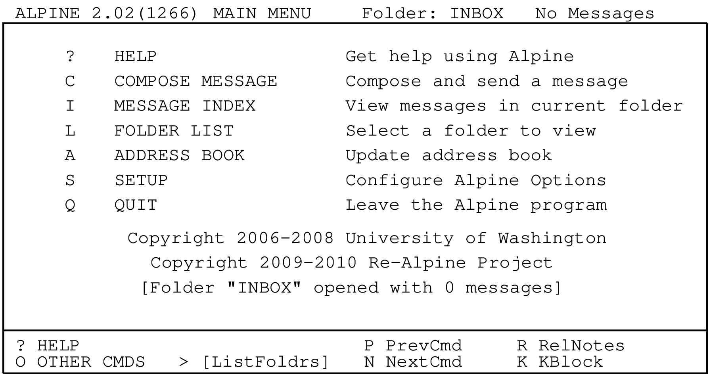
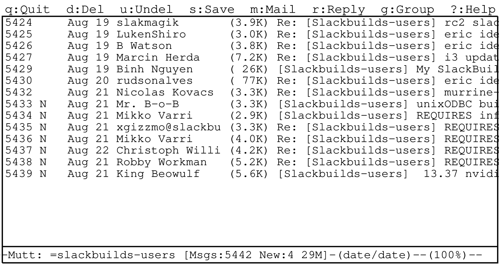

# 16. Basic Command-Line Networking Utilities

So you have finally set up your network connection—now what? How do you verify that it is functioning correctly? How do you confirm that your configuration is accurate, and what tools do you use to diagnose issues or interact with remote hosts? 

This chapter explores the foundational command-line networking utilities included with Slackware Linux, covering network diagnostics, remote administration, console web browsing, and file transfer tools.

## 16.1 Network Diagnostic Tools

Slackware Linux includes a rich selection of networking tools for troubleshooting connectivity, monitoring network traffic, and discovering active hosts. While a few utilities offer graphical interfaces, command-line tools remain the primary choice for remote server administration, quick terminal diagnostics, and shell scripting.

This section explores foundational diagnostic utilities—ranging from basic connectivity checks (`ping`, `traceroute`) to secure administration (`ssh`, `telnet`), packet inspection (`tcpdump`), port scanning (`nmap`), and DNS troubleshooting (`host`, `dig`).


### 16.1.1 `ping` — Testing Network Reachability

The `ping` utility is the fundamental diagnostic tool for verifying whether a host is active and reachable across a local network or the Internet. Conceptually, `ping` acts like sonar for IP networks: it transmits ICMP (Internet Control Message Protocol) **ECHO_REQUEST** packets to a target IP address or hostname and waits for a corresponding **ECHO_REPLY**.


By default on Linux, `ping` continues to send one packet per second until manually interrupted by pressing `<CTRL>-c`. Upon termination, it presents a statistical summary detailing packet loss and Round-Trip Time (RTT) latency. In the example below, `-c 3` is used to send exactly three packets before exiting automatically:

```text
darkstar:~# ping -c 3 www.slackware.com 
PING e9788.dscx.akamaiedge.net (2.19.10.212) 56(84) bytes of data.
64 bytes from a2-19-10-212.deploy.static.akamaitechnologies.com (2.19.10.212): icmp_seq=1 ttl=53 time=4.39 ms
64 bytes from a2-19-10-212.deploy.static.akamaitechnologies.com (2.19.10.212): icmp_seq=2 ttl=53 time=19.2 ms
64 bytes from a2-19-10-212.deploy.static.akamaitechnologies.com (2.19.10.212): icmp_seq=3 ttl=53 time=4.50 ms

--- e9788.dscx.akamaiedge.net ping statistics ---
3 packets transmitted, 3 received, 0% packet loss, time 2002ms
rtt min/avg/max/mdev = 4.387/9.346/19.156/6.936 ms
```


**Understanding the Output Fields**

- **bytes from**: Confirms that a response packet was received and displays its payload size (typically 64 bytes).
- **icmp_seq**: The sequence number of the packet, allowing you to detect dropped packets or out-of-order delivery.
- **ttl (Time to Live)**: The remaining hop count. Each router along the path decrements this value by 1, preventing lost packets from looping endlessly.
- **time**: The total round-trip time (in milliseconds) required for the packet to reach the target and return.
- **rtt min/avg/max/mdev**: Summary statistics calculated at the end of the session, showing minimum, average, maximum latency, and mean deviation.

**Common ping Command Flags**

| Flag | Description | Example|
| ---- | ----------- | ------ |
| -c <count> | Stops after sending a specified number of packets. | ping -c 4 www.slackware.com | 
| -i <seconds> | Adjusts the time interval between packets (default is 1 second). | ping -i 0.5 www.slackware.com | 
| -s <bytes> | Specifies the ICMP packet payload size (default is 56 bytes). | ping -s 1000 www.slackware.com | 
| -W <seconds> | Sets the timeout waiting for a reply for each packet. | ping -W 2 www.slackware.com | 
| -4 / -6 | Forces IPv4 or IPv6 resolution explicitly. | ping -6 www.slackware.com | 


> **Security Note on ICMP Filtering**: While ping is an excellent tool for verifying connectivity, many network firewalls and routers are configured to drop ICMP Echo requests for security or anti-reconnaissance reasons. Consequently, a host may fail to reply to ping even though its HTTP, SSH, or other services are fully operational.


### 16.1.2 `traceroute` — Tracing Network Hops


The `traceroute` utility maps the path (route) that IP packets travel from your local system to a remote destination host. It identifies every intermediate router (hop) along the route while measuring the round-trip latency for each jump.

Conceptually, `traceroute` works by transmitting a sequence of probe packets with incrementally increasing **Time to Live (TTL)** values—starting at `TTL=1`. The first router along the path decrements the TTL to `0`, drops the packet, and sends an ICMP **Time Exceeded** message back to your machine. `traceroute` logs the router's IP address and latency, then increments the TTL to `2`, repeating the process hop-by-hop until the target destination is reached.


```text

darkstar:~# traceroute www.slackware.com
traceroute to www.slackware.com (2.19.10.216), 30 hops max, 60 byte packets
 1  192.168.1.1 (192.168.1.1)  6.792 ms  6.740 ms  6.719 ms
 2  * * *
 3  201-1-230-94.dsl.telesp.net.br (201.1.230.94)  9.902 ms 201-1-230-92.dsl.telesp.net.br (201.1.230.92)  9.880 ms  9.860 ms
 4  179-88-6-72.user.vivozap.com.br (179.88.6.72)  9.842 ms 152-255-169-246.user.vivozap.com.br (152.255.169.246)  9.817 ms 152-255-183-228.user.vivozap.com.br (152.255.183.228)  9.799 ms
 5  187-100-57-102.dsl.telesp.net.br (187.100.57.102)  9.818 ms  9.798 ms  9.776 ms
 6  84.16.7.106 (84.16.7.106)  9.756 ms  5.982 ms  5.909 ms
 7  5.53.0.85 (5.53.0.85)  10.267 ms  14.243 ms  14.178 ms
 8  * * *
 9  * * *
10  * * *
11  a2-19-10-216.deploy.static.akamaitechnologies.com (2.19.10.216)  6.736 ms  6.690 ms  12.074 ms

```

**Understanding the Output Fields**

- **Hop Number (Column 1)**: The sequential distance (number of routers traversed) from your system.
- **Hostname / IP Address (Column 2)**: The domain name (if reverse DNS resolution succeeds) and IP address of the intermediate router interface.
- **RTT Probes (Columns 3–5)**: By default, traceroute sends three probe packets per hop, displaying the latency in milliseconds (ms) for each attempt.


**Common traceroute Command Flags**

| Flag | Description | Example |
| ---- | ----------- | ------- | 
| -n | Disables reverse DNS lookups (displays numerical IP addresses only, speeding up output). | traceroute -n www.slackware.com | 
| -I | Uses ICMP ECHO requests instead of default high-port UDP datagrams. | traceroute -I www.slackware.com | 
| -T | Uses TCP SYN packets (useful for tracing paths through strict firewalls on port 80/443). | traceroute -T -p 80 www.slackware.com | 
| -m <hops> | Sets the maximum hop limit (default is 30 hops). | traceroute -m 15 www.slackware.com | 
| -w <seconds> | Sets the timeout duration waiting for a response (default is 5 seconds). | traceroute -w 2 www.slackware.com | 

> **Handling Asterisks (* * *)**: If a hop displays asterisks (* * *) instead of latency times, it indicates that the intermediate router dropped the probe or was configured to suppress ICMP Time Exceeded responses. This does not necessarily mean a network failure unless all subsequent hops also fail to respond.


### 16.1.3 `telnet` — Testing Raw TCP Connections

Historically, `telnet` was the standard utility for accessing remote UNIX shells over a network. `telnet` establishes an unencrypted text connection between two host computers and hands direct control of the terminal session to the user. However, because `telnet` transmits all data—including usernames and passwords—in cleartext over the network, using it for remote shell administration has been superseded by `ssh`.

Today, `telnet` remains an indispensable network diagnostic tool. Because it creates a raw TCP connection to any arbitrary port, system administrators use it to test socket availability and interact manually with text-based network protocols (such as HTTP, SMTP, or POP3).


**Testing Raw Port Connectivity**

To test whether a remote service is listening on a specific port, specify the target hostname (or IP address) followed by the port number:


```text

darkstar:~$ telnet 127.0.0.1 80
Trying 127.0.0.1...
Connected to 127.0.0.1.
Escape character is '^]'.
get
HTTP/1.1 400 Bad Request
Date: Fri, 20 Nov 2026 20:39:03 GMT
Server: Apache/2.4.71 (Unix)
Content-Length: 266
Connection: close
Content-Type: text/html; charset=iso-8859-1

<!DOCTYPE HTML PUBLIC "-//W3C//DTD HTML 4.01//EN" "http://www.w3.org/TR/html4/strict.dtd">
<html><head>
<title>400 Bad Request</title>
</head><body>
<h1>Bad Request</h1>
<p>Your browser sent a request that this server could not understand.<br />
</p>
</body></html>
Connection closed by foreign host.

```

If the port is open and listening, `telnet` displays `Connected to <hostname>`. Once connected, you can type raw protocol commands directly into the socket (such as sending a `GET / HTTP/1.1` request to a web server).

**Escaping and Closing a Session**

When interacting with a raw TCP socket, the remote server may not close the connection automatically. To manually break out of an active `telnet` session:

1. Press `<CTRL>-]` (Control + Right Bracket) to trigger the escape sequence.
2. At the telnet> prompt, type `quit` (or `close`) and press ENTER:

> **Security Warning**: Never use `telnet` across untrusted or public networks to authenticate or execute remote shell commands. For all secure remote administration, use OpenSSH (`ssh`).


### 16.1.4 `ssh` — Secure Shell Remote Access

While `telnet` serves well as a raw TCP diagnostic tool, its cleartext nature makes it entirely unsuited for remote shell administration. Modern operating systems rely on the Secure Shell protocol via **OpenSSH**, or `ssh`, to provide encrypted, authenticated network communication across untrusted networks.

`ssh` uses strong public-key cryptography to encrypt all traffic—including user credentials, interactive shell sessions, and transferred files—protecting sessions against eavesdropping, connection hijacking, and packet tampering.


**Basic Connection Syntax**

To open a secure terminal session on a remote server, specify the remote username and hostname (or IP address):

```bash
darkstar:~# ssh username@remote.host
username@remote.host\`s password: secret
```

If your local username matches your remote login name, you can omit username@ and simply specify the host: `ssh remote.host`


**First-Time Connection and Host Verification**

When connecting to a host for the first time, `ssh` prompts you to verify and store the server's public host key fingerprint locally in `~/.ssh/known_hosts`:

```text
The authenticity of host 'remote.host (192.168.1.50)' can't be established.
ED25519 key fingerprint is SHA256:x8K9+.../vT4.
Are you sure you want to continue connecting (yes/no/[fingerprint])? yes
Warning: Permanently added 'remote.host' (ED25519) to the list of known hosts.
username@remote.host's password: 
```

Once accepted, `ssh` remembers the host key. On subsequent connections, `ssh` automatically validates the server's identity against `~/.ssh/known_hosts` before prompting for credentials.


**Host Key Mismatches and Man-in-the-Middle (MITM) Protection**

If a remote server's host key changes after your initial connection, `ssh` halts the connection process immediately and displays a prominent security warning:

```text
@@@@@@@@@@@@@@@@@@@@@@@@@@@@@@@@@@@@@@@@@@@@@@@@@@@@@@@@@@@
@    WARNING: REMOTE HOST IDENTIFICATION HAS CHANGED!     @
@@@@@@@@@@@@@@@@@@@@@@@@@@@@@@@@@@@@@@@@@@@@@@@@@@@@@@@@@@@
IT IS POSSIBLE THAT SOMEONE IS DOING SOMETHING NASTY!
Someone could be eavesdropping on you right now (man-in-the-middle attack)!
```

This error usually indicates one of two scenarios:

1. **Security Attack**: An unauthorized third party is intercepting your connection attempt (Man-in-the-Middle attack).
2. **Administrative Change**: The remote server was reinstalled or its SSH host keys were legitimately regenerated.


If the change was planned, you must remove the old host key entry from `~/.ssh/known_hosts` (using `ssh-keygen -R remote.host`) before ssh will allow you to reconnect.


**Common ssh Command Flags**

| Flag | Description | Example | 
| ---- | ----------- | ------- | 
| -p <port> | Specifies a non-standard SSH port (default is port 22). | ssh -p 2222 username@10.0.0.1 |
| -i <identity_file> | Selects a specific private SSH key file for public-key authentication. | ssh -i ~/.ssh/id_ed25519 username@10.0.0.1 |
| -X / -Y | Enables X11 forwarding, allowing remote graphical applications to render locally.  | ssh -X username@remote.slackware.com |
| -v / -vvv | Enables verbose debugging mode, invaluable for troubleshooting connection failures. | 
ssh -v username@10.0.0.1 |
| -L <local>:<host>:<port> | Configures local port forwarding (SSH tunneling). | ssh -L 8080:localhost:80 user@remote.host |


>>>>> STOP HERE
>>>>> STOP HERE
>>>>> STOP HERE

### 16.1.5 tcpdump

So far all the tools we've looked at have focused on making connections to other computers, but now we're going to look at the traffic itself. `tcpdump` (1) (which must be run as root) allows us to view all or part of the network traffic originating or received by our computer. `tcpdump` displays the raw data packets in a variety of ways with all the network headers intact. Don't be alarmed if you don't understand everything it displays, `tcpdump` is a tool for professional network engineers and system administrators. By default, it probes the first network card it finds, but if you have multiple interfaces, simply use the `-i` argument to specify which one you're interested in. You can also limit the data displayed using expressions and change the manner in which it is displayed, but that is best explained by the man page and other reference material.

```text

darkstar:~# tcpdump -i wlan0
tcpdump: verbose output suppressed, use -v or -vv for full protocol
decode
listening on wlan0, link-type EN10MB (Ethernet), capture size 96 bytes
13:22:28.221985 IP gw.ctsmacon.com.microsoft-ds > 192.168.1.198.59387:
Flags [P.], ack 838190560, win 3079, options [nop,nop,TS val 1382697489
ecr 339048583], length 164WARNING: Short packet. Try increasing the
snap length by 140
SMB PACKET: SMBtrans2 (REPLY)

13:22:28.222392 IP 192.168.1.198.59387 > gw.ctsmacon.com.microsoft-ds:
Flags [P.], ack 164, win 775, options [nop,nop,TS val 339048667 ecr
1382697489], length 134WARNING: Short packet. Try increasing the snap
length by 110
SMB PACKET: SMBtrans2 (REQUEST)

```

### 16.1.6 nmap

Suppose you need to know what network services are running on a machine, or multiple machines, or you wish to determine if multiple machines are responsive? You could `ping` each one individually, `telnet` to each port you're interested in, and note every detail, but that's very tedious and time consuming. A much easier alternative is to use a port scanner, and `nmap` (1) is just the tool for the job.

`nmap` is capable of scanning TCP and UDP ports, determining the operating system of a network device, probing each located service to determine its specific type, and much much more. Perhaps the simplist way to use `nmap` is to "ping" multiple computers at once. You can use network address notation (CIDR) or specify a range of addresses and `nmap` will scan every one and return the results to you when it's finished. You can even specify host names as you like.

In order to "ping" hosts, you'll have to use the `-sP` argument. The following command instructs `nmap` to "ping" www.slackware.com and the 16 IP addresses starting at 72.168.24.0 and ending at 72.168.24.15.

```text

darkstar:~# nmap -sP www.slackware.com 72.168.24.0/28

```

Should you need to perform a port scan, `nmap` has many options for doing just that. When run without any arguments, `nmap` performs a standard TCP port scan on all hosts specified. There are also options to make `nmap` more or less aggressive with its scanning to return results quicker or fool intrusion detection services. For a full discussion, you should refer to the rather exhaustive man page. The following three commands perform a regular port scan, a SYN scan, and a "Christmas tree" scan.

```text

darkstar:~# nmap www.example.com 
darkstar:~# nmap -sS www.example.com 
darkstar:~# nmap -sX www.example.com

```

**Warning**
Be warned! Some Internet Service Providers frown heavily on port scanning and may take measures to prevent you from doing it. `nmap` and applications like it are best used on your own systems for maintenance and security purposes, not as general purpose Internet scanners.

### 16.1.7 host

Often network problems stem from a failure of DNS (Domain Name Service) which maps domain names to IP addresses. An easy way to perform quick DNS lookups is the `host` (1) command. When this is run, your computer will perform a few common DNS lookups and return the results.

```text

darkstar:~# host www.slackware.com 
www.slackware.com is an alias for slackware.com. 
slackware.com has address 64.57.102.34 
slackware.com mail is handled by 1 mail-mx.cwo.com.

```

### 16.1.8 dig

More complex DNS lookups can be manually performed with the `dig` (1) tool. `dig` is "the meanest dog in the pound" when it comes to troubleshooting DNS issues. With this tool, you can perform virtually any DNS lookup from reverse lookups to A, CNAME, MX, SP, TXT records and more. There are far too many command-line options and lookup types to go into depth here, but the man page lists all the common use cases.

```text

darkstar:~# dig @207.69.188.185 www.slackware.com a

; <<>> DiG 9.4.3-P4 <<>> @207.69.188.185 www.slackware.com a
; (1 server found)
;; global options:  printcmd
;; Got answer:
;; ->>HEADER<<- opcode: QUERY, status: NOERROR, id: 57965
;; flags: qr rd ra; QUERY: 1, ANSWER: 2, AUTHORITY: 2, ADDITIONAL: 0

;; QUESTION SECTION:
;www.slackware.com.		IN	A

;; ANSWER SECTION:
www.slackware.com.	86400	IN	CNAME	slackware.com.
slackware.com.		86400	IN	A	64.57.102.34

;; AUTHORITY SECTION:
slackware.com.		86400	IN	NS	ns2.cwo.com.
slackware.com.		86400	IN	NS	ns1.cwo.com.

;; Query time: 348 msec
;; SERVER: 207.69.188.185#53(207.69.188.185)
;; WHEN: Sat Jul  3 16:25:10 2010
;; MSG SIZE  rcvd: 105

```

Let's take a took at the command-line options used above. The `@207.69.188.185` argument tells `dig` what DNS server to query. If it is not specified, `dig` will simply use whatever servers are listed in `/etc/resolv.conf` . The `a` argument at the end is the type of DNS record to lookup. In this case we looked for an "A" record which returned an IPv4 address.

### 16.1.9 finger  <<<<<<<<<<<<<<<<----- REMOVE???

`finger` (1) isn't exactly a network diagnostic tool as much as it is a network-user diagnostic tool. Using `finger` , you can gather a handful of useful information about users on servers running the `fingerd` (8) daemon. Today very few servers still offer `fingerd` , but for those that do it can be a useful tool for keeping track of your friends and co-workers.

```text

darkstar:~# finger alan@cardinal.lizella.net
[cardinal.lizella.net]
Login: alan           			Name: Alan Hicks
Directory: /home/alan               	Shell: /bin/bash
Office: 478 808 9919, 478 935 8133
On since Wed Apr 13 17:43 (UTC) on pts/9 from
75-150-12-113-atlanta.hfc.comcastbusiness.net
    32 minutes 24 seconds idle
     (messages off)
On since Wed Apr 13 17:45 (UTC) on pts/10 from :pts/9:S.0
   48 minutes 56 seconds idle
Mail forwarded to alan@lizella.net
No mail.
No Plan.

```


### 16.1.10 curl


## 16.2 Web Browsers

Slackware includes a variety of web browsers. If you're using a graphical desktop, you'll find `Firefox` , `Seamonkey` , and others you may already be familiar with, but what about console access? Fortunately, there are a number of capable web browsers here as well.

### 16.2.1 lynx

The oldest console-based web browser included with Slackware is definitely `lynx` (1), a very capable if somewhat limited web browser. `lynx` does not support frames, javascript, or pictures; it is strictly a text web browser. Navigation is performed using your keyboard's arrow keys and optionally, a mouse. While it lacks many features that other browsers support, `lynx` is one of the fastest web browsers you'll ever use for gathering information. For example, the `-dump` argument sends the formatted web page directly to the console, which can then be piped to other programs.


### 16.2.2 links

A more feature-rich alternative is the popular `links` (1), a console-based web browser that supports frames and has better table rendering than `lynx` . Like its predecessor, `links` is navigable with the arrow keys, and the use of a mouse is supported. Unlike `lynx` , it also includes a handy menu (simply click on the top line with your mouse to activate) and generally formats web pages better.


### 16.2.3 wget

Unlike the other browsers we've looked at, `wget` (1) is non-interactive. Rather than display HTTP content, `wget` downloads it. This takes the "browsing" out of the web browser. Unlike the dump modes of other browsers, `wget` does not format its downloads; rather it copies the content in its exact form on the web server with all tags and binary data in place. It also supports several recursive options that can effectively mirror online content to your local computer. `wget` need not operate exclusively on HTTP content; it also supports FTP and several other protocols.

```text

darkstar:~# wget ftp://ftp.osuosl.org/pub/slackware/slackware-current/ChangeLog.txt
--2010-05-01 13:51:19--
ftp://ftp.osuosl.org/pub/slackware/slackware-current/ChangeLog.txt
           => `ChangeLog.txt'
Resolving ftp.osuosl.org... 64.50.236.52
Connecting to ftp.osuosl.org|64.50.236.52|:21... connected.
Logging in as anonymous ... Logged in!
==> SYST ... done.    ==> PWD ... done.
==> TYPE I ... done.  ==> CWD /pub/slackware/slackware-current ...  done.
==> SIZE ChangeLog.txt ... 75306
==> PASV ... done.    ==> RETR ChangeLog.txt ... done.
Length: 75306 (74K)

100%[======================================>] 75,306       110K/s   in 0.7s    

2010-05-01 13:51:22 (110 KB/s) - `ChangeLog.txt' saved [75306]


```

## 16.3 Mail Clients

Slackware also includes a variety of email clients. If you're using a graphical desktop, you'll find `Thunderbird` , `Kmail` , `sylpheed` and others. As with web browsers, there are also applications that function within the shell. Once you start using an email client in the console, you may find yourself not wanting to use anything else; the flexibility and configurability can be addicting.

### 16.3.1 pine

`pine` is one of the oldest command-line interface mail clients still in existance and remains one of the most user-friendly. `pine` was created by the University of Washington and carries with it both a trademark and a copyright license that are difficult to work with. Thankfully back in 2005, the university saw fit to re-write it without the trademark and with a more open license, so `alpine` (1), the pine-clone distributed with Slackware, was born.

To start using `alpine` , simply type `pine` at the command line. Using it is very simple due to its menu-driven system as well as the command reference neatly located at the bottom of the screen. See for yourself:



Before configuring any mail client, you should check the documentation of your mail server to gather all of the pertinent information about what protocols and security measures your mail service uses. This will help you configure `pine` correctly. By default, `pine` will check for new e-mails delivered to a mail service running on your computer. Unless you're actually running such a mail service (many people do) this probably isn't what you want. Fortunately configuring `pine` is a straight forward process. Simply enter the [S]etup menu and chose the [C]onfig option. You'll be given an option to enter you name, mail path, SMTP server, and many other options.

### 16.3.2 mutt

Some people don't like `pine` . Some people want more control. Some people want a fully-configurable mail client with plugin support and a no-nonsense attitude. Those people use `mutt` (1). `mutt` isn't as user friendly as `pine` , but makes up for it with power. You won't find the user-friendly command reference at the bottom of the screen, `mutt` uses every last inch of real-estate for mail processing duty. It's feature support is extensive - threaded displays are no problem for the mighty mixed-breed! You can configure `mutt` with a `.muttrc` file in your home directory. With all the many different possible configuration options, there's even a man page for that, muttrc(5). You might want to read up on it.



Using `mutt` is unique because it is by nature a Mail User Agent (MUA), meaning its true purpose is to read and sort email. This was its only job originally, although some additional features such as retrieving mail via POP3 and even very basic transfering messages via SMTP have snuck into the application.

As is so often the case with robust console-based applications, the configuration options are myriad, and there is no "right" or "wrong" way of using `mutt` as long as it does what you want it to do. One thing to keep in mind if you are considering using `mutt` for mail handling is that its mail sending and receiving abilities are very limited. `mutt` focuses solely on sorting, reading, and composing mail messages in addition to other traditional Mail User Agent duties. This is keeping in focus with the UNIX philosophy of small tools that do one thing very well and which can be combined (or "chained") with other tools to complete whatever tasks are required. With this in mind, you'll likely need to setup some external tool to receiving mail at a minimum.

The commands used to navigate around in `mutt` are highly customizable but the defaults can be listed by typing <kbd>?</kbd> .

### 16.3.3 mailx

So those are great and everything, but what if you just want a mail client that isn't menu-driven? Thankfully `mailx` is here to save you.

`mailx` is based on the Berkeley Mail application, with a `mail` command appearing as early as Version 1 of AT&T's UNIX. It can be used either interactively or non-interactively.

`mailx` reads mail from your computer's mail spool and displays the usual combination of sender, subject, status, and size in a list, leaving the user at an interactive prompt. In fact, it might look familiar to you if you bothered checking your mail immediately after installing Slackware and read Pat Volkerding's greeting.

```text

darkstar:~# mailx 
Heirloom mailx version 12.4 7/29/08. Type ? for help. 
"/var/spool/mail/root": 2 messages 2 new 
>N 1 To root Thu Mar 10 23:33 52/1902 Register with the Linux counter project 
>N 2 To root Thu Mar 10 23:35 321/15417 Welcome to Linux (Slackware 14.0)! 
?;

```

To read a message, enter the number of the message at the prompt. This displays the message using `more` , so use the <kbd>RETURN</kbd> key to view the next page. Once the end of the message has been reached, press <kbd>q</kbd> to return to the list view, or <kbd>RETURN</kbd> to continue to the next message.

To see a list of available commands, enter <kbd>?</kbd> at the `mail` prompt; using the commands provided, you can view the headers of mail in the spool, reply, delete, save, and many other common email tasks.

`mailx` is most powerful when used in scripting. For all of the options available for `mailx` , view its man page. A simple way to send an email to someone requires only the command itself and the destination address.

```text

darkstar:~$ mailx bob@example.com

```

After the command has been issued, an interactive prompt appears for a subject line, the message body, and the end character (a single period on an otherwise empty line).

`mailx` can be used entirely without human intervention, however. Generally, it's safe to assume that any attribute you can define in the interactive shell for `mailx` can also be defined while scripting it or using it as one non-interactive command.

```text

darkstar:~$ mailx -n -s "Test message" bob@example.com < ~/message.txt

```

In this example, the contents of the file `message.txt` would be sent as the message body to the specified recipient. No interaction from the user is required.

Within one's own computer (localhost) or one's own network, sending email in this manner is entirely possible. But over the internet a few more steps are usually required along the way. Of course, most notably there is usually an smtp server handling the delivery of your email. This, too, can be specified as part of your `mail` command:

```text

darkstar:~$ env MAILRC=/dev/null 
from="bob@example.com (Bob Dobbs)" 
smtp=relay.example.com mail -n -s "Test message" connie@example.com < ~/message.txt

```

In this case, the MAILRC variable is set to /dev/null in order to override any system defaults, and the smtp server as well as the `FROM:` line are defined. The rest of the command is the same as using `mailx` internally within one's own computer or network.

Over all, `mailx` is usually viewed as a mail client with the bare-minimum features; this is largely true, but when you need to be able to script sending notification emails or important update messages, it quickly becomes a lot more valuable than a fully interactive application like `pine` or `mutt` .

## 16.4 FTP Clients

Lots of data is stored on FTP servers the world over. In fact, Slackware Linux was first publically offered via FTP and continues to be distributed in this fashion today. Most open source software can be downloaded in source code or binary form via FTP, so knowing how to retrieve this information is a handy skill.

### 16.4.1 ftp

The simplest FTP client included with Slackware is named simply, `ftp` (1) and is a reliable if somewhat simple means of sending and retrieving data. `ftp` connects to an FTP server, asks for your username and password, and then allows you to put or get data to and from that server. `ftp` has fallen out of favor with more experienced users do to a lack of features, but remains a handy tool, and much of the documentation you see online will refer you to it.

Once an FTP session has been initialized, you'll be placed at a prompt somewhat like a shell. From here you can change and list directories using the "cd" and "ls" commands, just like a shell. Additionally, you may issue the "put" command to send a file to the server, or a "get" command to retrieve data from the server. If you're connecting to a public FTP server, you'll want to use the "anonymous" username and simply enter your e-mail address (or a fake one) for the password.

```text

darkstar:~$ ftp ftp.osuosl.org
Name (ftp.osuosl.org:alan): anonymous
331 Please specify the password.
Password: secret
230 Login successful.
Remote system type is UNIX.
Using binary mode to transfer files.
ftp> cd pub/slackware/slackware-current/
250 Directory successfully changed.
ftp> get ChangeLog.txt
local: ChangeLog.txt remote: ChangeLog.txt
200 PORT command successful. Consider using PASV.
150 Opening BINARY mode data connection for ChangeLog.txt (33967
bytes).
226 File send OK.
33967 bytes received in 0.351 secs (94 Kbytes/sec)
ftp> bye
221 Goodbye.

```

### 16.4.2 ncftp

`ncftp` (1) (pronounced nick-f-t-p), is a more feature rich successor to `ftp` , supporting tab completion and recursive retrieval. It automatically connects to a server as the anonymous user, unless you specify a different username on the commandline with the `-u` argument. The primary advantage over `ftp` is the ability to send and retrieve multiple files at once with the "mput" and "mget" commands. If you pass the `-R` argument to either of them, they will recursively put or get data from directories.

```text

darkstar:~# ncftp ftp.osuosl.org
Logging in...                                                                   
Login successful.
Logged in to ftp.osuosl.org.                                                    
ncftp / > cd pub/slackware/slackware-current
Directory successfully changed.
ncftp ...ware/slackware-current > mget -R isolinux
isolinux/README.TXT:                                     4.63 kB 16.77 kB/s  
isolinux/README_SPLIT.TXT:                             788.00 B    5.43 kB/s  
isolinux/f2.txt:                                       793.00 B    5.68 kB/s  
isolinux/initrd.img:                                    13.75 MB 837.91 kB/s  
isolinux/iso.sort:                                      50.00 B  354.50 B/s   
isolinux/isolinux.bin:                                  14.00 kB 33.99 kB/s  
isolinux/isolinux.cfg:                                 487.00 B    3.30 kB/s  
isolinux/message.txt:                                  760.00 B    5.32 kB/s  
isolinux/setpkg:                        

```

### 16.4.3 lftp

The last client we're going to look at is `lftp` (1). Like `ncftp` , it supports tab completion and recursive activity, but has a more friendly license. Rather than user "mget" and "mput", all recursive operations are handled with the "mirror" command. "mirror" has many different options available, so I'll have to refer you to the man page and the built-in "help" command for complete details.

```text

darkstar:~# lftp ftp.osuosl.org
lftp ftp.osuosl.org:~> cd /pub/slackware/slackware-current
cd ok, cwd=/pub/slackware/slackware-current            
lftp ftp.osuosl.org:/pub/slackware/slackware-current> mirror isolinux
Total: 2 directories, 16 files, 1 symlink                                      
New: 16 files, 1 symlink
14636789 bytes transferred in 20 seconds (703.7K/s)
lftp ftp.osuosl.org:/pub/slackware/slackware-current> bye

```

## 16.5 rsync

Ready to see something cool? Have you ever found yourself needing just a handful of files from a large directory, but you're not entirely sure which files you already have and which ones you need? You can download the entire directory again, but that's duplicating a lot of work. You can pick and chose, manually check everything, but that's very tedious. Perhaps you've downloaded a large file such as an ISO, but something went wrong with the download? It doesn't make sense that you should have to pull down the entire file again if only a few bits have been corrupted. Enter `rsync` (1), a fast and versatile copying tool for local and remote files.

`rsync` uses a handful of simple, but very effective techniques to determine what needs to be changed. By checking file size and time stamps, it can determine if two files are different. If something has changed, it can determine what bytes are different, and simply download that handfull of data rather than an entire file. It is truly a marvel of modern technology.

In its simplist form, `rsync` connects to an rsync protocol server and downloads a list of files and directories, along with their sizes, timestamps, and other information. It then compares this to the local files (if any) to determine what it needs to transfer. Only files that are different will be synced. Additionally, it breaks up large files into smaller chunks and compares those chunks using a quick and simple hash function. Any chunks that match are not transferred, so the amount of data that must be copied can be dramatically reduced. `rsync` also supports compression, verbose output, file deletion, permission handling, and many other options. For a complete list, you'll need to refer to the man page, but I've included a small table of some of the more common options.

| -v | Increased verbosity |
| --- | --- |
| -c | Checksum all files rather than relying on file size and timestamp |
| -a | Archive mode (equivilant to -rlptgoD) |
| -e | Specify a remote shell to use |
| -r | Recursive mode |
| -u | Update - skip files that are newer on the receiving end |
| -p | Preserve permissions |
| -n | Dry-run - perform a trial run without making any changes |
| -z | Compress - handy for slow network connections |

Due to the power and versatility of `rsync` , it can be invoked in a number of ways. The following two examples connect to an rsync protocol server to retrieve some information and to another server via ssh to encrypt the transmission.

```text

darkstar:~# rsync -avz rsync://ftp.osuosl.org/pub/slackware/slackware-current/ \ 
/src/slackware-current/ 
darkstar:~# rsync -e ssh ftp.slackware.com:/home/alan/foo /tmp/foo

```
