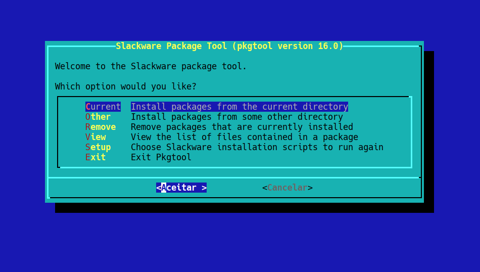

# 17. Package Management

Package management is an essential component of any Linux distribution. Every piece of software included in Slackware, along with many third-party applications, is distributed as source code that can be compiled from scratch. However, building thousands of distinct applications and libraries manually is both tedious and time-consuming. 

For this reason, most users prefer installing pre-compiled software packages. In fact, during the Slackware installation process, the `setup` utility relies heavily on native package management tools to unpack and configure the core system. 

It is worth noting a crucial distinction that is frequently misunderstood: Slackware **does** have a complete package management system, but it **does not** include automatic dependency resolution. Rather than automatically resolving and downloading missing library dependencies, Slackware's package tools deliberately trade automated dependency tracking for simplicity, transparency, and total administrative control.

This chapter explores the foundational tools and techniques used to install, upgrade, remove, and manage packages on a Slackware system.


## 17.1 pkgtool

The simplest way to perform basic package management and system maintenance tasks is to invoke `pkgtool`, a menu-driven front-end interface built on `ncurses`. 

`pkgtool` provides an intuitive text-based interface that allows you to perform several key tasks:

* **Current:** Install packages from the current directory.
* **Other:** Install packages from a specified directory.
* **Remove:** Remove packages that are currently installed on the system.
* **View:** View the list of files contained inside a package.
* **Setup:** Re-run Slackware installation configuration scripts.
* **Exit:** Exit the utility.





While `pkgtool` is ideal for quick, interactive administration, dedicated command-line utilities are better suited for advanced tasks, scripting, and batch operations.


## 17.2 Installing, Removing, and Upgrading Packages

While `pkgtool` scores points for interactive convenience, command-line package management utilities are far more versatile for day-to-day administration, batch tasks, and scripting. 

Slackware relies on five core command-line tools: `makepkg`, `explodepkg`, `installpkg`, `removepkg` and `upgradepkg`. True to Slackware's design philosophy, these tools perform explicit operations without prompting for confirmation or attempting automated dependency tracking.


### 17.2.1 Installing Packages (`installpkg`)

In its simplest form, `installpkg` takes one or more package filenames as arguments and unpacks them into the filesystem:


```bash
darkstar:~# installpkg rust-1.100.0-x86_64-1.txz
Verifying package rust-1.100.0-x86_64-1.txz.
Installing package rust-1.100.0-x86_64-1.txz [REC]:
PACKAGE DESCRIPTION:
# rust (a safe, concurrent, practical language)
#
# Rust is a curly-brace, block-structured expression language.
# Its design is oriented toward concerns of "programming in the large",
# that is, of creating and maintaining boundaries - both abstract and
# operational - that preserve large-system integrity, availability,
# and concurrency.
#
# Homepage: https://rust-lang.org
#
Executing install script for rust-1.100.0-x86_64-1.txz.
Package rust-1.100.0-x86_64-1.txz installed.

```

You can install multiple packages simultaneously using shell wildcards. For instance, to install the entire N (networking) disk series from a mounted installation directory:

```bash
darkstar:~# installpkg /mnt/cdrom/slackware64/n/*.txz
```

#### 17.2.1.1 Inspecting Installed Packages (/var/log/packages)

Slackware tracks every installed package using plain-text database files located in /var/log/packages/. Listing the contents of this directory shows every installed software package along with its exact version number.

To inspect the package metadata, description, and every file installed by a specific package, simply read its log entry:

```bash
darkstar:~# cat /var/log/packages/rust-1.100.0-x86_64-1
PACKAGE NAME:     rust-1.100.0-x86_64-1
COMPRESSED PACKAGE SIZE:     102M
UNCOMPRESSED PACKAGE SIZE:     526M
PACKAGE LOCATION: rust-1.100.0-x86_64-1.txz
PACKAGE DESCRIPTION:
rust: rust (a safe, concurrent, practical language)
rust:
rust: Rust is a curly-brace, block-structured expression language.
rust: Its design is oriented toward concerns of "programming in the large",
rust: that is, of creating and maintaining boundaries - both abstract and
rust: operational - that preserve large-system integrity, availability,
rust: and concurrency.
rust:
rust: Homepage: https://rust-lang.org
rust:
rust:
FILE LIST:
./
etc/
etc/profile.d/
etc/profile.d/rust_lib_src.csh.new
etc/profile.d/rust_lib_src.sh.new
etc/target-spec-json-schema.json
install/
install/doinst.sh
install/slack-desc
usr/
usr/bin/
usr/bin/cargo
usr/bin/cargo-clippy
usr/bin/cargo-fmt
usr/bin/clippy-driver
usr/bin/rust-analyzer
usr/bin/rust-gdb
usr/bin/rust-gdbgui
usr/bin/rust-lldb
usr/bin/rustc
usr/bin/rustdoc
... a lot of many lines...
```

This plain-text logging design makes package auditing extremely transparent and easy to query using standard text processing utilities like `grep` or `less`.


### 17.2.3 Removing Packages (removepkg)

Removing software is handled by removepkg. When invoked, removepkg checks the package database, deletes all files listed in the package log, and cleans up the package record.

```bash
darkstar:~# removepkg rust-1.100.0-x86_64-1
Removing package: rust-1.100.0-x86_64-1
```

To protect system integrity during uninstallation, `removepkg` applies two safe defaults:

- **Shared Files**: If a file is shared with another installed package, removepkg leaves it untouched.
- **Non-Empty Directories**: Directories containing user-created or third-party files are preserved.

Historical records of uninstalled software are kept in /var/log/removed_packages/ for administrative auditing.


```bash
darkstar:~# ls -l /var/log/removed_packages/rust-*
-rw-r--r-- 1 root root  397646 nov 15 19:05 /var/log/removed_packages/rust-1.100.0-x86_64-1
-rw-r--r-- 1 root root 2519818 nov 23  2024 /var/log/removed_packages/rust-1.58.1-x86_64-1-upgraded-2024-11-24,12:01:57
-rw-r--r-- 1 root root 3667441 nov 24  2024 /var/log/removed_packages/rust-1.82.0-x86_64-1-upgraded-2024-12-10,21:32:51
-rw-r--r-- 1 root root 3671233 dez 10  2024 /var/log/removed_packages/rust-1.83.0-x86_64-1-upgraded-2025-01-13,13:27:10
-rw-r--r-- 1 root root 3708434 jan 13  2025 /var/log/removed_packages/rust-1.84.0-x86_64-1-upgraded-2025-02-03,09:26:03
-rw-r--r-- 1 root root 3708434 fev  3  2025 /var/log/removed_packages/rust-1.84.1-x86_64-1-upgraded-2025-02-26,14:14:59
-rw-r--r-- 1 root root 3745026 fev 26  2025 /var/log/removed_packages/rust-1.85.0-x86_64-1-upgraded-2025-04-11,10:09:21
-rw-r--r-- 1 root root 3754540 abr 11  2025 /var/log/removed_packages/rust-1.86.0-x86_64-1-upgraded-2025-07-31,23:06:29
-rw-r--r-- 1 root root  496866 jul 31  2025 /var/log/removed_packages/rust-1.88.0-x86_64-1-upgraded-2025-08-11,16:45:51
-rw-r--r-- 1 root root  496866 set 19  2025 /var/log/removed_packages/rust-1.88.0-x86_64-1-upgraded-2026-05-30,08:37:12
-rw-r--r-- 1 root root  506091 ago 11  2025 /var/log/removed_packages/rust-1.89.0-x86_64-1-upgraded-2025-09-19,21:26:16
-rw-r--r-- 1 root root  581701 mai 30 08:37 /var/log/removed_packages/rust-1.95.0-x86_64-1-upgraded-2026-06-13,11:27:25
-rw-r--r-- 1 root root  607730 jun 13 11:27 /var/log/removed_packages/rust-1.96.0-x86_64-1-upgraded-2026-07-16,20:03:35
-rw-r--r-- 1 root root  731054 jul 16 20:03 /var/log/removed_packages/rust-1.97.0-x86_64-2-upgraded-2026-07-26,21:03:49
-rw-r--r-- 1 root root  731054 jul 26 21:04 /var/log/removed_packages/rust-1.97.1-x86_64-1-upgraded-2026-08-11,10:40:20
-rw-r--r-- 1 root root  731138 ago 11 10:40 /var/log/removed_packages/rust-1.97.1-x86_64-2-upgraded-2026-08-24,08:48:59
-rw-r--r-- 1 root root  742267 ago 24 08:49 /var/log/removed_packages/rust-1.98.0-x86_64-1-upgraded-2026-09-06,10:52:29
-rw-r--r-- 1 root root  742279 set  6 10:52 /var/log/removed_packages/rust-1.98.1-x86_64-1-upgraded-2026-09-13,16:51:26
-rw-r--r-- 1 root root  742267 set 13 16:51 /var/log/removed_packages/rust-1.98.1-x86_64-2-upgraded-2026-10-03,11:05:32
-rw-r--r-- 1 root root  728949 out  3 11:05 /var/log/removed_packages/rust-1.99.0-x86_64-1-upgraded-2026-10-07,21:49:13
-rw-r--r-- 1 root root  728867 out  7 21:49 /var/log/removed_packages/rust-1.99.0-x86_64-2-upgraded-2026-10-25,15:41:37
```

### 17.2.4 Upgrading Packages (upgradepkg)

To update software, use `upgradepkg`. The upgrade process performs two actions: it installs the new package version and subsequently cleans up any leftover files unique to the older release.

```bash
darkstar:~# upgradepkg mariadb-12.3.4-x86_64-1.txz 

+===============================================================================+
| Upgrading mariadb-12.3.3-x86_64-1 package using ./mariadb-12.3.4-x86_64-1.txz |
+===============================================================================+

Pre-installing package mariadb-12.3.4-x86_64-1...
Removing package: mariadb-12.3.3-x86_64-1-upgraded-2026-11-15,19:15:46
Installing package mariadb-12.3.4-x86_64-1.txz [OPT]:
PACKAGE DESCRIPTION:
# mariadb (Drop-in replacement for the MySQL Database Server)
#
# MariaDB is a backward compatible, drop-in replacement branch of the
# MySQL(R) Database Server. It includes all major open source storage
# engines, including the Aria storage engine.
#
# Homepage: http://mariadb.org/
#
Executing install script for mariadb-12.3.4-x86_64-1.txz.
Package mariadb-12.3.4-x86_64-1.txz installed.
Package mariadb-12.3.3-x86_64-1 upgraded with new package ./mariadb-12.3.4-x86_64-1.txz.

```

> Note: upgradepkg does not enforce version order; it can also be used to downgrade a package to a lower version number if needed.

> Tip: - **--dry-run**: Instructs upgradepkg to display planned changes without modifying the filesystem.


### 17.2.5 Creating Custom Packages (makepkg)

The makepkg utility generates a standard compressed Slackware .txz (or .tgz) package from a staged build directory containing software binaries, configuration files, and an install/ metadata folder (containing slack-desc and optional doinst.sh).

```bash
darkstar:/tmp/build-foo# makepkg -l y -c n /tmp/foo-1.0-x86_64-1.txz
```

**What makepkg Does Automatically:**

- Checks file permissions and prompts to fix world-writable files.
- Converts explicit symbolic links into ln -s commands in install/doinst.sh to prevent broken symlinks across build environments.
- Compresses the directory structure into the target .txz archive.

Key Flags:

- -l y (--linkadd y): Automatically converts symbolic links in the build root into dynamic installation scripts inside doinst.sh.
- -c n (--chown n): Preserves custom ownership settings instead of prompting to set all file ownerships to root:root.


### 17.2.6 Extracting Package Archives Manually (explodepkg)

Unlike `installpkg` (which extracts files directly to `/` and modifies system logs), `explodepkg` extracts the complete contents of a Slackware package into the current working directory without modifying /var/log/packages/ or executing post-install scripts.

```bash
darkstar:/tmp/sandbox# # explodepkg htop-3.5.3-x86_64-2.txz 
Exploding package: 'htop-3.5.3-x86_64-2.txz' into current directory:
./
install/
install/doinst.sh
install/slack-desc
usr/
usr/bin/
usr/bin/htop
usr/doc/
usr/doc/htop-3.5.3/
usr/doc/htop-3.5.3/AUTHORS
usr/doc/htop-3.5.3/COPYING
usr/doc/htop-3.5.3/ChangeLog
usr/doc/htop-3.5.3/NEWS
usr/doc/htop-3.5.3/README.md
usr/man/
usr/man/man1/
usr/man/man1/htop.1.gz
usr/share/
usr/share/applications/
usr/share/applications/htop.desktop
usr/share/icons/
usr/share/icons/hicolor/
usr/share/icons/hicolor/scalable/
usr/share/icons/hicolor/scalable/apps/
usr/share/icons/hicolor/scalable/apps/htop.svg
usr/share/pixmaps/
usr/share/pixmaps/htop.png

An installation script was detected in ./install/doinst.sh, but
was not executed.

```

**Common Use Cases:**

- **Inspecting** package contents, binaries, or configuration files before performing an actual installation.
- **Auditing** install/doinst.sh or install/slack-desc metadata files.
- **Extracting** specific individual files without performing a full system package installation.


## 17.3 Package Compression Formats

Historically, all Slackware packages were compressed using the `gzip` utility, resulting in files with the `.tgz` extension. While `gzip` provided a solid balance between compression speed and archive size, modern Slackware releases primarily use the `xz` compression algorithm, yielding `.txz` package files with significantly higher compression ratios and smaller download footprints.

Slackware package management tools natively support multiple compressed `tar` archive formats, collectively referred to as `.t?z` (or `.t*z`) files. Rather than relying on a single hardcoded compressor, `makepkg` automatically selects the appropriate compression tool based on the **file extension** specified in the target package filename:


| Extension | Compression Utility | Description & Use Case |
| :--- | :--- | :--- |
| **`.txz`** | `xz` | **Default & Official Format.** Delivers the highest compression ratio and smallest file footprint for modern Slackware releases. |
| **`.tgz`** | `gzip` | **Legacy & Standard Format.** Fast compression speed, widely used by legacy packages and third-party build scripts (e.g., SlackBuilds.org). |
| **`.tbz`** | `bzip2` | Supported alternative offering higher compression than `gzip`. |
| **`.tlz`** | `lzma` | Supported alternative using the LZMA compression algorithm. |

> **Note:** To build a package with a specific extension, the corresponding compression utility (`xz`, `gzip`, `bzip2`, or `lzma`) must be installed on your system.


**The Standard Tar Archive Advantage**

One of Slackware's greatest strengths is that its packages are simply standard compressed `tar` archives. Unlike complex binary package formats (such as `.deb` or `.rpm`), Slackware packages require no specialized build toolchains to create, inspect, or deconstruct. Any standard UNIX archiving utility (`tar`, `xz`, `gzip`) can extract and inspect their contents on virtually any operating system.


What Makes a `.t?z` File a Slackware Package?

While every Slackware package is a `.t?z` archive, **not every `.t?z` file is a valid Slackware package**. 

`installpkg` will not magically install a raw upstream source tarball (such as a generic `application-1.0.tar.gz`). To be recognized and installed as a valid Slackware package, the archive must include a dedicated `install/` metadata directory at its root containing:

* **`install/slack-desc`**: The mandatory plain-text package description file containing formatted header lines displayed during installation and logged in `/var/log/packages/`.
* **`install/doinst.sh`**: An optional post-installation shell script executed automatically by `installpkg` after files are unpacked (used for creating dynamic symlinks, building system caches, or initializing default configuration files).

If `installpkg` processes a tarball lacking this metadata structure, it will fail to register the package in the system database.


## 17.4 Converting Foreign Binary Package Formats

One of the most ubiquitous binary package formats in the Linux ecosystem is RPM (Red Hat Package Manager). It is fairly common to find software developers who distribute pre-compiled applications solely as RPM packages alongside raw source code.

When an application is only available as an RPM package, system administrators generally have three choices:

1. Build your own Slackware package.
2. Compile and install directly from source code.
3. Convert and install from RPM.

> **Why Direct `make install` is Discouraged:** Compiling and installing directly from source bypasses Slackware's package manager entirely. Without a log entry in `/var/log/packages/`, tracking installed files, performing upgrades, or cleanly uninstalling software becomes extremely difficult.


### 17.4.1 `rpm2tgz` and `rpm2txz`

The `rpm2tgz` utility (and its modern counterpart `rpm2txz`) converts an RPM package archive directly into a native Slackware `.tgz` or `.txz` package. This allows you to install foreign software binaries while maintaining full tracking, upgrading, and uninstallation capabilities through `installpkg` and `removepkg`.

To convert an RPM package, execute `rpm2tgz` (or `rpm2txz`) with the target filename:

```bash
darkstar:~# rpm2tgz foo-1.0.0-x86_64.rpm
```

This extracts the payload compressed inside the RPM and repacks it as `foo-1.0.0-x86_64.tgz`. Once conversion is complete, you can safely discard the original `.rpm` file and install the new package:

```bash
darkstar:~# installpkg foo-1.0.0-x86_64.tgz
```

**Important Caveats and Limitations**

While `rpm2tgz` provides a quick bridge for running third-party software, keep the following considerations in mind:

- **No Automated Dependency Resolution**: `rpm2tgz` does not parse or resolve RPM dependency metadata. You must verify and install any required shared libraries manually.
- **RPM Installation Scripts are Ignored**: Complex RPM pre-install, post-install, or trigger scripts are not automatically translated into Slackware's `install/doinst.sh` script format.
- **Filesystem Path Differences**: Certain RPM packages target non-standard directory structures or paths specific to other distributions. Inspecting converted packages with `explodepkg` before installation is recommended for complex applications.


### 17.4.2 `deb2tgz`

Similar to RPM conversion tools, Slackware provides utility to convert Debian binary packages (`.deb`) into native Slackware `.txz` archives using `deb2tgz`.

Debian `.deb` packages are standard `ar` archives containing control metadata and an internal compressed payload (typically `data.tar.gz`, `data.tar.xz`, or `data.tar.zst`). The `deb2tgz` utility extracts this internal payload and repacks it into a standard Slackware-compatible package.

To convert a Debian package, invoke `deb2tgz` with the target filename:

```bash
darkstar:~# deb2tgz foo-1.0.0_amd64.deb
```

This process creates `foo-1.0.0_amd64.txz`, which can then be inspected or directly installed onto the system:

```bash
darkstar:~# installpkg foo-1.0.0_amd64.txz
```

**Technical Considerations & Limitations**

Like rpm2tgz, deb2tgz shares the exact same caveats regarding dependency resolution and maintenance scripts, along with specific Debian directory differences:

- **No Automated Dependency Resolution**: deb2tgz does not parse or resolve Debian dependency metadata (control). You must manually verify and install any required shared libraries.
- **Ignored Maintenance Scripts**: Debian maintainer scripts (preinst, postinst, prerm, postrm) are not translated into Slackware's install/doinst.sh. Any post-installation configuration must be performed manually.
- **Multiarch Library Paths**: Debian and Ubuntu place 64-bit libraries into architecture-specific paths (such as /usr/lib/x86_64-linux-gnu/), whereas Slackware expects 64-bit libraries in /usr/lib64/. Inspecting the converted package with explodepkg to adjust library paths prior to installation is often recommended.


## 17.5 `slackpkg` — Automated Package Management

While core tools like `installpkg` and `upgradepkg` operate on local package files, `slackpkg` is Slackware's official automated package management tool designed to fetch and manage packages directly over a network (via HTTP or FTP). 

First introduced in the `/extra` repository of Slackware 12.1 and included as part of the standard `ap/` package series since Slackware 12.2, `slackpkg` simplifies applying security patches, upgrading system components, and keeping your system synchronized with official Slackware repositories.


### 17.5.1 Mirror Configuration (`/etc/slackpkg/mirrors`)

Before using `slackpkg`, you must select **exactly one** official Slackware network mirror. 

As `root`, open `/etc/slackpkg/mirrors` in a text editor and uncomment a single HTTP or FTP mirror URL that matches your system architecture and Slackware version (e.g., `slackware64-15.0` or `slackware64-current`):

```bash
darkstar:~# vi /etc/slackpkg/mirrors
```

> Critical Rule: You must uncomment only one mirror in /etc/slackpkg/mirrors. Uncommenting multiple mirrors simultaneously will cause slackpkg to throw errors or behavior unpredictably.

Once a mirror is selected, initialize and synchronize your local package index files:

```bash
darkstar:~# slackpkg update
```

Running `slackpkg update` downloads the latest `ChangeLog.txt` and package metadata files from the mirror into `/var/lib/slackpkg/`. It does not install or update any actual packages on your disk yet.


### 17.5.2 Day-to-Day Package Management Commands

`slackpkg` streamlines common administration tasks into simple, interactive commands:

- **Searching for Packages or Files (search)**: Search for any application, library, or specific filename across the official Slackware distribution tree:

```bash
darkstar:~# slackpkg search mariadb

Looking for mariadb in package list. Please wait... DONE

The list below shows all packages with name matching "mariadb".

[ installed ] - mariadb-12.3.4-x86_64-1

You can search specific files using "slackpkg file-search file".
```

`slackpkg` displays a formatted list of all matching packages along with their installation status (`installed` or `uninstalled`).

- **Inspecting Package Metadata (info)**: View package descriptions, uncompressed file sizes, and series information prior to downloading:

```bash
darkstar:~# slackpkg info slackpkg info mariadb

PACKAGE NAME:  mariadb-12.3.4-x86_64-1.txz
PACKAGE LOCATION:  ./slackware64/ap
PACKAGE SIZE (compressed):  46416 K
PACKAGE SIZE (uncompressed):  427360 K
PACKAGE DESCRIPTION:
mariadb: mariadb (Drop-in replacement for the MySQL Database Server)
mariadb:
mariadb: MariaDB is a backward compatible, drop-in replacement branch of the
mariadb: MySQL(R) Database Server. It includes all major open source storage
mariadb: engines, including the Aria storage engine.
mariadb:
mariadb: Homepage: http://mariadb.org/
mariadb:

```

- **Installing Packages (install)**: Download and install uninstalled packages (or entire package series) by name or pattern:

```bash
darkstar:~#  slackpkg install mariadb
Package: mariadb-12.3.4-x86_64-1.txz
                        Linking /home/brusso/Slackware/slackware64-current/./slackware64/ap/mariadb-12.3.4-x86_64-1.txz...
                        Linking /home/brusso/Slackware/slackware64-current/./slackware64/ap/mariadb-12.3.4-x86_64-1.txz.asc...
        Package mariadb-12.3.4-x86_64-1.txz is already in cache - not downloading
        Installing mariadb-12.3.4-x86_64-1...
Verifying package mariadb-12.3.4-x86_64-1.txz.
Installing package mariadb-12.3.4-x86_64-1.txz:
PACKAGE DESCRIPTION:
# mariadb (Drop-in replacement for the MySQL Database Server)
#
# MariaDB is a backward compatible, drop-in replacement branch of the
# MySQL(R) Database Server. It includes all major open source storage
# engines, including the Aria storage engine.
#
# Homepage: http://mariadb.org/
#
Executing install script for mariadb-12.3.4-x86_64-1.txz.
Package mariadb-12.3.4-x86_64-1.txz installed.
Searching for NEW configuration files...
                No .new files found.
```


- **Upgrading Installed Packages (upgrade)**: Download and upgrade currently installed packages to their latest version available on the mirror:

```bash
darkstar:~# slackpkg upgrade libffi
Package: libffi-3.8.1-x86_64-1.txz
                        Linking /home/brusso/Slackware/slackware64-current/./slackware64/l/libffi-3.8.1-x86_64-1.txz...
                        Linking /home/brusso/Slackware/slackware64-current/./slackware64/l/libffi-3.8.1-x86_64-1.txz.asc...
        Package libffi-3.8.1-x86_64-1.txz is already in cache - not downloading
        Upgrading libffi-3.8.1-x86_64-1...

+===========================================================================+
| Upgrading libffi-3.8.0-x86_64-2 package using ./libffi-3.8.1-x86_64-1.txz |
+===========================================================================+

Pre-installing package libffi-3.8.1-x86_64-1...
Removing package: libffi-3.8.0-x86_64-2-upgraded-2026-11-15,20:01:39
Installing package libffi-3.8.1-x86_64-1.txz:
PACKAGE DESCRIPTION:
# libffi (A Portable Foreign Function Interface Library)
#
# FFI stands for Foreign Function Interface. A foreign function 
# interface is the popular name for the interface that allows code 
# written in one language to call code written in another language. 
# The libffi library really only provides the lowest, machine dependent 
# layer of a fully featured foreign function interface. 
#
# Homepage: https://sourceware.org/libffi/
#
Executing install script for libffi-3.8.1-x86_64-1.txz.
Package libffi-3.8.1-x86_64-1.txz installed.
Package libffi-3.8.0-x86_64-2 upgraded with new package ./libffi-3.8.1-x86_64-1.txz.
Searching for NEW configuration files...
                No .new files found.


```

- **Reinstalling Packages (reinstall)**: Force the re-download and reinstallation of an already installed package (useful if system binaries or configuration files were corrupted):

```bash
darkstar:~# slackpkg reinstall mariadb

Package: mariadb-12.3.4-x86_64-1.txz
                        Linking /home/brusso/Slackware/slackware64-current/./slackware64/ap/mariadb-12.3.4-x86_64-1.txz...
                        Linking /home/brusso/Slackware/slackware64-current/./slackware64/ap/mariadb-12.3.4-x86_64-1.txz.asc...
        Package mariadb-12.3.4-x86_64-1.txz is already in cache - not downloading
        Installing mariadb-12.3.4-x86_64-1...
Verifying package mariadb-12.3.4-x86_64-1.txz.
Installing package mariadb-12.3.4-x86_64-1.txz:
PACKAGE DESCRIPTION:
# mariadb (Drop-in replacement for the MySQL Database Server)
#
# MariaDB is a backward compatible, drop-in replacement branch of the
# MySQL(R) Database Server. It includes all major open source storage
# engines, including the Aria storage engine.
#
# Homepage: http://mariadb.org/
#
Executing install script for mariadb-12.3.4-x86_64-1.txz.
Package mariadb-12.3.4-x86_64-1.txz installed.
Searching for NEW configuration files...
                No .new files found.

```

- **Removing Packages (remove)**: Uninstall packages matching a given name or wildcard pattern:

```bash
darkstar:~# slackpkg remove mariadb
Package: mariadb-12.3.4-x86_64-1
        Removing... 
Removing package: mariadb-12.3.4-x86_64-1


```

- **Downloading Without Installing (download)**: Fetch .txz package files directly into /var/cache/packages/ without applying them immediately to the system:

```bash
darkstar:~# slackpkg download mariadb
```


### 17.5.3 System Maintenance and Full Upgrades

When upgrading between Slackware releases or tracking the -current development branch, slackpkg provides three essential workflow commands that must be executed in sequence:

- **slackpkg install-new**: Scans the remote mirror for newly added packages that do not exist on your local installation and prompts to install them.
- **slackpkg upgrade-all**: Upgrades every installed package on your system to match the remote mirror's package tree.
- **slackpkg clean-system**: Scans your system for packages that are no longer part of the official Slackware distribution. This identifies obsolete packages removed from the upstream tree as well as custom third-party packages.

Recommended System Upgrade Sequence:

```bash
darkstar:~# slackpkg update
darkstar:~# slackpkg install-new
darkstar:~# slackpkg upgrade-all
darkstar:~# slackpkg clean-system
```
It's a great and easy option to do your system update!


### 17.5.4 Protecting Packages (/etc/slackpkg/blacklist)

To prevent specific packages—such as custom-compiled kernels, proprietary graphics drivers, or third-party applications—from being accidentally upgraded or removed during automated maintenance, you can add them to the blacklist.

You can blacklist packages by editing `/etc/slackpkg/blacklist` or by running the interactive blacklist command:

```bash
darkstar:~# slackpkg blacklist
Edit /etc/slackpkg/blacklist to add or remove packages.

Packages in blacklist:

mariadb
```

Blacklisted packages will be excluded from slackpkg upgrade, upgrade-all, and clean-system operations.
