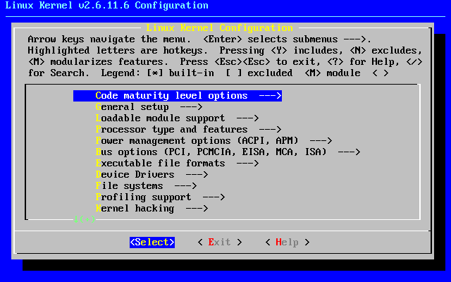

# 19. The Linux Kernel

## 19.1 What Does the Kernel Do?

You have likely heard system administrators and developers talk about compiling or building a custom kernel, but what exactly is the kernel, and what role does it play in Linux?

The **kernel** is the central component of an operating system. It serves as the fundamental bridge between physical hardware and user applications, acting as the primary software layer responsible for directly managing and orchestrating hardware resources.


```text
+-------------------------------------------------------+
|                 User Applications                     |
|         (Bash Shell, Text Editors, Web Browsers)      |
+-------------------------------------------------------+
                           |
                           v
+-------------------------------------------------------+
|                    Linux Kernel                       |
|   (Process Scheduling, Memory Management, Drivers)    |
+-------------------------------------------------------+
                           |
                           v
+-------------------------------------------------------+
|                 Physical Hardware                     |
|           (CPU, Memory, Disks, Network NICs)          |
+-------------------------------------------------------+
```

**Core Functions of the Kernel**

Specifically, the kernel handles low-level hardware interactions and resource management:

- **Hardware Control**: It instructs storage drives to read or write data blocks and tells Network Interface Cards (NICs) when to transmit data across physical media.
- **Hardware Interrupt Handling**: It continuously listens for events generated by hardware devices. For instance, when a network card receives data packets from a remote computer, it triggers a hardware interrupt, prompting the kernel to receive, process, and pass the data to the appropriate application.
- **Resource Allocation**: It manages CPU time, physical RAM usage, and peripheral access across all running processes while enforcing security and isolation boundaries.

Because it operates with complete access to hardware and CPU memory spaces, the kernel is both the single most critical and most complex piece of software on your computer.


## 19.2 Working with Modules

The complexity of a modern Linux kernel is impressive. Uncompressed, the Linux kernel source code reaches nearly 1.8 GB. With thousands of active developers and hundreds of configurable features, compiling everything statically into a single monolithic binary would result in an impractically large kernel image and unnecessarily high RAM consumption.

To keep the core kernel size compact and RAM usage manageable, most drivers and features are compiled as **Loadable Kernel Modules (LKMs)**. These modules function as dynamic device drivers that can be inserted into or removed from a running kernel on demand without requiring a system reboot. Beyond traditional device drivers, modules also provide support for network protocols, firewall filters, security layers, and filesystems.


**Automatic Module Handling with `udev`**

Slackware Linux automatically handles module loading for most hardware devices. During the boot process, the device manager daemon (`udevd`) probes the system's hardware buses. For every detected component, `udevd` automatically loads the matching kernel module and creates the corresponding device node under `/dev`.

Consequently, manual module management is rarely required during routine system operation, though it remains an essential skill when troubleshooting or configuring specialized hardware.


**Listing Loaded Modules (`lsmod`)**

To view all kernel modules currently loaded in memory, use the `lsmod` utility:

```text
darkstar:~# lsmod 
xt_nat                 12288  1
xt_tcpudp              12288  3
veth                   40960  0
xt_conntrack           12288  3
xt_MASQUERADE          12288  4
nf_conntrack_netlink    57344  0
ip6table_nat           12288  1
ip6table_filter        12288  1
ip6_tables             32768  2 ip6table_filter,ip6table_nat
iptable_nat            12288  1
nf_nat                 61440  4 ip6table_nat,xt_nat,iptable_nat,xt_MASQUERADE
nf_conntrack          176128  5 xt_conntrack,nf_nat,xt_nat,nf_conntrack_netlink,xt_MASQUERADE
nf_defrag_ipv6         20480  1 nf_conntrack
nf_defrag_ipv4         12288  1 nf_conntrack
... many more lines ommitted ...
```
The output displays three columns:

1. **Module**: The name of the loaded kernel module.
2. **Size**: The memory footprint of the module in bytes.
3. **Used by**: The count and names of other loaded modules or processes currently depending on it.


**Loading Modules (`modprobe` vs. `insmod`)**

Linux provides two utilities for inserting modules into the kernel: `modprobe` and `insmod`.

- **modprobe (Recommended)**: Reads dependency mappings from /lib/modules/$(uname -r)/modules.dep. When you request a module by name, modprobe automatically locates and loads any required prerequisite modules first.

- **insmod (Low-level)**: Inserts a single standalone module file directly. Unlike modprobe, insmod requires the exact filesystem path to the module file (.ko) and does not perform automatic dependency resolution.


```text
darkstar:~# insmod /lib/modules/$(uname -r)/kernel/fs/bfs/bfs.ko
darkstar:~# modprobe cramfs
darkstar:~# lsmod | grep fs
cramfs                 57344  0
mtd                   110592  1 cramfs
bfs                    24576  0
```


**Unloading Modules (`modprobe` -r vs. `rmmod`)**

Similarly, two programs exist for removing modules from memory: `rmmod` and `modprobe -r`.

- **modprobe -r (Recommended)**: Unloads the specified module and recursively removes any dependent modules that are no longer in use by other processes.
- **rmmod**: Unloads only the specified single module. If other active modules depend on it, `rmmod` will fail and report a busy error.


```text
darkstar:~# rmmod bfs
darkstar:~# modprobe -r cramfs
darkstar:~# lsmod | grep fs
darkstar:~#
```


>> Stop here
## 19.3 Compiling A Kernel and Why to do So

Most Slackware users will never need to compile a kernel. The huge and generic kernels contain virtually all the support you will need.

However, some users may need to compile a kernel. If your computer contains bleeding edge hardware, a newer kernel may offer improved support. Sometimes a kernel patch my be available that corrects a problem you are experiencing. In these cases a kernel compile is probably warranted. Users who simply want the latest and greatest version or who believe using a custom compiled kernel will give them greater performance can certainly upgrade, but are unlikely to actually notice any major changes.

If you still think compiling your own kernel is something you want or need to do, this section should walk you through the many steps. Compiling and installing a kernel is not that difficult, but there are a number of mistakes that can be made along the way, many of which can prevent your computer from booting and cause major frustration.

The first step is ensuring you have the kernel source code installed on your system. The kernel source package is included in the "k" disk set in the Slackware installer, or you can download another version from http://www.kernel.org/ . Traditionally, the kernel source is located in `/usr/src/linux` , a symbolic link that points to the specific kernel release used, but this is by no means set in stone. You can place the kernel source code virtually anywhere without encountering any problems.

```text

darkstar:~# ls -l /usr/src 
lrwxrwxrwx 1 root root 14 2009-07-22 19:59 linux -> linux-2.6.29.6/ 
drwxr-xr-x 23 root root 4096 2010-03-17 19:00 linux-2.6.29.6/

```

The most difficult part of any kernel compile is the kernel configuration. There are hundreds of options, many of which can optionally be compiled into modules. This means there are thousands of ways to configure a kernel. Fortunately, there are a few handy tricks that can keep you from running into too much trouble. The kernel configuration file is `.config` . If you are very brave, you can manually edit this file with a text editor, but I highly recommend you use the kernel's built-in tools for manipulating `.config` .

Unless you are very familiar with configuring kernels, you should always start with a solid base configuration and modify it. This prevents you from skipping an important option that might force you to compile the kernel again and again until you get it right. The best kernel `.config` files to start with are those used by Slackware's default kernels. You can find them on your Slackware install disks or at your favorite mirror in the `kernels/` directory.

```text

darkstar:~# mount /mnt/cdrom 
darkstar:~# cd /mnt/cdrom/kernels 
darkstar:/mnt/cdrom/kernels# ls 
VERSIONS.TXT huge.s/ generic.s/ speakup.s/ 
darkstar:/mnt/cdrom/kernels# ls genric.s System.map.gz bzImage config

```

You can replace the default `.config` file easily by copying or downloading the `config` file for the kernel you wish to use as a base. Here I am using Slackware's recommended generic.s kernel for a base, but you may wish to use the huge.s config file. The generic kernel builds more things as modules and thus creates a smaller kernel image, but it usually requires the use of an initrd.

```text

darkstar:/mnt/cdrom/kernels# cp generic.s/config /usr/src/linux/.config

```
**Important**

The Slackware kernel file lacks the "dot" while the kernel file includes it. If you forget, or simply copy the `config` to `/usr/src` whatever `.config` file was already present will be used instead.

If you want to use the configuration for the currently running kernel as your base, you may be able to locate it at `/proc/config.gz` . This is a special kernel-related file that includes the entire kernel configuration in a compressed format and requires that your kernel was built to support it.

```text

darkstar:~# zcat /proc/config.gz > /usr/src/linux/.config

```

Now that we've created a solid base configuration, it's time to make any configuration changes we want. The entire kernel build process from configuration to compilation is performed with the `make` (1) command and special arguments to it. Each argument performs a different function.

If you are upgrading to a newer kernel release, you will definitely want to use the `oldconfig` argument. This will step through your base `.config` and look for missing elements that usually indicates that the new kernel release contains additional options. Since options are added at virtually every kernel release, this is generally a good thing to do.

```text

darkstar:/usr/src/linux# make oldconfig 
scripts/kconfig/conf -o arch/x86/Kconfig 
* 
* Restart config... 
* 
* 
* File systems 
* 
Second extended fs support (EXT2_FS) [M/n/y/?] m 
    Ext2 extended attributes (EXT2_FS_XATTR) [N/y/?] n 
    Ext2 execute in place support (EXT2_FS_XIP) [N/y/?] n 
Ext3 journalling file system support (EXT3_FS) [M/n/y/?] m 
    Ext3 extended attributes (EXT3_FS_XATTR) [Y/n/?] y 
        Ext3 POSIX Access Control Lists (EXT3_FS_POSIX_ACL) [Y/n/?] y 
        Ext3 Security Labels (EXT3_FS_SECURITY) [Y/n/?] y 
The Extended 4 (ext4) filesystem (EXT4_FS) [N/m/y/?] (NEW) m

```

Here you can see that I the new kernel I am compiling has added support for a new filesystem: ext4. `oldconfig` has gone through my original configuration, kept all the old options exactly as they were set, and prompted me on what to do with new options. Typically it is save to choose the default option, but you may wish change this. `oldconfig` is a very handy tool for presenting you with only new configuration options, making it ideal for users who simply have to try out the latest kernel release.

For more serious configuration tasks, there are a multitude of options. The linux kernel can be configured in three primary ways. The first is `config` , which will step through each and every option one by one and ask what you would like to do. This is so tedious that hardly anyone ever uses it anymore.

```text

darkstar:/usr/src/linux# make config 
scripts/kconfig/conf arch/x86/Kconfig 
* 
* Linux Kernel Configuration 
* 
* 
* General setup 
* 
Prompt for development and/or incomplete code/drivers (EXPERIMENTAL) [Y/n/?] Y 
Local version - append to kernel release (LOCALVERSION) [] -test 
Automatically append version information to the version string (LOCALVERSION_AUTO) [N/y/?] n 
Support for paging of anonymous memory (swap) (SWAP) [Y/n/?]

```

Fortunately, there are two much easier ways to configure your kernel, `menuconfig` and `xconfig` . Both of these create a menu-driven program that lets you select and de-select options without having to step through each one. `menuconfig` is the most commonly used method, and the one I recommend. `xconfig` is only useful if you are attempting to compile the kernel from a graphical user interface within `X` . Both are so similar however, that we are only going to document `menuconfig` .

Running `make menuconfig` from a terminal will present you with the friendly curses-driven interface you see below. Each kernel section is given its own submenu, and you can navigate with the arrow keys.



**Warning**

If you are compiling a kernel that is the same release as the stock Slackware kernel, you must set the "Local version" option. This is found on the "General setup" submenu. Failure to set this will result in your kernel compile over-writing all the modules used by the stock kernels. This can quickly render your system unbootable.

Once you've finished configuring the kernel, it's time to begin compiling it. There are many different methods for this, but the most reliable is to use `bzImage` . When you pass this argument to `make` , the kernel compilation will begin and you will see lots of data scroll through the terminal until either the compile process is complete or a fatal error is encountered.

```text

darkstar:/usr/src/linux# make bzImage 
scripts/kconfig/conf -s arch/x86/Kconfig 
    CHK include/linux/version.h 
    CHK include/linux/utsrelease.h 
    SYMLINK include/asm -> include/asm-x86 
    CALL scripts/checksyscalls.sh 
    CC scripts/mod/empty.o 
    HOSTCC scripts/mod/mk_elfconfig 
    MKELF scripts/mod/elfconfig.h 
    HOSTCC scripts/mod/file2alias.o 
... many hundreds of lines ommitted ...

```

If the process ends in an error, you should check your kernel configuration first. Compile errors are usually caused by a fault `.config` file. Assuming everything went alright, we're still not entirely finished, as we need to build the modules.

```text

darkstar:/usr/src/linux# make modules 
    CHK include/linux/version.h 
    CHK include/linux/utsrelease.h 
    SYMLINK include/asm -> include/asm-x86 
    CALL scripts/checksyscalls.sh 
    HOSTCC scripts/mod/file2alias.o 
... many thousands of lines omitted ...

```

If both the kernel and the modules compiles finished sucessfully, we're ready to install them. The kernel image needs to be copied into a safe location, typically the `/boot` directory, and you should give it a unique name to avoid overwriting any other kernel images located there. Traditionaly kernel images are named `vmlinuz` with the kernel release and local version appended.

```text

darkstar:/usr/src/linux# cat arch/x86/boot/bzImage > /boot/vmlinuz-release_number-local_version 
darkstar:/usr/src/linux# make modules_install

```

Once these steps have been completed, you will have a new kernel image located under `/boot` and a new kernel modules directory under `/lib/modules` . In order to use this new kernel, you will need to edit `lilo.conf` , create an initrd for it (only if you need to load one or more of this kernel's modules to boot), and run `lilo` to update the boot loader. When you reboot, if all went according to plan, you should have an option to boot with your newly compiled kernel. If something went wrong, you may be spending some time fixing the problem.
