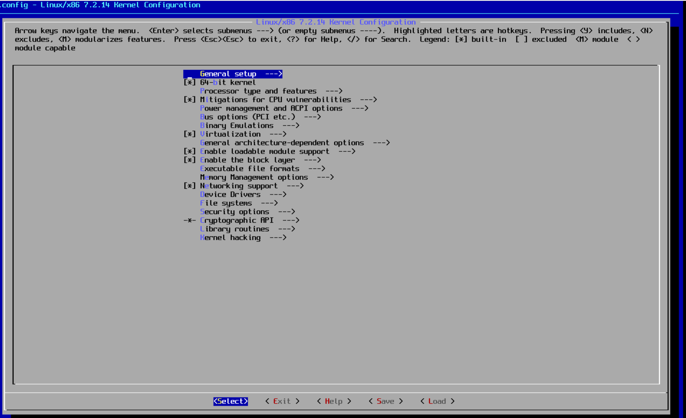
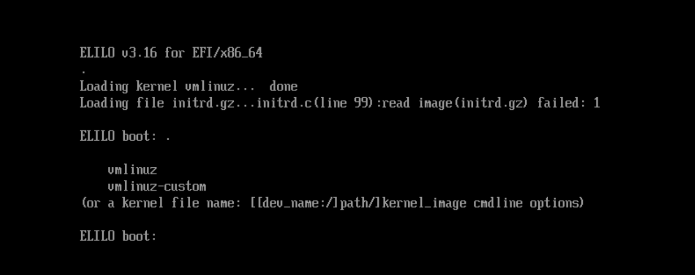

# 19. The Linux Kernel

## 19.1 What Does the Kernel Do?

You have likely heard system administrators and developers talk about compiling or building a custom kernel, but what exactly is the kernel, and what role does it play in Linux?

The **kernel** is the central component of an operating system. It serves as the fundamental bridge between physical hardware and user applications, acting as the primary software layer responsible for directly managing and orchestrating hardware resources.


```text
+-------------------------------------------------------+
|                 User Applications                     |
|         (Bash Shell, Text Editors, Web Browsers)      |
+-------------------------------------------------------+
                           |
                           v
+-------------------------------------------------------+
|                    Linux Kernel                       |
|   (Process Scheduling, Memory Management, Drivers)    |
+-------------------------------------------------------+
                           |
                           v
+-------------------------------------------------------+
|                 Physical Hardware                     |
|           (CPU, Memory, Disks, Network NICs)          |
+-------------------------------------------------------+
```

**Core Functions of the Kernel**

Specifically, the kernel handles low-level hardware interactions and resource management:

- **Hardware Control**: It instructs storage drives to read or write data blocks and tells Network Interface Cards (NICs) when to transmit data across physical media.
- **Hardware Interrupt Handling**: It continuously listens for events generated by hardware devices. For instance, when a network card receives data packets from a remote computer, it triggers a hardware interrupt, prompting the kernel to receive, process, and pass the data to the appropriate application.
- **Resource Allocation**: It manages CPU time, physical RAM usage, and peripheral access across all running processes while enforcing security and isolation boundaries.

Because it operates with complete access to hardware and CPU memory spaces, the kernel is both the single most critical and most complex piece of software on your computer.


## 19.2 Working with Modules

The complexity of a modern Linux kernel is impressive. Uncompressed, the Linux kernel source code reaches nearly 1.8 GB. With thousands of active developers and hundreds of configurable features, compiling everything statically into a single monolithic binary would result in an impractically large kernel image and unnecessarily high RAM consumption.

To keep the core kernel size compact and RAM usage manageable, most drivers and features are compiled as **Loadable Kernel Modules (LKMs)**. These modules function as dynamic device drivers that can be inserted into or removed from a running kernel on demand without requiring a system reboot. Beyond traditional device drivers, modules also provide support for network protocols, firewall filters, security layers, and filesystems.


**Automatic Module Handling with `udev`**

Slackware Linux automatically handles module loading for most hardware devices. During the boot process, the device manager daemon (`udevd`) probes the system's hardware buses. For every detected component, `udevd` automatically loads the matching kernel module and creates the corresponding device node under `/dev`.

Consequently, manual module management is rarely required during routine system operation, though it remains an essential skill when troubleshooting or configuring specialized hardware.


**Listing Loaded Modules (`lsmod`)**

To view all kernel modules currently loaded in memory, use the `lsmod` utility:

```text
darkstar:~# lsmod 
xt_nat                 12288  1
xt_tcpudp              12288  3
veth                   40960  0
xt_conntrack           12288  3
xt_MASQUERADE          12288  4
nf_conntrack_netlink   57344  0
ip6table_nat           12288  1
ip6table_filter        12288  1
ip6_tables             32768  2 ip6table_filter,ip6table_nat
iptable_nat            12288  1
nf_nat                 61440  4 ip6table_nat,xt_nat,iptable_nat,xt_MASQUERADE
nf_conntrack          176128  5 xt_conntrack,nf_nat,xt_nat,nf_conntrack_netlink,xt_MASQUERADE
nf_defrag_ipv6         20480  1 nf_conntrack
nf_defrag_ipv4         12288  1 nf_conntrack
... many more lines ommitted ...
```
The output displays three columns:

1. **Module**: The name of the loaded kernel module.
2. **Size**: The memory footprint of the module in bytes.
3. **Used by**: The count and names of other loaded modules or processes currently depending on it.


**Loading Modules (`modprobe` vs. `insmod`)**

Linux provides two utilities for inserting modules into the kernel: `modprobe` and `insmod`.

- **modprobe (Recommended)**: Reads dependency mappings from /lib/modules/$(uname -r)/modules.dep. When you request a module by name, modprobe automatically locates and loads any required prerequisite modules first.

- **insmod (Low-level)**: Inserts a single standalone module file directly. Unlike modprobe, insmod requires the exact filesystem path to the module file (.ko) and does not perform automatic dependency resolution.


```text
darkstar:~# insmod /lib/modules/$(uname -r)/kernel/fs/bfs/bfs.ko
darkstar:~# modprobe cramfs
darkstar:~# lsmod | grep fs
cramfs                 57344  0
mtd                   110592  1 cramfs
bfs                    24576  0
```


**Unloading Modules (`modprobe` -r vs. `rmmod`)**

Similarly, two programs exist for removing modules from memory: `rmmod` and `modprobe -r`.

- **modprobe -r (Recommended)**: Unloads the specified module and recursively removes any dependent modules that are no longer in use by other processes.
- **rmmod**: Unloads only the specified single module. If other active modules depend on it, `rmmod` will fail and report a busy error.


```text
darkstar:~# rmmod bfs
darkstar:~# modprobe -r cramfs
darkstar:~# lsmod | grep fs
darkstar:~#
```

## 19.3 Compiling A Kernel and Why to do So

Most Slackware users will never need to compile a custom kernel. The stock **vmlinuz** kernel supplied by Slackware includes built-in support and modules for virtually all modern hardware configurations.

However, some users may still need to compile a kernel. If your computer contains bleeding-edge hardware, a newer kernel version may offer improved support. In other cases, a specific kernel patch may be available to correct an issue you are experiencing. Users who simply want the latest kernel version or believe that a custom-compiled kernel will yield better performance can certainly build one, though major performance differences are rarely noticeable on modern systems.


If you decide that compiling a custom kernel is necessary for your environment, this section walks you through each step. Compiling and installing a kernel is straightforward, but several critical mistakes can render your system unbootable.


**Obtaining Kernel Source Code**

The first step is ensuring the kernel source code is installed on your system. The official kernel source package is included in the **`k`** package series in the Slackware installer, or you can download vanilla source archives directly from [https://www.kernel.org/](https://www.kernel.org/). I recommend you use the package.

For the examples in this section, we will use **kernel 7.2.14**.

Traditionally, the kernel source resides in `/usr/src/linux`, which is usually a symbolic link pointing to the specific installed kernel release directory. However, this path is not mandatory; you can extract and build kernel source code inside any directory where you have write permissions.

```text
root@darkstar:/usr/src# ls -l
total 16
drwxr-xr-x 3 root root 4096 Oct 13 15:10 bcachefs-1.39.7/
lrwxrwxrwx 1 root root   10 Nov 14 14:17 gmock -> googlemock/
drwxr-xr-x 6 root root 4096 Nov 14 14:17 googlemock/
drwxr-xr-x 7 root root 4096 Nov 14 14:17 googletest/
lrwxrwxrwx 1 root root   10 Nov 14 14:17 gtest -> googletest/
lrwxrwxrwx 1 root root   12 Nov 14 14:15 linux -> linux-7.2.14/
drwxr-xr-x 26 root root 4096 Oct 30 11:49 linux-7.2.14/

```

**Base Kernel Configuration (`.config`)**

The most difficult part of compiling a kernel is the configuration process. With thousands of configurable drivers, subsystems, and options, configuring a kernel from scratch can be overwhelming. 

The entire kernel configuration is stored in a hidden file named `.config` located at the root of the kernel source directory. While `.config` is a plain-text file, manually editing it with a text editor is strongly discouraged; instead, you should always rely on the kernel's built-in interactive configuration tools.

Unless you are an experienced kernel developer, you should always start with a known, working base configuration and modify it as needed. Building upon an established base prevents you from accidentally omitting critical hardware drivers or filesystem support required to boot your machine.

The best starting points for a solid base `.config` are the stock configurations provided by Slackware:

* **Installed System:** The active configuration is saved directly in `/boot/config` (or versioned files such as `/boot/config-generic-7.2.14`).
* **Running Kernel (`/proc` filesystem):** If supported by your active kernel, the exact running configuration can be extracted from `/proc/config.gz`.
* **Installation Media & Mirrors:** Stock configurations can also be found on the Slackware installation media or repository mirrors within the `kernels/` directory.

> Note: In this example `7.2.14` is a version of kernel that I have Installed in my computer. This number can change.


**Setting Up .config from /boot**

The most difficult part of compiling a kernel is the configuration process. The entire configuration is stored in a hidden file named `.config` located at the root of the kernel source directory. While `.config` is a plain-text file, manually editing it with a text editor is strongly discouraged.

Unless you are an experienced kernel developer, you should always start with a known, working base configuration. The most practical and reliable way is to copy the active kernel configuration file directly from /boot into your kernel source root directory:

```bash
darkstar:~# cp /boot/config /usr/src/linux/.config
```

> Note: On systems with multiple versioned configuration files in `/boot`, copy the specific file matching your active kernel, such as `cp /boot/config-generic-7.2.14 /usr/src/linux/.config`.


Alternatively, if your running kernel was compiled with `/proc/config.gz support`, you can extract the active configuration using `zcat`:

```bash
darkstar:~# zcat /proc/config.gz > /usr/src/linux/.config
```


**Customizing Options with make menuconfig**

Once your `.config` base file is in place, you can customize hardware options, filesystem support, and kernel subsystems using the interactive terminal interface:

```bash
darkstar:/usr/src/linux# make menuconfig
```

Running `make menuconfig` opens an `ncurses-driven`, menu-based interface. It allows you to navigate submenus using arrow keys, toggle built-in drivers ([*]), loadable modules ([M]), or disabled features ([ ]), and save your updated `.config` file when finished.

> Note: If you are upgrading to a newer upstream kernel version using an existing base configuration, running make oldconfig beforehand will prompt you specifically for any newly introduced kernel features.





**Compiling and Installing the Kernel**


Once configuration is complete, compile the compressed kernel image (bzImage) and its loadable modules:

```bash
darkstar:/usr/src/linux# make -j$(nproc)
darkstar:/usr/src/linux# make modules_install
darkstar:/usr/src/linux# cp arch/x86/boot/bzImage /boot/vmlinuz-7.2.14-custom
darkstar:/usr/src/linux# cp System.map /boot/System.map-7.2.14-custom
darkstar:/usr/src/linux# cp .config /boot/config-7.2.14-custom
```

> Note: The `-j$(nproc)` flag tells make to compile using all available CPU cores in parallel, significantly reducing build times.


**Generating the Initial Ramdisk (initrd)**

If your root partition or storage controller drivers (such as NVMe or ext4) are compiled as modules, generate an initial ramdisk image for your custom kernel:

```bash
darkstar:~# mkinitrd -c -k 7.2.14 -f ext4 -r /dev/nvme0n1p2 -m nvme:ext4 -o /boot/initrd-custom.gz
```


**Configuring the Bootloader for NVMe Drives (LILO vs. ELILO)**

On modern NVMe storage drives, device nodes follow the `/dev/nvmeXnY` naming scheme (for example, `/dev/nvme0n1`), with partitions designated by a `p` suffix (such as `/dev/nvme0n1p1` for the EFI System Partition and `/dev/nvme0n1p2` for the Linux root `/` partition).

After compiling and installing your custom kernel, update your bootloader configuration to add an entry for the new kernel image while keeping the stock kernel entry intact for system recovery.


**Configuring LILO (`/etc/lilo.conf`)**

If your system uses traditional BIOS/CSM boot with LILO, edit `/etc/lilo.conf` to append an entry for your custom kernel:

```text
# Global Settings
boot = /dev/nvme0n1
prompt
timeout = 50
vga = normal

# Stock Kernel Entry (Retain for Recovery)
image = /boot/vmlinuz
    root = /dev/nvme0n1p2
    initrd = /boot/initrd.gz
    label = Slack-Stock
    read-only

# Custom Compiled Kernel Entry
image = /boot/vmlinuz-7.2.14-custom
    root = /dev/nvme0n1p2
    initrd = /boot/initrd-custom.gz
    label = Slack-Custom
    read-only
```

> Important: Whenever you modify `/etc/lilo.conf`, you must execute the lilo command as root to write the changes to the boot sector map:

```bash
darkstar:~# lilo
```


**Configuring ELILO (elilo.conf — UEFI Boot)**


If your system boots using UEFI firmware, Slackware manages the startup process via ELILO. Because UEFI firmware reads files directly from the VFAT-formatted EFI System Partition (ESP), both the custom kernel binary and its matching initrd image must be copied into the ELILO directory located under /boot/efi.

- **Step 1**: Copy Kernel and initrd Images to the ESP

```bash
darkstar:~# cp /boot/vmlinuz-7.2.14-custom /boot/efi/EFI/Slackware/vmlinuz-custom
darkstar:~# cp /boot/initrd-custom.gz /boot/efi/EFI/Slackware/initrd-custom.gz
```


- **Step 2**: Edit /boot/efi/EFI/Slackware/elilo.conf

> Note: File paths inside elilo.conf are relative to the directory where elilo.conf resides on the ESP.

```bash
darkstar:~# vi /boot/efi/EFI/Slackware/elilo.conf

chooser=simple
delay=1
timeout=1

# Stock Kernel Entry (Retain for Recovery)
image=vmlinuz
    label=vmlinuz
    initrd=initrd.gz
    read-only
    append="root=/dev/sda4 vga=normal ro"

# Custom Compiled Kernel Entry
image=vmlinuz-custom
    label=vmlinuz-custom
    initrd=initrd-custom.gz
    read-only
    append="root=/dev/sda4 vga=normal ro"
```

> Note for ELILO: Unlike LILO, ELILO does not require running an updater binary after saving changes. The UEFI firmware reads elilo.conf directly from the EFI FAT partition during system startup.

After reboot the machine, you'll select que kernel in boot menu, like you can show in the image below.




