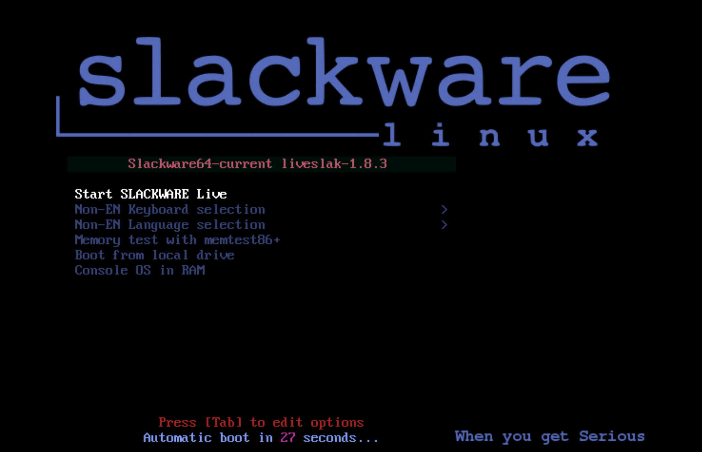
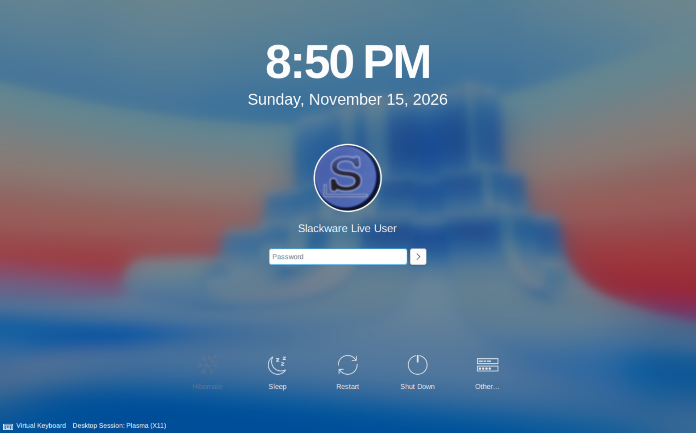
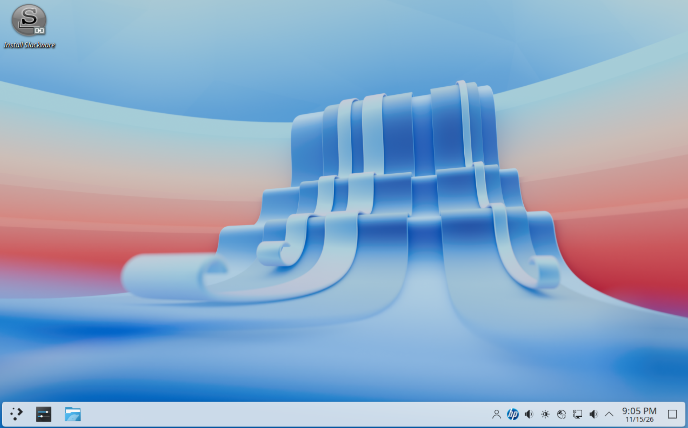

# 20. Slackware Live Edition

## 20.1 Introduction to Slackware Live Edition

**Slackware Live Edition** is an official-equivalent, portable live operating system created and maintained by Eric Hameleers (Alien BOB). Built using the `liveslak` toolset, Slackware Live Edition runs entirely from a DVD, USB flash drive, or ISO file without modifying local hard drive partitions unless explicitly commanded to do so.

Unlike many derivative distributions that heavily modify the underlying system, alter desktop themes, or strip out core server utilities, Slackware Live Edition remains 100% faithful to stock Slackware. It ships with un-patched stock kernels, standard Slackware package series, and default configuration files, providing an authentic Slackware experience in a zero-installation format.

### Primary Goals and Design Philosophy

The `liveslak` project was designed around several core principles:

* **Showcase Pure Slackware:** Provide a pristine, unadulterated Slackware environment for evaluation, demonstration, and educational purposes without hiding kernel boot messages or forcing custom branding.
* **Track the Bleeding Edge (`-current`):** Offer a safe, risk-free environment to test Slackware's development tree (`-current`) on real hardware without risking productivity loss or system breakage on primary workstation drives.
* **Deterministic, Scripted Builds:** Generate ISO images completely from scratch using standard Slackware package mirrors via reproducible Bash scripts.
* **KISS Principle (Keep It Simple, Stupid):** Leverage stock Linux kernel features—specifically `OverlayFS` and `SquashFS`—without requiring custom-compiled third-party kernel patches or out-of-tree file system drivers.
* **Portability with Persistence:** Enable users to carry a fully configured Slackware OS in their pocket on a USB stick, retaining file changes, custom software, and encrypted user home directories across reboots.

### Default User Credentials and System State

When booted, Slackware Live Edition configures two standard user accounts:

* **`live`** (Password: `live`): The default unprivileged user account.
* **`root`** (Password: `root`): The system administrator account.

By default, the ISO images boot directly into **runlevel 4** (graphical desktop mode with display manager login), though users can easily select runlevel 3 (multi-user console mode) or single-user mode at the boot prompt.

---

## 20.2 Core Architecture: OverlayFS and SquashFS

Slackware Live Edition achieves its flexibility through a combination of two core Linux kernel technologies: **SquashFS** (a read-only compressed file system) and **OverlayFS** (a union mount file system driver integrated into Linux kernel 4.x and newer).

### File System Assembly

During ISO creation, Slackware packages are grouped and compressed into individual read-only SquashFS archive modules with the `.sxz` extension (SquashFS compressed with `xz` or `zstd`). When the system boots:

1. The initial RAM file system (`initrd`) creates a temporary RAM-based root file system.
2. The `liveslak` `init` script detects the boot media and loop-mounts each `.sxz` module in a specific numeric sequence.
3. **OverlayFS** stacks these read-only layers into a single unified directory tree.
4. On top of the read-only stack, OverlayFS places a **writable upper layer**:
   * **Volatile Mode (RAM):** For read-only media (DVDs) or unconfigured USBs, writes are held in a RAM disk and discarded upon reboot.
   * **Persistent Mode (USB/Disk):** For configured USB drives or container files, write operations are stored permanently on disk.

### Module Naming and Prefix Conventions

Modules in `/liveslak/system/`, `/liveslak/addons/`, and `/liveslak/optional/` follow a strict numeric naming convention (`NNNN-modname-version-arch.sxz`) that dictates their loading order:

| Prefix Range | Module Purpose & Contents |
| :--- | :--- |
| `0000` | Contains the core Slackware `/boot` directory and kernel structures. |
| `0005` | Console OS modules (minimal RAM-based rescue environment). |
| `0010`–`0019` | Modules generated from Slackware series tagfiles (`a`, `ap`, `d`, `l`, `n`, `x`, `xap`, etc.). |
| `0020`–`0029` | Modules generated from custom package lists (`pkglists/*.lst`). |
| `0030`–`0039` | Modules generated from local package directories (`./local/` or `./local64/`). |
| `0099` | Live OS configuration module (`0099-slackware_zzzconf-*.sxz`), containing user setup, hardware tweaks, and system scripts. |
| `0040`–`0098` | Free range reserved for user-created custom addon modules. |

---

## 20.3 Available ISO Variants (Flavors)

The flagship **Slackware Live Edition** (based on Slackware `-current`) is the most comprehensive and feature-complete ISO variant. It delivers a full Slackware system pre-packaged with a rich selection of desktop environments, window managers, and display servers out-of-the-box, allowing you to choose your preferred graphical session directly from the login manager:

* **KDE Plasma:** The default, feature-rich desktop environment for modern workstations.
* **XFCE:** A fast, highly efficient desktop environment ideal for daily use and lighter hardware.
* **WindowMaker:** A classic, ultra-lightweight NeXTSTEP-like window manager for maximum speed.
* **labwc:** A lightweight Wayland stacking compositor inspired by Openbox, bringing modern Wayland support out-of-the-box.

In addition to traditional X11 display sessions, modern Slackware Live builds include native **Wayland** support for compatible desktop environments and compositors.

> **Official Documentation Note:** For specialized builds, historical flavors, or architecture-specific ISO images, consult the official documentation page at [https://docs.slackware.com/slackware:liveslak#iso_variants](https://docs.slackware.com/slackware:liveslak#iso_variants).


## 20.4 Downloading Slackware Live

Official pre-built ISO images for stable Slackware releases and the `-current` development branch are hosted across several public mirrors:

* **Primary Repository:** `https://download.liveslak.org/` (rsync: `rsync://liveslak.org/liveslak/`)
* **US Mirror:** `https://us.liveslak.org/` (rsync: `rsync://us.liveslak.org/liveslak/`)
* **UK Mirror:** `https://slackware.uk/liveslak/` (rsync: `rsync://slackware.uk/liveslak/`)
* **Asian Mirror:** `http://repo.ukdw.ac.id/slackware-live/`

Always verify the downloaded ISO file against its provided MD5 checksum prior to writing it to boot media:

```text
darkstar:~$ md5sum -c slackware64-live-current.iso.md5
```

## 20.5 Starting Slack Live

After downloading the ISO image and writing it to a bootable USB flash drive or DVD, boot your machine from the live media.

Upon startup, the initial Slackware Live boot menu will appear, as shown below:




If no key is pressed within 30 seconds, the system will automatically boot into the default desktop environment and present the graphical login manager, as shown below:





Once logged in, you have a fully functional Slackware Live system ready for use. The screenshot below shows a desktop session running KDE Plasma:





Notice the **Install Slackware** icon located directly on the desktop. Double-clicking this shortcut launches the `setup2hd` utility, allowing you to permanently install Slackware onto your local hard drive or NVMe SSD directly from the live environment.


## 20.6 Booting and Hardware Compatibility

Slackware Live Edition ISOs are **hybrid ISOs**, meaning they can be burned directly to optical DVDs or copied verbatim to raw USB block devices using `dd` or `cp`:

```text
darkstar:~# dd if=slackware64-live-current.iso of=/dev/sdX bs=1M status=progress; sync
```

### BIOS Booting (Syslinux)

On legacy BIOS systems, Syslinux handles the boot process (`isolinux` on ISOs, `extlinux` on ext4 USB partitions). Pressing <kbd>Tab</kbd> at the Syslinux boot prompt allows editing kernel parameters directly before pressing <kbd>Enter</kbd> to boot.

### UEFI Booting (GRUB2)

On modern UEFI systems, GRUB2 presents an interactive boot menu. Pressing the <kbd>e</kbd> key on a GRUB menu item opens the command line editor. Press <kbd>F10</kbd> or <kbd>Ctrl+x</kbd> to boot with modified parameters, or <kbd>Esc</kbd> to discard changes.

### UEFI Secure Boot Support

Starting with `liveslak-1.5.0`, 64-bit Slackware Live ISOs include full support for UEFI Secure Boot. Because Slackware does not officially ship a Microsoft-signed bootloader, `liveslak` incorporates a signed 3rd-party `shim` binary (`/EFI/BOOT/bootx64.efi`, extracted from distribution packages like Fedora, Debian, or openSUSE).

`shim` validates GRUB and kernel binaries using an **Alien BOB public SSL certificate**. To boot on a Secure Boot system, you must enroll this certificate into your machine's **MOK (Machine Owner Key)** database:

1. **Automatic First Boot Enrollment:** On first boot, `shim` will fail validation and launch **MokManager** (a blue dialog screen). Select **Enroll key from disk**, navigate to the EFI partition's `/EFI/BOOT/` directory, select `liveslak.der`, confirm enrollment, and reboot.
2. **Pre-enrollment via Linux (`mokutil`):** If running an existing Linux system, pre-import the public key before booting the Live media:
   ```text
   darkstar:~# mokutil --import liveslak.der
   ```
